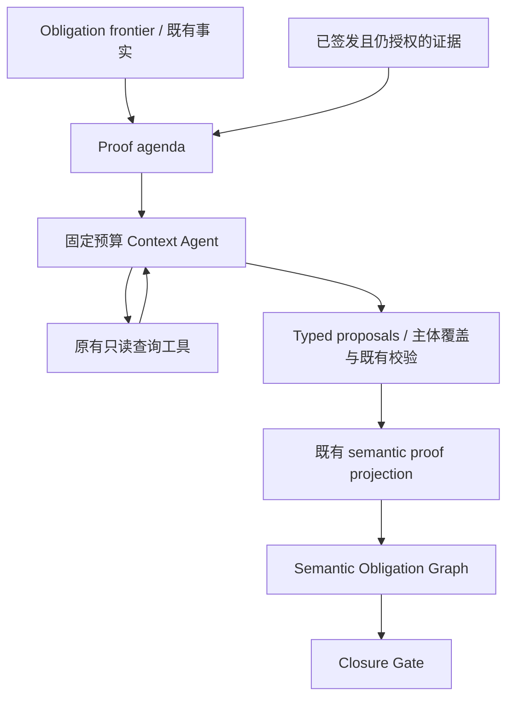

# Agent 固定预算补证据能力：实现与测试报告

日期：2026-10-02。以当前本地 `v0.2` 为基础，继续上一轮 Semantic Closure Framework；本轮没有启动 blind experiment。

本轮提高的是 Context Agent 调查缺失证明的能力：按确切主体组织证明问题，复用此前 unresolved 调查中的证据，保留已成立主体，并在证据不足时准确提交 unresolved。450 项离线测试通过。没有增加仓库工具、Semantic Contract 或 Obligation 节点类型，也没有放宽 Closure Gate。

首批四类真实模型配对开发 smoke 中，正确证明结果为基线 **1/4**、首版修改 **3/4**。首版负例已识别字段不匹配，但损坏的 terminal JSON 在预算耗尽后无法修复，按失败计入。随后仅针对该失败点修改提交指导，追加一对 fresh 调用：基线仍错误 resolved，最终版正确提交 unresolved。两个版本的结果分别保存，不能拼成最终版“4/4”。离线最终结果与日志见下文。

## 1. 本轮修改范围

主要实现：

- [investigation.py](../harness_generation/harness_context/investigation.py)：从现有 requirements、义务 frontier、事实、签发的候选和证据构建 `proof_agenda`。
- [agent.py](../harness_generation/harness_context/agent.py)：发送各 slot 的完整调查目标、全部缺失 task，执行主体覆盖检查，使用配置中已有的轮次上限。
- [tools.py](../harness_generation/harness_context/tools.py)：恢复同一 requirement/group 已签发且仍授权的证据，包括先前没有提交 facts 的 unresolved 调查。
- [models.py](../harness_generation/harness_context/models.py)、[persistence.py](../harness_generation/harness_context/persistence.py)：版本与恢复指纹更新。
- [测试](../tests/test_agent_proof_investigation.py)、[开发评测脚本](../scripts/evaluate_agent_proofs.py)：分别验证行为边界和预算匹配的真实模型调查。

本轮以修改前的实际工作区制作基线快照，没有用远端 main 或早期 callback 实验的实现替代基线。已有的架构重构仍保留。

## 2. Agent 如何更准确地补齐证明

### 明确每个 slot 的证明问题

`proof_agenda` 不要求 Agent 设计 harness。它列出：

1. 当前 predicate 要证明的确切关系，以及 frontier 中的目标参数。
2. 已成立的局部证明与必须保留的主体条目。
3. 候选 API 对参数、返回对象或字段的已观察效果；这些仍只是候选提示，不证明必要性。
4. 已签发证据的 ID、查询参数、来源位置和截断状态。
5. 现有工具中的下一步查询选项。
6. 证据不足时可直接填写的 unresolved 格式。

例如，state 调查应检查“同一个对象的哪个字段由哪个 API 在什么路径上写入”，而不是因为函数接收相同类型就认为它是 initializer。ownership 调查应检查确切 pointer subject 的分配、借用、逃逸与释放路径。callback 调查分别考虑 ABI、userdata 构造与有效期。

查询建议只使用原有工具。候选、查询历史和 agenda 不参与 Gate 的事实判定，也不自动选择 API。

### 复用 unresolved 调查中的证据

旧流程主要通过已提交事实重新暴露证据；一次没有 facts 的 unresolved 即使读过 creator/initializer，下一轮仍可能看不到那些源码。

现在恢复同一 requirement/group 的已签发记录，并检查当前函数/符号授权范围。来自其他 requirement 的无关候选记录不会被导入；带 live-source 摘要的范围证据须匹配当前文件才可复用。复用不重新签发源码，不重复收取 source chars；调用 bootstrap 或再次调用查询工具仍正常计入 tool calls。模型再次看到这些源码仍产生 prompt tokens。

最终版还将原查询参数加入证据目录，并避免在 agenda 中重复建议已取得未截断记录的同一查询。这是调查指导，模型仍可能重复查询；它不是工具调用屏蔽规则。

### 覆盖全部追问，使用已有预算

旧代码对缺失证明追问只突出第一条 task，并将有效轮次固定压到两轮。顺序执行“发现候选 → 读取候选源码 → 提交”至少需要三次响应，因此两轮限制会造成调查尚未完成就被迫提交。

现在向同组每个 slot 提供相关 task，按被阻塞根义务的数量排列重点。有效轮次为配置上限与剩余全局 model calls 的较小值，最后一轮仍只允许 terminal。没有增加配置预算。

这属于预算分配改善：新版可能实际消耗更多已有调用额度。下文的配对实验不能将收益全部归因于提示或证据记忆。

### 避免局部补证据丢掉已有主体

terminal 仍表示整个 slot 的快照。提交包含 facts 时，框架检查此前已成立的主体是否仍被表示；例如补 `ctx` ownership 时，不能丢掉已验证的 `data` ownership。

检查只针对主体覆盖，允许有证据地修改同一主体的语义；语义仍由既有 validator 校验。遗漏可使用既有的一次 terminal schema repair，不新增修复额度。明确 unresolved 且 `facts=[]` 仍有效，框架不会把旧事实或模型诊断自动合并成新证明。

### 减少 unresolved 的格式失败

真实负例暴露了“语义分析正确、最终 JSON 错误”的问题。最终版为每个 slot 提供完整的 unresolved template，要求将缺失关系、已检查的 evidence IDs 和下一步查询写入 `open_questions`，保持 `facts=[]`，避免重复 unknown facts 或把 evidence IDs 放在错误层级。

不自动修补 malformed JSON，不从自由文本提取已证明事实。提交无效仍按失败处理。

## 3. 架构与版本边界



Agent 提出语义事实，确定性证明与 Gate 保持原职责。`proof_agenda` 是调查投影，不是新的证明证书或 canonical contract。

| 快照 | Agent prompt | 调查投影 | Production fingerprint |
|---|---|---|---|
| 修改前基线 | `semantic-obligation-context-agent-v13` | 无 | `9a0303dea3560577e61c953462f78b3be10c9243c676c6918f6137dcc94174c0` |
| 首版修改 | `proof-focused-context-agent-v14` | `proof-focused-investigation-v1` | `80e440bb345fd544f9b44816ed28a3e19cbe1352c05e39feedc83edaf7d84c6a` |
| 最终版 | `proof-focused-context-agent-v15` | `proof-focused-investigation-v2` | `1fe8da1b0a4eafa84e68a2d5d13d60bb0b6be6c5bc486260292474df27ee1cdf` |

工具行为版本更新为 `ft-scoped-repository-v5`，注册工具集合与 schema 不变。Context policy、义务图版本、HarnessPlan policy 不变。恢复配置包括 investigation version 与 prompt digest，旧版 Agent 结果不会作为新版本的兼容恢复结果。

## 4. 离线验证

新增 **12 项**针对性测试，覆盖：

- unresolved 后恢复已读 creator 源码，避免重复 source 计费；不导入其他 requirement 的候选历史，不复用改变过的 live range。
- 同组各 slot 的 proof agenda 与全部追问；已有一轮可解决的组仍保持一次模型调用。
- 在原有四轮上限内完成发现、读取、提交；全局预算耗尽后没有额外调用。
- 局部主体遗漏被拒绝，并在已有修复额度内补齐；ownership 记忆使用合法 signed subject IDs。
- unresolved template 可通过既有 terminal/schema 校验，已有查询参数进入记忆且不重复建议。
- 注册的工具集合完全相同，没有引入执行、编译或新的搜索工具。

首版全量：**448 passed，170.85 秒**。最终版重点回归：**77 passed，41.35 秒**。最终全量：**450 passed，167.25 秒**，没有跳过或失败，见 [最终日志](../artifacts/agent_proof_targeted_20261002/revision_v15_pytest.log)。全量测试包含已有 Plan、编译、runtime 与 sanitizer 回归；这些是离线 fixture 验证，不能代替本轮真实模型生成的端到端统计。`git diff --check` 通过。

## 5. 真实模型测试设计

使用本地 `.env` 的真实 `openai-compatible` provider；请求模型为 `ark-code-latest`，响应记录的 served model 为 `deepseek-v4-flash-ga-260731`，thinking disabled。没有模拟响应、provider 重试或失败替换。

只测试 Context requirement investigation。Minimal FT 和 requirement 由已知合成 fixture 离线准备；没有运行真实 Candidate/Slice、完整 Context Gate、HarnessPlan 或模型代码生成。这是 Development / Regression Set，不能报告 Candidate recall、Context completion 或真实 compile/runtime 成功率。

| 预算项 | 生产默认：修改前 → 修改后 | 每个真实 trial：两组相同 |
|---|---|---|
| 每次 requirement 轮次上限 | 4 → 4 | 4 |
| 全局 model calls | 24 → 24 | 4 |
| tool calls | 64 → 64 | 12 |
| source chars | 96,000 → 96,000 | 24,000 |
| discovered functions | 16 → 16 | 16 |
| dependency depth | 2 → 2 | 2 |
| query references | 6 → 6 | 6 |
| terminal schema repair | 1 → 1 | 1，计入全局 model calls |

所有 trial 都提供 followup task。因此基线受原来内部的两轮限制，新版可使用配置的四轮上限；配置预算相同，实际调用数不同。seed bootstrap 与负例预先读取 initializer 的 tool/source 成本也计入预算，没有在 Agent 启动前清零。

首批四类各运行一对，交替两组顺序；补测只追加负例一对。每对源码摘要、Minimal FT 摘要、工具集合、预算和 seed 成本均匹配。生产快照在各阶段运行期间未变化。

正确结果必须来自有效的 native terminal，无执行错误，且符合 fixture 的预期关系。模型自报 resolved 或预算失败返回的 unresolved 都不能单独算正确。

## 6. 首版四对结果

| 样例 / 目标证明 | 基线 | 首版修改 | model calls：基线 / 修改 | tool calls：基线 / 修改 |
|---|---|---|---|---|
| owned-return：返回对象由 `finish` 释放 | 错误：owned 但 release API 缺失 | 正确：读取 cleanup 并选择 `finish` | 2 / 3 | 5 / 6 |
| shared field：`parse` 前 `prime` 写入 `box.ready=1` | 错误：initialized 但 API=null | 正确：绑定 `prime`，引用主体与 initializer 源码 | 2 / 4 | 5 / 9 |
| callback userdata：`user`、既有 `data` 均 during-call borrowed | 正确 | 正确，并保留 `data` 主体 | 2 / 2 | 4 / 4 |
| 负例：`prime` 只写 other，不写 ready | 错误 resolved | **失败**：分析正确，但 terminal JSON malformed，repair 被全局预算阻止 | 2 / 4 | 6 / 10 |

基线四个 terminal 均通过结构/已有语义解析，但只有一个满足该开发样例的完整证明目标。这说明不能用“Agent 返回 resolved”替代证明正确性；这些结果没有经过完整 Context closure，本报告不将其称为 false Context complete。

| 首批累计成本 | 基线 | 首版修改 |
|---|---|---|
| 正确证明结果 | 1/4 | 3/4 |
| 有效 terminal | 4/4 | 3/4 |
| 实际 native 响应 / model calls | 8 | 13 |
| tool calls，含 seed | 20 | 29 |
| source chars | 10,079 | 13,983 |
| prompt tokens | 57,725 | 122,665 |
| completion tokens | 3,493 | 4,512 |
| total tokens | 61,218 | 127,177 |
| provider 请求错误 | 0 | 0 |
| 超出配置预算 | 0 | 0 |

修改版 token 消耗约为基线 **2.08 倍**。增加调查轮次、投影信息及再次暴露证据都有成本，当前不能声称 token 效率提升。

## 7. 最终版负例补测

首版失败轨迹保留在原目录，未覆盖或从分母剔除。新增 unresolved template 与查询记忆后，仅追加以下 fresh 配对：

| 同一 wrong-field 负例 | 基线 | 最终版 |
|---|---|---|
| 结果 | 错误 resolved：initialized/API=null | 正确 unresolved，facts=[] |
| 缺失证明描述 | 无 | 指明 `box.ready==1` guard、`prime` 只写 other、已检查证据与后续查询方向 |
| model calls | 2 | 4 |
| tool calls，含 seed | 6 | 11 |
| source chars | 3,479 | 4,285 |
| total tokens | 15,334 | 41,364 |
| terminal repair | 未触发 | 未触发 |
| provider 请求错误 | 0 | 0 |

最终版能在这一 fresh 负例上准确说明缺失证明并提交合法格式，且遵守相同预算。其他三个正例没有在最终 prompt 版本上重新运行 native，不能把首版正例与最终版负例拼成统一成功率。

两阶段合计 **10 个 trial、27 个真实响应、245,093 tokens**；没有新的 blind cohort。零 provider 请求错误并不证明历史 HTTP 400 路径已进一步修复：本轮唯一 repair 尝试在发起 provider 请求前就被预算阻止，最终补测没有触发 repair。

## 8. 原始数据与复现

- [首批 registration / 原始配对结果](../artifacts/agent_proof_targeted_20261002/native/summary.json)。各 trial 下有 `agent/{trace,evidence,result,metadata}.json`。
- [最终负例配对结果](../artifacts/agent_proof_targeted_20261002/native_final_negative/summary.json)。
- [预算、源码和快照审计](../artifacts/agent_proof_targeted_20261002/audit.json)。三份快照全部匹配其 manifest；最终工作区 production fingerprint 与 `revision_final` 一致。
- [首版全量日志](../artifacts/agent_proof_targeted_20261002/revision_v14_pytest.log)、[最终重点回归日志](../artifacts/agent_proof_targeted_20261002/revision_v15_targeted_pytest.log)、[最终全量日志](../artifacts/agent_proof_targeted_20261002/revision_v15_pytest.log)。

快照和原始运行数据保存在本地 `artifacts/`，按项目惯例不进入源码提交。凭证不写入报告或 artifact。

```bash
.venv/bin/python -m pytest -q tests
.venv/bin/python scripts/evaluate_agent_proofs.py \
  --baseline artifacts/agent_proof_targeted_20261002/baseline \
  --revision artifacts/agent_proof_targeted_20261002/revision_final \
  --cases wrong_field_initializer \
  --output artifacts/agent_proof_targeted_reproduction \
  --env-file .env
```

复现须使用新的输出目录；模型采样不保证逐字相同。历史 callback 冻结基线 177 个文件、修改版 197 个文件也已重新核对，摘要全部未改变。

## 9. 当前不足与下一步

1. **只证明局部调查改善。** 四类已知 fixture 每版每类一次，不代表复杂项目、完整 Context closure 或端到端稳定性；callback 样例测的是 userdata ownership，未测试完整 callback registration/ABI/construction 链。
2. **调用与 token 效率尚未改善。** 两轮内部限制造成的提前停止已消除，但本轮没有单独消融 prompt、记忆、主体覆盖与轮次分配。没有新增 token 硬上限，不能称为等 token 对照。
3. **格式失败仍可能发生。** unresolved template 改善了一个真实负例；最后一轮 malformed 时依然可能没有修复额度。需保留失败轨迹，继续检查预算内 terminal 分配，不能以失败重试抬高成功率。
4. **结构候选与完整语义证明仍有距离。** 现有语义 validators 不是通用程序证明器；字段值、复杂分支、间接调用、跨函数 escape 和 conditional origin 仍可能缺证据。已读源码不会自动变成证明。
5. **记忆范围与诊断仍保守。** 只复用同 slot/group 且仍授权的记录；自然语言 open question 的下一步查询方向还不保证是可直接执行的完整工具参数。

下一步应固定最终版与现有预算，在一小组已知 obligation 上重复测试并分层统计“正确补齐、准确 unresolved、格式失败、预算停止”和实际 token 成本；再做相同有效轮次下的记忆/agenda 消融。优先验证这些能力是否提高完整 closure，而不是继续增加工具或 contract。完整 blind experiment 继续暂停。
