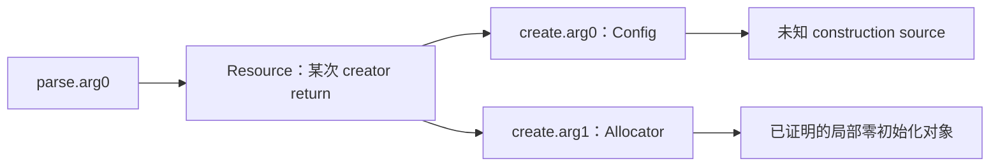

# Argument Construction Graph 与依赖解析实现报告

本轮基于本地 `v0.2` 的已存在主链继续开发。新增的是 Harness Context 内部的确定性数据层与请求诊断，没有新增 Agent、stage 或 API-specific certificate，没有修改 Candidate/Slice 语义政策、HarnessPlan 主结构、coverage/feedback，也没有放松 Completeness Gate。此前 240/240 与 52/240 paused cohort 原始文件保持不变。

## 1. 修改文件

| 范围 | 文件 | 作用 |
| --- | --- | --- |
| Graph | `harness_generation/harness_context/argument_graph.py` | 参数、来源候选、调用实例资源、递归依赖、图缺口与可表示参数投影 |
| Context 集成 | `evidence.py`, `completeness.py`, `ordering.py`, `persistence.py` | 重算图、独立 Gate、硬顺序、发布并认证 sidecar |
| 调查与证据复用 | `agent.py`, `loop.py`, `construction.py`, `tools.py`, `models.py` | graph-hole 提示、现有工具定向预检、框架身份、execution 状态、prompt v6 |
| Provider | `semantic_discovery/request_diagnostics.py`, `deepseek_client.py`, `loop.py` | 错误分类、脱敏、请求摘要、repair 阶段诊断 |
| 回归 | `tests/test_argument_graph.py`, `tests/test_request_diagnostics.py` | 新结构模式、负例、请求失败与身份校验 |
| 既有 fixture 适配 | `tests/test_harness_context.py`, `tests/test_context_semantics.py` | 旧模拟资源标签改为使用实际签发 ID，保持原始 fact 不可变检查 |
| 真实 smoke | `scripts/smoke_argument_graph.py` | 五类开发 API 的 fresh native 主链验证，固定预算、独立产物 |
| 结果收集 | `scripts/collect_argument_graph_smoke.py` | 只读汇总 native summary、请求错误、图缺口与回放修复观察 |

上述相对 Context 文件均位于 `harness_generation/harness_context/`。工作区此前已有未提交改动；本报告只描述此次增量，不将它们全部归为本轮实现。

## 2. Provider error taxonomy

持久化 `transport_error`、`timeout`、`http_400`、`http_401`、`http_403`、`http_429`、`http_5xx`、`invalid_response`、`tool_call_parse_error`、`terminal_schema_error`、`terminal_repair_error`、`unknown_provider_error`。预算停止另记 `budget_exhausted`。

HTTP/transport 分类与 phase 独立：一次 repair 的 HTTP 400 同时具有 `error_category=http_400`、`phase=terminal_repair` 和 `repair_error_category=terminal_repair_error`，不会丢失底层原因。

SDK 保持 `max_retries=0`；已有 schema repair 最多一次，计入全局模型预算。请求失败的 requirement 不在同一 completeness run 中重复调查，也不能作为已回答的 optional cache 恢复。没有 retry-until-success 或相同 HTTP 400 请求的无限重放。

每次请求保存 stage、model、request ID、attempt number、message/tool count、schema size、prompt chars、实际请求 payload SHA256，以及 status、provider error code/message 和脱敏 body；不保存 API key、Authorization header 或完整环境。凭证替换先于字符串截断，避免截断留下前缀。

首批真实 smoke 捕获三个独立 HTTP 400，均发生于 terminal repair，provider 返回 `InvalidParameter / Invalid request body`。对应历史消息分别含有 675、599、2189 字符的 malformed JSON 工具参数。HTTP 400 与这一请求结构的关联已可定位，但供应商没有给出字段级拒绝原因，不能据此将此前所有 HTTP 400 归为同一根因。

追加请求处理：在 outbound 消息副本中把这些已经被拒绝的历史工具参数替换成 wire-valid `{}`，保存原文 digest、字符数、tool identity 和 normalization count；原始 trace 保留。该处理不执行历史工具、不认可损坏参数、不增加 repair 次数。实际 payload digest 根据处理后请求计算。诊断版本从首批 `provider-request-diagnostics-v1` 更新为 `provider-request-diagnostics-v2`，故追加 smoke 独立冻结。Fake/Recorded provider 已验证 malformed-history 拒绝的复现与有界修复；真实补测另列。

## 3. ArgumentConstructionGraph schema

`argument_graph.json` 为确定性派生 artifact，嵌入同份 `harness_context.json` 并单独发布。schema version 1，graph version `argument-construction-graph-v1`，dependency version `harness-dependency-graph-v1`，prompt version `ft-argument-graph-agent-v6`。

```text
schema_version / artifact_kind / version / ft_id / input_digest
nodes / edges / construction_candidates
dependency_graph:
    resolved_parameters / unresolved_parameters / edges / cycles
resource_origins / resource_consumers / unresolved_ownership
state_dependencies / wrapper_diagnostics / diagnostics
```

图从源码索引、签发的完整 body evidence、调用现场和值流、已有独立验证的 semantic facts 重建，模型不提交图。证据 ID 按 snapshot fingerprint 与 record 摘要核验；截断、修改后仍沿用旧 ID、缺少完整 body 的记录不成为值流证明。

## 4. Node 与 edge 类型

| Nodes | 用途 |
| --- | --- |
| Function / Parameter / ReturnValue / OutParameter | 可调用实体、参数位置、返回与输出来源 |
| LocalValue / StructField / Resource | 局部存储、字段及调用现场来源身份 |
| FuzzInput / Constant | 已证实字节/长度根、受限常量 |
| CallbackObject / Allocator | 已验证 callback 构造机制或独立 allocator role；不证明 callback 行为 |

边类型包括 `produces`、`assigned_to`、`aliases`、`passed_as`、`stored_into`、`loaded_from`、`derived_from`、`consumed_by`、`released_by`、`initialized_by`、`feeds`。每条边保存 evidence IDs 与 proof status。节点存在不表示整个语义契约已完成。

## 5. Parameter identity

参数 ID 为 `parameter_ + digest(function_id, parameter_index)`，保留声明顺序，字段包含 declared type、base type、pointer depth、constness 与 role。名称用于显示和匹配实际声明，不作为角色推断依据。

`get_function` 同时返回 `framework_parameters` 和 `framework_return_resource_id`，Agent 的目标视图给出已签发参数/资源身份。semantic proposal 引用不存在的 function/parameter 或未经框架签发的 resource ID 时拒绝；类型相似或同名不能建立身份。

## 6. Construction candidate 生成和拒绝

候选字段包括 `candidate_id`、`source_kind`、`source_node`、`target_parameter`、`evidence_ids`、`proof_status`、`rejection_reason`、`dependencies`，必要时含 API、resource ID、受限 scalar IR、constant、局部初始化 recipe。

来源机制覆盖 fuzz bytes/size、constant、derived scalar、stack/zero-init、creator return、out parameter、existing resource、callback object、struct field、allocator object、unknown。生成候选与闭合依赖分离：`proven` 来源边可以仍因 creator 参数未闭合而不能成为 `resolved` construction。

不按 `ctx`、`data`、`size_t`、函数名或项目名认定来源。仅存在类型或参数名时为 `argument_origin_missing`；多个来源、重赋值、未知逃逸和未证明的表达式保留为缺口。裸 stack storage 和非零 aggregate recipe 不自动投影到不能表达它们的旧 Plan。

## 7. Resource identity 复用

来源身份复用原 `value_flow.py` 的 `(producer function, return/out kind, parameter, caller, call offset, type, pointer depth)` 摘要。同一局部值传给多个 API 的参数，使用相同来源 ID；`b=a` 与 `holder.ctx=producer()` 的简单局部字段路径保留 provenance。

两次 creator 调用保留两个来源事件，不能按类型合并。来源事件不同不自动证明两个返回对象永不 alias，也不证明两份 ownership/refcount 单位。重复 API 参数出现多个 origin 时保持 ambiguous。新的参数绑定另写入 `resource_identity.argument_bindings`，模型原始 facts 不被改写成推测的身份。

## 8. Creator-with-args 的递归 dependency



`parse.arg0` 的来源候选仍保存为 creator return；缺口变为 `creator_argument_missing`，并精确引用 create 的参数节点。Agent 提示同时包含这些依赖、已知 evidence 与候选，避免再次泛问整个 parser 生命周期。依赖闭合不等于 API 初始化状态正确，state/ownership/return requirements 保持独立。

## 9. Out-parameter

完整 straight-line source 中、唯一的 `*out=call(...)` 写入与调用现场 `producer(&local,...)` 建立独立 OutParameter 来源。输出指针存储与获得的资源是不同节点；剩余 producer 参数成为递归依赖。

条件输出、多个输出写入或缺少 producer body 为 `out_parameter_origin_unknown`。该证明只说明输出来源，不凭 call 名称推断分配/ownership 或 success convention。当前 HarnessPlan 主结构未变，out storage/资源调用配方不能完整表示时保留 diagnostic，仍由原 Gate 拦截。

## 10. Ownership 与 construction 分离

creator return、局部 stack、zero-init 和 release consumer 的结构事实不自动产生 owned/borrowed 结论。Resource 的 origin ownership 只引用独立验证的 producer ownership 条目；消费者 borrowed 条目单独记录，不拿来证明 origin ownership。缺少 origin ownership 继续出现在 `unresolved_ownership`。

cleanup 来源复用现有有证据的 release 分析，没有新增 creator/refcount/stream 专用证书。release 后再次使用或无法解析的 escape 不复用之前的有效 origin。

## 11. State ordering 与 input binding

硬 state 顺序需要同一来源对象、实际调用现场的先后关系，以及完整 body 中的字段 writer→reader 交集。仅 `feed`/`parse` 名称或共享类型不产生硬边；普通模型顺序建议仍为 soft。图边投影进入原 `ordering_graph`，保留具体字段、resource ID 和 evidence。

已验证 input binding 是 fuzz bytes/size 根，再经 call-site value flow 传播到独立参数节点。buffer units、NUL、binary zero、mutability、alignment 仍使用独立 canonical contracts，未全部从来源图自动完成。受限 scalar IR 支持直接长度、常量、可证明的 min 与有界加减；`size-1` 未证明非负时、`size+header` 未证明不溢出时、任意函数或 C expression 均不执行或投影到 Plan。

## 12. Gate 如何消费图

`build_context` 重建图，并只把当前 Plan 可表达的证明投影到 argument contract；全部参数可独立证明时，可以对对应 argument-construction requirement 添加 framework proof。它不会同时完成 lifecycle/ownership/state/input requirements。

原 requirement universe、typed semantic validation、API closure、独立所有权、callback ABI 和 ordering Gate 全部保留。没有合法 support closure 的 creator 仍不能生成。修改 context 内派生图会被 canonical recomputation 拒绝；单独 sidecar 与 context 图不一致、文件 digest 不符或 live source 改变都会使 publication authentication 失败。

## 13. Failure taxonomy

图细分为 `argument_origin_missing`、`argument_origin_ambiguous`、`creator_argument_missing`、`out_parameter_origin_unknown`、`derived_scalar_unknown`、`resource_alias_ambiguous`、`cleanup_consumer_missing`、`state_writer_missing`、`state_reader_missing`、`dependency_cycle`。

Gate 的原 hard missing 保留兼容 code，另附精确 graph holes、parameter ID/index/name、候选、missing dependencies 和 evidence，输出 `graph_failure_taxonomy`。这使失败可以定位到 `create.config` 而非只有笼统的 argument-construction 标签。

## 14. Offline tests

完整命令 `.venv/bin/python -m pytest -q`：**351 passed，64.63 秒**。新增 graph 测试模块 29 项、provider/request 测试模块 24 项，共 53 项；完整数量包含仓库既有回归。`git diff --check` 与 `pip check` 通过。

覆盖 direct/nonstandard buffer、带参数 creator、out origin、同类型多实例、alias、struct field、reassignment、conditional origin、简单 scalar bounds、真实字段 writer/reader、owned cleanup、依赖环、释放后使用、证据与派生 artifact 篡改。

Provider Fake/Recorded 回归覆盖 HTTP 400/401/403/429/5xx、transport/timeout、invalid response、invalid tool call、malformed terminal、repair failure、脱敏与预算/重试边界。

## 15. 小规模真实模型 smoke

这是 Development/Regression targeted smoke，非新的 blind cohort 或稳定性评价。每个样例 fresh native 上游 Candidate/Slice/FT 与真实 Context 调查，不用 mock semantic fact 补偿模型失败。静态分析为 parser-only，五类目标均为合成 C fixture，不能当作五个独立真实项目。

首批目录：`artifacts/argument_graph_native_smoke_20260929/`。五次均完成，生产代码运行期间未变，五份图均进入保存的模型调查提示。

| API 模型 | Slice / FT 状态 | Context | Hard gaps | 图 resolved / holes | Context model / tool calls | 整链 tokens | Compile / runtime |
| --- | --- | --- | --- | --- | --- | --- | --- |
| creator-with-args | completed / completed_with_unresolved | incomplete | 8 | 5 / 3 | 21 / 43 | 318,114 | 未运行 |
| out-parameter | completed / completed | incomplete | 4 | 7 / 1 | 19 / 38 | 266,411 | 未运行 |
| shared-context | completed / completed_with_unresolved | incomplete | 1 | 7 / 0 | 16 / 42 | 295,507 | 未运行 |
| owned-return | completed_with_unresolved / completed_with_unresolved | complete | 0 | 4 / 2 | 15 / 34 | 196,661 | 通过 / 通过 |
| callback-context | completed / completed_with_unresolved | incomplete | 13 | 5 / 4 | 24 / 52 | 392,173 | 未运行 |

首批总计 128 个实际 provider 响应、1,468,866 tokens。四个 Slice 为严格 `completed`，一个为 `completed_with_unresolved`，五个均输出可用 Minimal FT；两种状态不合并为无未知项的 Slice 成功。Context、生成、编译及 runtime 各 1/5。owned-return 的 runtime 使用六个固定输入，返回码均为 0；未执行 fuzz/coverage，不能推断完整 API 语义正确。

带参数 creator 的图明确闭合 `acquire.o/p ← zero-init`，并把 `parse.s` 与 `dispose.s` 绑定同一 creator-return origin；剩余图缺口为 parse 的长度与 usage 输入根。out-parameter 的图证明 `parse.s` 与 `dispose.s` 来自同一 out origin，并闭合 Options，输出存储参数仍有来源歧义。shared-context 的图已闭合全部七个参数且生成 `supply → parse` 的 `bytes/count` writer-reader hard edge；Gate 仍因 Slice 中 `usage` 的独立 argument contract 不完整而阻止生成。callback 的剩余参数明确为 creator 的 `bias` 与 callback/parse/cleanup 的 userdata，不能用泛化 `input` 标签消除。

这也暴露一项边界：图可以证明来源，而已有独立 semantic proposal、legacy argument contract 或 Plan 表达能力仍可冲突。当前不会覆盖已经提交的参数契约，也不会仅因图没有参数缺口而忽略 Gate 的剩余错误。owned-return 的两个图缺口属于证据 usage 节点，没有对应 mandatory requirement，因而不阻止该例生成。

| 冻结项 | 值 |
| --- | --- |
| 首批 production fingerprint | `fd7a8df400703f46d828db27f533e65bf55c0989150233e04f4b5f140ef397e7` |
| 请求历史修复后 fingerprint | `c38ba5cf72ec2752753506b8b4af6d2892e081a84f34915a7fbf89768daa3880` |
| Graph / dependency / Context prompt | `argument-construction-graph-v1` / `harness-dependency-graph-v1` / `ft-argument-graph-agent-v6` |
| 请求模型 / 实际 served model | `ark-code-latest` / `deepseek-v4-flash-ga-260731` |
| Provider / endpoint | `openai-compatible` / `https://ark.cn-beijing.volces.com/api/plan/v3` |
| Context 预算 | 24 model calls、64 tool calls、96,000 source chars、4 rounds/requirement、3 completeness rounds、1 terminal repair |
| Candidate/Slice 默认预算 | 6 rounds、24 tools、48,000 source chars；不按 case 提高 |
| Context / code 输出上限 | 8192 / 8192 tokens；Candidate/Slice 4096；thinking disabled |

首批 `summary.json` SHA256：`18a124bb550a26841ebb0382df125e687b904f94b0793261fd9e1c80bdc734a3`。首批目录内保存 `implementation_before_history_normalization.tar.gz` 与 `source_digests.json`，可复核其实际运行源码。

仅追加 creator-with-args、out-parameter 各一个 fresh native trial，目录为 `artifacts/argument_graph_history_repair_smoke_20260929/`；预算不变，原失败不替换。两批版本分别报告，不将七次视作同版本重复实验。

| 追加 API 模型 | Slice / FT 状态 | Context | Hard gaps | 图 resolved / holes | Context model / tool calls | 整链 tokens | 后续结果 |
| --- | --- | --- | --- | --- | --- | --- | --- |
| creator-with-args | completed / completed | complete | 0 | 4 / 4 | 12 / 30 | 206,315 | 代码校验拒绝，编译/runtime 未运行 |
| out-parameter | completed / completed_with_unresolved | incomplete | 15 | 8 / 0 | 13 / 32 | 162,199 | timeout 后 Gate 拦截，生成未运行 |

追加批总计 39 个实际 provider 响应、368,514 tokens，Context 1/2、compile/runtime 0/2，两份图均进入调查提示。creator 的代码校验为 `required_call_order_violated` 与 `required_invocation_count_mismatch`，观察到 `dispose` 调用两次；不将 Context 完整记为端到端成功。本次遵守范围约束，没有修改 Slice/Plan/代码生成器来补救这一失败。

creator 图保留 `acquire.o/p` 的多个零初始化候选来源，细分为 `argument_origin_ambiguous`，由此使 `parse.s` / `dispose.s` 出现 `creator_argument_missing`。独立 semantic argument contracts 仍被现有 Gate 接受，因此这里的 mandatory 参数也可能出现“Context complete、图仍有候选缺口”。当前集成为图证明提供补充路径，不将每个图歧义自动升级为 veto；候选机制等价消歧、图与已验证 contract 的冲突诊断仍需进一步完善。out-parameter 图没有参数缺口，但 unresolved support/ownership/输入路径等 independent requirements 仍阻止生成。

追加批只有一次独立 `timeout / exploration`，未出现 HTTP 400；**没有请求实际触发历史参数 normalization**。因此这两次新抽样不能验证 malformed-history 修复是否消除了供应商真实 HTTP 400，也不能归因 Context 变化于该修复。可确认的是 wire normalization 在 Fake/Recorded 回归中通过，原三次 400 的请求结构已有完整诊断；真实供应商字段级根因仍待专门对照验证。

追加 `summary.json` SHA256：`f0426023896c84ad114c4fad8923d3f2baaffe136515407651a9ed1b7226df3f`。追加目录保存 `implementation.tar.gz` 和 `source_digests.json`。完整只读收集结果位于 [artifacts/argument_graph_results_20260929/report.md](../artifacts/argument_graph_results_20260929/report.md)，同目录 `summary.json` 包含逐次 graph holes、provider 错误、原始损坏参数摘要和 normalization 观察；这些均为本地运行产物。

复现入口（输出目录必须尚不存在）：

```bash
.venv/bin/python scripts/smoke_argument_graph.py \
  --output artifacts/argument_graph_new_smoke --workers 2

.venv/bin/python scripts/collect_argument_graph_smoke.py \
  --smoke-dir artifacts/argument_graph_native_smoke_20260929 \
  --smoke-dir artifacts/argument_graph_history_repair_smoke_20260929 \
  --output artifacts/argument_graph_new_collection
```

原 240 次与 paused 52 次的原始 summary SHA256 校验通过；未改写或重标这些 native trials。生产源码两批各自冻结校验通过。凭证扫描没有发现当前 `.env` 中的凭证值进入本轮源码、报告或 native 文本产物。

## 16. Execution failure 与 semantic unresolved

canonical requirement 可仍为 unresolved，但请求失败额外保存 `resolution_attempt_failed=provider_error`，元数据保存 execution status 和分类事件，completeness 单列 execution-failed requirements。malformed protocol 另记 protocol error；模型明确提交 unresolved 时没有 provider-failure 标记。

失败请求不产生 semantic fact，不作为已回答的 cache；已有独立验证的事实不会被一次后续请求失败抹掉。请求错误不能解释成“模型已调查并证明无法构造”，也不直接产生 semantic invalid 或 Context complete。

## 17. 当前不支持的复杂情况

| 情况 | 当前边界 |
| --- | --- |
| branch-dependent origins | 不合并路径；保持 unknown / ambiguous |
| loops | 不构建 loop phi、迭代 state 或调用次数证明 |
| complex alias/escape | 未知间接调用、重赋值、复杂地址/逃逸保守失效 |
| function pointers | 原 ABI enrichment 保留；动态 callee 与 callback 行为/外部 state 不由图猜测 |
| macro-dependent ABI | 无预处理后准确声明证明时保持 unresolved |
| cross-translation-unit hidden state | 只用已签发可见 source，不能推断隐藏 global/heap 状态 |
| C++ constructors | 本图为 C straight-line 子集，不推断构造/析构、RAII、重载或隐式生命周期 |
| refcount / returned aliases | 不推断任意调用返回对象互异、引用计数单位与重复释放配平 |
| integer conversions | 受限 scalar bounds 不覆盖所有目标整数宽度、隐式 narrowing、符号转换或枚举/macro 求值 |
| graph / contract reconciliation | 多个等价构造机制候选和既有 semantic contract 尚未统一消歧；graph hole 不直接覆盖独立已验证事实 |
| Plan 配方边界 | out resource、非零 aggregate/field recipe、scalar IR 和 repeated CORE 实例没有扩展 Plan；不可表示时不能直接生成 |

本轮验收以来源/依赖缺口是否明确、可追踪、可重算为准。真实 Context 或 runtime 成功率没有足够样本时，不声称跨项目泛化或 stability 提升。新完整 blind cohort 尚未启动。
