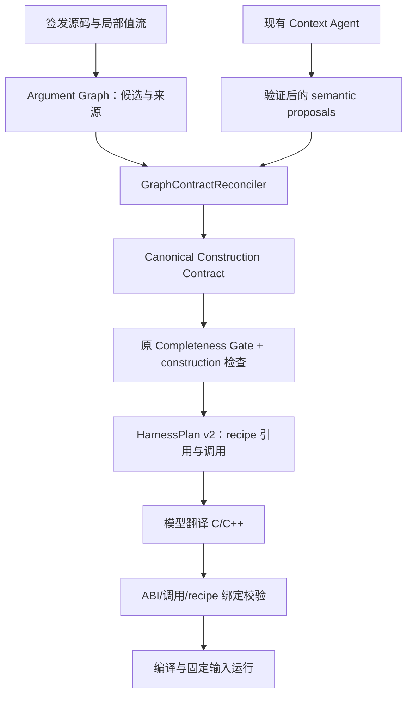

# Canonical Construction Contract 与 HarnessPlan recipe 实现报告

本轮基于本地 `v0.2` 的实际实现继续开发，把参数构造的选择统一为可重算的 Canonical Construction Contract。Graph 保存静态候选和来源，Agent 仍提交独立 semantic proposals；Reconciler 选择 recipe，Gate 检查 callable 参数，Plan 只消费 canonical 选择。没有新增 Agent、查询工具、pipeline stage、API-specific certificate 或 benchmark 预算特判，未启动新的 240 次 blind cohort。

## 1. 实现与数据流

核心增量文件：

| 文件 | 作用 |
| --- | --- |
| `harness_generation/harness_context/reconciliation.py` | 机制等价类、来源选择、冲突、递归闭合、兼容视图投影 |
| `harness_generation/harness_context/evidence.py` | 构图后 reconciliation；保留原始 facts；重算拒绝篡改 |
| `harness_generation/harness_context/completeness.py` | callable 参数必须 canonical resolved；冲突与 unknown 均阻止生成 |
| `harness_generation/harness_context/agent.py` | 提供 canonical 选择/缺口，补充框架签发身份 |
| `harness_generation/harness_context/argument_graph.py` | derived-prefix length 不再误种为完整 fuzz size；签发确定性 subject identity |
| `harness_generation/harness_context/persistence.py`, `models.py` | 保存并认证 sidecar；版本与缓存失效 |
| `harness_generation/context_generation/recipes.py` | recipe 降低为 Plan 参数引用、存储类型与受限 scalar 表达式 |
| `harness_generation/context_generation/builder.py`, `stage4.py` | Plan schema 2；只按 canonical recipe 生成 |
| `harness_generation/context_generation/recipe_validation.py`, `validation.py` | out cell/来源一致性、creator result、零初始化、常量与 scalar IR 检查 |
| `tests/test_construction_reconciliation.py` | 19 项新增结构、Gate、Plan 与生成代码负例 |
| `tests/test_recipe_pipeline.py` | 三类显式测试契约，经真实 Gate/Plan、本地 Clang 编译与固定输入运行 |
| `scripts/smoke_argument_graph.py`, `collect_argument_graph_smoke.py` | 六类 fresh native smoke 与只读收集 |
| `scripts/probe_malformed_history.py` | 两次供应商请求的单变量历史 JSON 对照 |

此前工作区已有未提交改动，本报告只描述此次增量；旧报告、原始 240 次、paused 52 次和此前七次 Graph smoke 均保留。

## 2. 选择规则

| 情况 | Canonical 结果 |
| --- | --- |
| 唯一 mechanical recipe 与 semantic proposal 一致 | resolved，保留两方 evidence |
| 同一参数的多个可证明等价 zero-init/常量/fuzz 机制 | 等价类；确定性 canonical recipe |
| 不同 runtime origin | 不按类型或 producer 名称合并 |
| semantic proposal 精确引用一个已证明的 runtime resource ID | 可选择该候选；其他 lifecycle/multiplicity Gate 仍独立检查 |
| 只有相同类型或 API 标签 | 不能消除多个 runtime origin |
| semantic proposal 存在而 mechanical proof 缺失 | 显式 `semantic_recipe_not_reproduced` diagnostic；可表达的独立已验证 proposal 可形成 semantic-only canonical recipe |
| mandatory semantic contract 与 mechanical origin 冲突 | `construction_contract_conflict`；不能冻结或生成 |
| 重赋值、释放后使用或未闭合 creator 参数 | unknown/conflict；不会用 semantic confidence 覆盖 |

等价按 construction mechanism、参数声明、常量、依赖和 resource identity 判断，不按候选节点 ID 或 evidence ID 相同与否。两个局部 `{0}` Config 的同一可执行构造机制可合并；两个 creator 调用来源 R1/R2 仍保留不同身份。没有声称不同来源事件必然返回不同物理对象。

未绑定的 caller-parameter forwarding 不构成另一个已经证明的 origin。`void *` 的空指针初始化只能与源码的常量 0 证明配对，不会被解释成完整的外部 context 对象。

Canonical 参数行包含 parameter/function identity、声明、status、reason、recipe、依赖、候选 IDs、semantic fact IDs、evidence IDs 与 proof digest。`argument_contract` 中成功参数是兼容投影并引用 `recipe_id`；失败参数保留诊断视图并带 canonical status，不能被 Gate 当作可生成参数。

## 3. 递归闭合与 Gate

creator-return 的 recipe 保存 producer API 和其参数依赖；Reconciler 递归解析这些参数。多个等价 zero-init 候选不再使 creator 的 consumer 被错误报告为 `creator_argument_missing`。真实缺少 Config/Policy 来源时，consumer 保持 unknown，并精确列出缺失的 producer 参数。依赖环不通过 confidence 消解。

Graph 的原始候选诊断仍保留，不删除未选候选。是否可构造以 canonical 选择为准，因而允许 raw Graph 仍有候选歧义、canonical 已通过等价类闭合；这与此前“semantic contract 绕过 unresolved canonical construction”不同。

Gate 对 CORE 与 required SUPPORT 的每个参数检查 canonical resolved。任何 canonical conflict/unknown 都产生 hard gap；argument-construction requirement 可由完整可重算 canonical proof 满足。ownership、input/length、state、return semantics、API closure、callback ABI 和调用顺序仍使用独立要求，不被 construction 一并完成。旧 lifecycle/order certificates 继续存在。

新增独立 `canonical_construction.json` sidecar，与 context 内同一数据比较、计算 publication digest，并在加载时重建 Context。修改 canonical recipe、兼容参数视图、图或输入合同，不能绕过生成前 Gate；生产版本变化会使旧 Context 在当前验证器下无法直接生成，需要重新构建，旧 artifact 不被改写。

## 4. HarnessPlan recipe 表达

Plan schema 从 1 升至 2，policy 为 `frozen-context-harness-plan-v6`。每个 invocation 参数引用同一个 canonical `recipe_id`，Plan 保存 `construction_recipes` 与 canonical contract digest。模型不重新选择来源。

| Recipe | 当前表达 |
| --- | --- |
| fuzz_bytes / fuzz_size / constant | 已验证输入根、已有输入 transform、数值常量 |
| stack_zero_init / stack_storage | 参数位置对应的局部存储；opaque/layout/state 仍受原 Gate 限制 |
| creator_call | 递归 dependency recipe、producer invocation、捕获并复用同一资源 |
| out_parameter_storage | 单独指针 cell、初始化 NULL、按地址传入 producer |
| out_parameter_call | producer 输出的 pointee 与 consumer/cleanup 绑定；不释放 cell |
| derived_scalar | AST 型 IR、可重算上下界、框架生成的受限 C 表达式 |
| resource_reference / callback_object | 精确资源或现有 callback ABI 构造；不增加行为推断 |

scalar IR 只支持 fuzz size、数值常量、min 和已证明安全的加减。无非负/有限上界证明的 `size-1` / `size+header` 不下沉；输出不得超出保守目标类型范围，不按宿主 ABI 猜 typedef 宽度。derived-prefix 的长度合同不会自动变成整个 fuzz size。既有已验证 callback 字段初始化配方纳入 canonical recipe 的 `certified_fields`；旧 certificate 在 Plan 中只作 provenance。

代码模型只能采用 supplied expression、类型和调用顺序。新增静态检查能拒绝未初始化 out cell、使用不同输出对象、错误 creator-result/cleanup 绑定、缺失零初始化、常量不一致，以及以直接 size、任意表达式或重写后的变量代替已证明的 bounded scalar。ABI、调用次数、顺序、禁止额外 API/源文件等检查继续存在。

## 5. Provider HTTP 400 的真实对照

目录：`artifacts/canonical_provider_control_20260929/`。从旧 out-parameter 失败 trace 提取真实 599 字符 malformed terminal arguments，构造两份其他字段相同的协议请求。只改变历史 assistant tool-call `function.arguments` 是否替换为 `{}`；不执行任何工具，不接受任何 semantic fact，无 retry。

| 请求 | HTTP 结果 | 供应商观察 |
| --- | --- | --- |
| 原始 malformed 历史参数 | 400 | `InvalidParameter / Invalid request body` |
| normalized 历史参数 | 200 | served model `deepseek-v4-flash-ga-260731`，415 tokens |

请求模型仍为 `ark-code-latest`、同一 OpenAI-compatible endpoint、thinking disabled。控制 probe 上限 128 output tokens；这是独立诊断请求，不改变 Context smoke 预算。

该对照证实当前供应商会因这份历史工具参数的 malformed JSON 拒绝请求，现有 normalization 可使这一触发条件通过。它没有证明旧每一次 HTTP 400 都源于同一字段，也没有声称消除了 timeout、transport、429 或其他 schema 错误。原始失败 trace 保留，诊断保存 status、request ID、payload digest 与脱敏错误 body；不会把请求失败算为模型明确 unresolved。

本轮 native shared-context 又实际触发了生产 `terminal_repair` normalization：原历史 `submit_requirement_resolutions` 参数长度 1327，digest 为 `3f8ecf526027b945777b95e151cb3906749d38a5c6f6883993a4dddaac567665`；仅在 outbound copy 替换为 `{}`，供应商返回 HTTP 200。原始 malformed response 留在 trace。该请求的 payload digest 为 `0e2d5af73348056cf09b818a3278bae5fad21a718c368746a8a971b5133140cf`，request ID 为 `0217906646388808df8e1a1401bb5aa62b5b494646ada584e71ed`。因此此次证据同时包含独立控制 probe 与真实 pipeline 的 terminal-repair 路径。

## 6. 离线验证与冻结

`.venv/bin/python -m pytest -q`：**373 passed，66.90 秒**。新增 19 项覆盖机制等价、精确来源选择、creator 递归缺口、Graph/semantic contradiction、semantic-only diagnostic、out cell/pointee、bounded/narrow scalar、canonical tamper、mandatory Gate 和生成表达式错绑。另有三项 creator-with-args、out cell 和 bounded scalar 的 Context → Plan → 本地 Clang 编译/runtime 回归，全部通过。这三项使用显式 Scripted semantic facts 与 FakeLLM golden code，源码解析、证据签发、Gate、Plan、编译和运行均为实际实现；不计入真实模型的成功率。既有六类代码编译/runtime 回归继续通过。`git diff --check` 与 `pip check` 通过。

| 冻结项 | 值 |
| --- | --- |
| Production fingerprint | `6d08be4b4964cdf020ec894410b87fce7e29b876627c3611ac25931d7a453637` |
| Graph / dependency | `argument-construction-graph-v2` / `harness-dependency-graph-v1` |
| Reconciler / recipe | `graph-contract-reconciliation-v1` / `canonical-construction-recipe-v1` |
| Context prompt / code prompt | `ft-canonical-construction-agent-v7` / `frozen-plan-code-v6` |
| Plan policy / code validator | `frozen-context-harness-plan-v6` / `frozen_plan_code_v3` |
| Provider | openai-compatible；`ark-code-latest`；`https://ark.cn-beijing.volces.com/api/plan/v3` |
| Context 预算 | 24 model、64 tools、96,000 source chars、4 rounds/requirement、3 completeness rounds、1 terminal repair |
| Candidate/Slice 默认预算 | 6 rounds、24 tools、48,000 source chars；无 case-specific 增额 |
| Context / code output 上限 | 8192 / 8192；Candidate/Slice 4096；thinking disabled |

运行源码、smoke/收集/probe 脚本已归档到 native 目录的 `implementation.tar.gz` 与 `source_digests.json`。冻结后没有修改生产代码。

## 7. Fresh targeted smoke

目录：`artifacts/canonical_construction_native_smoke_20260929/`。六类各一个 fresh native trial：bounded scalar、creator-with-args、out-parameter、shared-context、owned-return、callback-context。使用真实 Candidate → Slice → FT → Context → Plan → code → compile/runtime，不注入 fake/recorded semantic facts，不替换失败 trial。静态输入是 parser-only 合成 C Development/Regression fixture，不作为跨项目稳定性证据。

全部完成，源码 fingerprint 一致。Slice **6/6**；Context complete、生成、compile/runtime 各 **1/6**，唯一通过为 owned-return。五个 blocked case 没有调用代码模型，也没有编译/runtime；表中的“未执行”不是编译失败。全链取得 151 次实际供应商响应，1,784,867 tokens；Context 使用 105 model calls / 218 tool calls。另有 out-parameter 一次 exploration timeout，请求错误保留，未重试替换 trial。供应商 400 为 0；schema/repair 协议事件仍有 5 条，不与请求错误混为一类。

| Case | Slice | CORE / FT 大小 | Context | canonical active resolved / total | hard gaps | Context model / tools | 全链 tokens | compile / runtime |
| --- | --- | --- | --- | --- | --- | --- | --- | --- |
| bounded_scalar | completed | 2 / 2 | incomplete | 3 / 4 | 1 | 10 / 17 | 157,741 | 未执行 |
| creator_with_args | completed | 2 / 4 | incomplete | 7 / 8 | 5 | 14 / 29 | 280,737 | 未执行 |
| out_parameter | completed_with_unresolved | 1 / 3 | incomplete | 4 / 6 | 18 | 24 / 45 | 310,734 | 未执行 |
| shared_context | completed | 3 / 5 | invalid | 7 / 7 | 0 | 19 / 44 | 406,461 | 未执行 |
| owned_return | completed_with_unresolved | 2 / 3 | complete | 4 / 4 | 0 | 14 / 29 | 225,567 | 通过 / 六个固定输入通过 |
| callback_context | completed | 3 / 5 | incomplete | 8 / 11 | 19 | 24 / 54 | 403,627 | 未执行 |

active 指 CORE 与 closure 的 required SUPPORT。Graph 可包含 optional/support/caller 参数，因此“raw Graph resolved”不等于 canonical active resolved，也不等于 Context complete。例如 shared-context 的七个 active 参数均已 canonical resolved；owned-return optional caller 的两个 unknown 不构成 active construction gap。

具体失败：

- **bounded scalar**：`parse.cb` 有完整 fuzz size 与有界 prefix 两种可执行 recipe；模型保持普通 length 合同，不能确定选择，canonical 为 `runtime_origin_ambiguous` / conflict。Gate 以 `construction_contract_conflict` 阻止生成。离线显式 derived-length 契约可下沉并编译运行，因此 native 失败位于契约 reconciliation 输入，而不是 scalar Plan lowering。
- **creator-with-args**：`acquire.o/p` 的两个 stack zero-init 依赖、consumer 和 cleanup 的 creator origin 均已 canonical 闭合；`parse.src` 被模型声明成带 resource ID 的 input，触发 `phantom_input_resource`。Config/Policy lifecycle、creator API contract 仍未闭合，另有 `conflicting_resource_identity` 验证错误。没有用 construction proof 代替 ownership/lifecycle。
- **out-parameter**：`acquire.out` 与 pointee 已区分，Config zero-init、parse/cleanup 的 out origin 已解析；输入来源 `parse.src/cb` 与 caller 根未闭合。原有 `core_fuzz_input_path_unresolved`、lifecycle、ownership、return semantics 等仍阻止生成，24 次 Context 全局预算耗尽。上游 Slice 保留 unresolved，不算完整无缺口 Slice。
- **shared-context**：原先独立 argument-construction requirement 的重复来源已统一为 canonical，七个 active 参数闭合；最终仍因 `conflicting_resource_identity` invalid。同一已证明 runtime origin 的 creation/cleanup/reuse 一致，但 `parse` 声明 mandatory `supply` initialization，`acquire` return 与 `supply` 参数声明无额外 initialization；旧 lifecycle identity 校验要求这些 shape 完全一致。这里暴露的是调用点 state/initialization obligation 与资源全局定义的边界，不能笼统归为参数来源未知。hard gaps 为 0 仍不允许跳过 invalid Gate，此 trial 没有被标作 Context complete；本轮未放宽或删除该校验。
- **owned-return**：真实模型 Context complete，Plan recipe 资源绑定通过校验，代码生成一次，Clang 编译与六个固定输入运行通过，resume 不重复生成；不把 resume 当作第二个 fresh trial。
- **callback-context**：creator-return 与常量参数的 construction 已进入 canonical；callback stub 来源有 semantic-only diagnostic。`handle.src` 与 `usage.raw` 被标成带 resource ID 的 input，触发 `phantom_input_resource`；`handle.user` 仍 unknown，callback/ownership/lifecycle/order 等独立 hard gaps 共 19；全局预算耗尽。未宣称 external callback context 已端到端解决。

所有六个 trial 的保存 prompt 均实际包含 Graph；canonical sidecar 与逐参数选择、诊断、完整 provider trace、模型/工具计数和源码归档保留。只读收集结果位于 `artifacts/canonical_construction_results_20260929/{summary.json,report.md}`。

| 原始/收集 artifact | SHA-256 |
| --- | --- |
| native `summary.json` | `19e2132c2a11a44d78dab528a9334dfb7742926a5bcebba93f1d7c801f954c4c` |
| collector `summary.json` | `6d57e61173fb2ac2543d00e1dccd220a501cf33e8d801b5a701d110e1b4b3aa8` |
| provider control `summary.json` | `6ecd5f0cbf17fbc04026cc424643266b4afa751268b829716a55e16a844ffd3a` |

原七次 Graph smoke 分版本保留，不用它们充当此次架构的重复样本。本轮六个样例每类只跑一次，没有 matched repeated-cohort 或 A/B 稳定性结论；成功率仍不足以支持跨项目泛化或新一轮大规模 blind cohort。

## 8. 仍然保守或未支持的情况

- branch/loop dependent origins、复杂 alias/escape、动态 function pointers 与 hidden cross-TU state，没有完整 SSA/CFG 证明。
- C++ constructor/RAII、macro-dependent ABI、复杂 declarator/嵌套 cv qualifier 与任意 typedef 整数范围，没有完整 ABI 类型系统。
- 非零 aggregate 和一般 field initialization 尚未实现通用 recipe；现有 certified callback fields 仅作兼容。
- repeated CORE instance、复杂 creator multiplicity、refcount 单位和返回 alias 配平没有完整 invocation schedule；原 Gate/Plan 限制保留。
- 调用点的 initialization obligation 尚未与资源全局 lifecycle 定义拆分；shared-context 仍会因这一兼容边界 invalid。后续需保持每次调用的 state/order 要求，再让 Plan 确定性消费资源与调用点两种作用域，不能简单忽略 identity 冲突。
- semantic-only recipe 会显式报告 mechanical proof 缺失；独立 semantic validator 仍需依靠模型调查与已签发 source grounding，不能当作完整程序语义证明。
- 代码 recipe 校验覆盖受限局部表达式与资源绑定，不是完整控制流、nullable/error-path 或生命周期验证；编译和固定输入运行也不能证明所有路径安全。

下一步是否扩大实验，应依据本节的真实失败与 canonical conflicts 决定。本轮不启动或覆盖完整 blind cohort。
