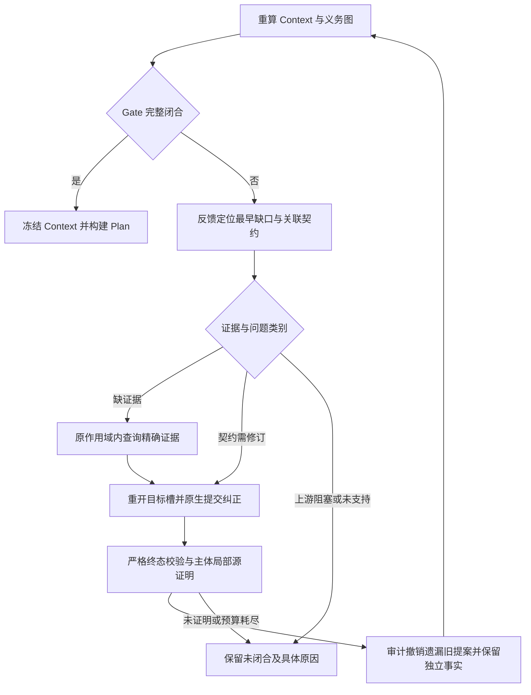

# Context 闭合反馈与源证明修订

后续实现（2026-10-05）：Main 当前为 I，已加入候选事务、关联槽位一起校验、失败回滚及下一既有 pass 的一次拒绝纠正。测试保持暂停，本轮仅静态检查；机制、当前 fingerprint 和仍会拒绝的边界见 [候选事务与回滚报告](CONTEXT_REPAIR_TRANSACTION_REPORT.md)。下文 G 是历史已执行版本，其全量回归和 fresh 结果不能用于宣称 I 稳定。

本轮让 Context 在已有源码和原预算内纠正先前提交的契约遗漏。Completeness 从未闭合的最早依赖生成反馈，重新打开明确阻断其他根的 typed slots；Agent 必须原生重新提交，merge 和源证明只退休被证明可替换的旧事实，然后重新计算 Context、Gate 和 Plan。反馈本身不产生事实、证据或闭合证书。

真实 F `owned_return_r03` 的冻结 11 响应前缀得到逐文档相同的原失败状态。在该状态和 ledger 上追加 **2 次显式离线 native 修订事务**后，Context 和 frozen Plan 闭合，model operations 从 **11/24 到 13/24**，tool calls 保持 **12/64**，source chars 保持 **8,367/96,000**。这证明已保存错误契约可经过原生接口和源证明被纠正；追加回答由离线脚本明确编写，**不是 fresh 模型成功、provider 调用或历史失败的重分类**。

离线结果审计已通过。新 fingerprint G 的独立 fresh 全链为 **JSON 5/5、owned return 3/3**，八次都在首个 Context pass 闭合，实际未触发契约修订。修订路径的证据来自真实 F 离线追加及故障注入 native scheduler 测试；fresh 成功本身不证明模型在错误旧契约出现后必然纠正。全量回归结果另记于本文验证部分。

## 机制与边界

[closure_feedback.py](../harness_generation/harness_context/closure_feedback.py) 读取新算出的 semantic obligation frontier，沿明确的 construction dependency 追到最早未证明的参数/字段。反馈包含当前 fact IDs、精确 field paths、关联修订 requirement IDs、已签发的合法源选项、完整或截断的证据状态、受影响 roots、暂缓的依赖 gaps，以及必须保留的独立事实。它区分 `contract_correction`、`missing_evidence`、`upstream_blocker` 和 `unsupported`；后三类不能因一次反馈就获得完成结论。

[loop.py](../harness_generation/harness_context/loop.py) 在原最多 3 个 completeness passes 内，允许一个已经提交、没有 execution failure 的 exact requirement 至多一次使用相同证据的契约修订。明确阻断 derived recipe 的 input/length slot 即使自己的局部 root 曾 closed，也会一并重新调查。原 unchanged-evidence/proved skip 规则继续适用于非修订对象。修订重复旧答案记 `no_progress`，失败请求记 `execution_failure`；provider 失败不会购买新的语义尝试，也不会增加第四个 completeness pass。



[agent.py](../harness_generation/harness_context/agent.py) 将反馈送入普通 native typed terminal，继续用原 schema、签发 evidence/choices 和全局剩余额度验证。每个修订记录 old/submitted/retained fact IDs、affected roots、前后 ledger 和结果；旧 `attempt_*` 保存原始响应与 trace，当前 result 保存源证明后的有效投影。[persistence.py](../harness_generation/harness_context/persistence.py) 的 commit digests 覆盖反馈与 revision history，并将 policy、prompt 和 feedback version 纳入配置身份，防止旧缓存被当成本轮运行。

[repair_proofs.py](../harness_generation/harness_context/repair_proofs.py) 对本次 extent omission 的退休要求同时存在两个**显式提交**的 matching 契约：`input_binding.size_parameter` 和 `buffer_length.length_parameter`，且 parameter、单位及其他字段保持同一证明范围。已签发的 pair 是合法源提示，不是单位证明；必须重新证明 canonical `fuzz_bytes`/`fuzz_size` recipes 和相关义务。仅空槽遗漏可退休，未提交 counterpart、单位变化、独立对象变化、未知源码或具体且冲突的备选值仍阻断。Counterfactual resolutions 按 `fact_id` 排序后继续通过严格 canonical identity 校验；未放宽持久化验证。

## F 的原始正式结果保持 18/20

F production fingerprint 为 `4d43a73bc44843cbf1d00d3ffb8ac3ef99ebe54e998bdfc6680574dfd98d4302`。原 cohort 20 个独立 fresh trial 全部完成，最终全链 **18/20**，无 whole-trial retry/resume。冻结执行时的 integrity 与独立审计通过；这不表示本轮修改后的 Main 仍等于旧 F 源码。

原最终 [summary.json](../artifacts/stability_formal_F_readonly_metrics_review_20261005/checkpoint_0055_final/summary.json)、[逐 trial / stage 成本 metrics.json](../artifacts/stability_formal_F_readonly_metrics_review_20261005/checkpoint_0055_final/metrics.json)、[20 行结果表](../artifacts/stability_formal_F_readonly_metrics_review_20261005/checkpoint_0055_final/cohort_report.md) 和 [independent audit](../artifacts/stability_formal_F_readonly_metrics_review_20261005/checkpoint_0055_final/independent_audit.json) 均保持原样。

| F 原始样例 | 全链成功 | 原始失败 |
| --- | ---: | --- |
| json_parse | 5/5 | 无 |
| callback_context | 2/3 | r03：代码生成后的严格绑定验证失败 |
| shared_context | 3/3 | 无 |
| owned_return | 2/3 | r03：Context 契约未闭合 |
| out_parameter | 3/3 | 无 |
| memory_stream | 3/3 | 无 |
| 合计 | **18/20** | **2** |

原条件分母为 Validation **20/20**、Slice **20/20**、Context **19/20**、Plan **19/19**、code **18/19**、build/runtime **18/18**。全 pipeline 成本为 **305 model calls、546 tool calls、820,534 source chars、5,928,340 tokens**（prompt 5,554,707；completion 373,633），305 provider responses、0 failed requests、0 provider recoveries；semantic recoveries 3、protocol recoveries 10、code repair 1、extra terminal repair operations 4。全部 responses 有完整 usage，但 20 个请求缺少 timing；不能把事件数再加作 provider 请求数。

| F 原始失败 trial | Pipeline model / tool calls | Pipeline tokens | 真正停止位置 |
| --- | ---: | ---: | --- |
| callback_context_r03 | 19 / 23 | 429,314 | Context 已 complete、0 hard gaps、Plan frozen；两次相同代码均 invalid |
| owned_return_r03 | 18 / 22 | 322,625 | Context 11 calls / 12 tools / 279,211 tokens，3 个 completeness passes 耗尽；code model calls 0 |

### callback_context_r03：已生成代码被拒绝

原 Context `ft_parse_49a1d8b4a632a351e031afec` 为 complete，`generation_allowed=true`，hard missing 0。原 frozen Plan 要求 callback producer 为精确 API `api.c:7:handle`。初始代码定义 `handle_callback` wrapper，在 fuzzer entry 外调用 `handle`，然后把 wrapper 传给 `parse`。严格验证报告 `canonical_callback_binding_mismatch` 和 `project_api_outside_fuzzer_entry`。唯一允许的 code repair 再次返回相同 SHA256 `bc3cc36a2ec253c7812195593d9173e19889194b7635e828ccdf98ae76104eb3`，所以回退第一次代码仍是 invalid。

此失败不是“不生成 harness”。原生生成与预算内 code repair 已发生，最终有效产物被 gate 拒绝；本轮 Context 反馈修订不改变该失败，也没有改 frozen Plan 以接纳错误 wrapper。证据位于原 [callback trial](../artifacts/stability_repair_formal_20261005F/callback_context_r03)、该 trial 的 `artifacts/context_generations/ft_parse_49a1d8b4a632a351e031afec/` 下的 `harness.cpp`、`code_validation.json`、`code_attempts/` 和 `metadata.json`。Context 调查还使用过 protocol/semantic recovery，最终已经 answered；它们与下游 invalid code 是不同阶段。

### owned_return_r03：已获取源码但长度绑定没有闭合

原函数为 `Result *parse(const unsigned char *src, size_t cb)`，内部 `r->value = cb ? src[0] : 0`。这里的 **`cb` 声明为 size_t 标量，不是 callback**；声明和 guard 本身不独立证明长度单位。模型已把 `src` 标成 fuzz input、`cb` 标成 derived，但 `src.size_parameter` 与 `src` buffer link 的 `length_parameter` 都仍为 null。单独一个 derived 标签不能证明该标量来自哪一组 fuzz bytes 的长度，canonical recipe 因而保留 `construction_source_missing`。

`parse.cb` 不能构造，连锁导致 `dispose.r` / `observe.r` 的 creator arguments missing、相关 invocation 不可证明，`observe` 的 input path 也未提交闭合事实。原 **19 hard gaps** 包含 17 个 canonical construction diagnostics 和两个 input diagnostics；图的实际 frontier 为 4、open roots 为 10。它们主要是相同未闭合 recipe 的依赖扩散，不是 19 个独立源码缺陷。

完整 `parse` body、合法 `src ↔ cb` choices 和 length-link feedback 在原调查中已提供。旧流程后续反复询问的是 `argument_construction`，而已有 locally resolved 的 `input_binding` / `buffer_length` 没有被因果反馈同时重新打开。继续保留空槽，再回退到前一个相同空槽，并不能建立已证明的构造来源。正确的恢复是明确修订这些具体契约，而不是绕过 Gate 或回退整个认证 FT/scope。

原 Context metadata 显示 **11/24 model calls、12/64 tool calls、8,367/96,000 source chars、3/3 completeness rounds**，termination `completeness_budget_exhausted`，最终 execution failures 空。一次 observe 输出截断使用了原 protocol recovery 和普通 terminal correction，随后成功原生提交；停止原因不是 provider/authentication 错误。原 [owned-return trial](../artifacts/stability_repair_formal_20261005F/owned_return_r03) 的 `blocked.json` 保持 code model calls 0。

## 忠实 frozen F 前缀与追加 native 事务

离线 [replay driver](../artifacts/context_closure_feedback_replay_20261005/scripts/replay_owned_return.py) 从原 trace 按真实 request start time 还原 11 个 model responses、原 tool calls 和 terminal slots。重复保存的 grouped traces 只取 cost owner；framework 注入消息不计模型响应。原 11 响应使用 **frozen F 实现**运行，严格比较 active requirement group，不把旧回答强行适配新 Main 的不同调度槽位。

| 原响应序号 | 原调查对象与动作 |
| --- | --- |
| 1 | parse 七个 typed slots 原生提交，extent 两个字段仍为 null |
| 2 | dispose argument/ownership 原生提交 |
| 3 | observe 组查询 parse、dispose 完整 body 与 Result type |
| 4 | observe 输出截断，没有 native tool submission |
| 5 | observe 在原 terminal-budget recovery 中原生提交 |
| 6–7 | parse.argument、dispose.argument 再次原生提交 |
| 8 | observe argument/input 组查询 excluded usage signature 和 parse callers |
| 9 | observe 组原生 unresolved |
| 10–11 | parse.argument、dispose.argument 再次原生提交 |

权威 baseline 为 [frozen_prefix_01](../artifacts/context_closure_feedback_replay_20261005/results/frozen_prefix_01)。其 facts、resolutions、evidence、completeness 和 metrics 与 F 原始记录 **逐文档相同**。新 Main 的 continuation 读取这一最终状态，继承原预算、issued evidence cache、tokens、discoveries 和第 3 轮 ledger；没有新增 production 任意 hydration API，也没有重开新的 3 轮。所有离线追加明确标记 scripted-native-correction / offline-continuation。

| 追加事务 | 显式提交与证明 | 原 ledger 的变化 | 重算后的闭合状态 |
| --- | --- | --- | --- |
| 1 | parse input/argument/length 组：`src.size_parameter=cb` 与 `src.length_parameter=cb`；保留 cb derived、src input 与其他独立字段和事实；源证明退休两个旧 null extent facts | model operations 11 → 12；tools 12、chars 8,367 不变 | hard missing **19 → 2**，open roots 1、frontier 1；observe 的独立 input contract 仍未提交 |
| 2 | observe input slot：`r.source=context`、`transform=field`、`via_function_id=api.c:4:parse`，引用已签发的完整 observe evidence；真实 input-flow 和 invocation 证明重算 | model operations 12 → 13；tools 12、chars 8,367 不变 | hard missing **0**、open roots **0**、frontier **0**；Gate allowed、Context frozen、Plan frozen |

权威追加结果为 [main_continuation_03/summary.json](../artifacts/context_closure_feedback_replay_20261005/results/main_continuation_03/summary.json)、[transactions.json](../artifacts/context_closure_feedback_replay_20261005/results/main_continuation_03/transactions.json)、[两个原生终态](../artifacts/context_closure_feedback_replay_20261005/results/main_continuation_03/scripted_corrections.json) 和 [harness_plan.json](../artifacts/context_closure_feedback_replay_20261005/results/main_continuation_03/harness_plan.json)。追加使用真实 Agent、typed terminal validator、subject merge、RepairProofEvaluator、Completeness validator 和 HarnessPlanBuilder，未调用代码模型，也未编译运行离线新 Plan。

[只读结果审计](../artifacts/context_closure_feedback_replay_20261005/results/result_audit.json) 重新 strict-validate 所有 native resolutions，并独立重建 Context、Completeness 和 Plan，均与保存产物逐文档相同。原 raw 文件的 SHA256 清单与已保存 input hashes 一致；原 FT/minimal marker 内容相同；所有非退休的原 fact 逐条保留；issued evidence 文档完全相同。原失败仍为 `harness-context_failed`。离线目录是独立分析产物，旧 authenticated attempts 仍留在 frozen prefix，不能把它直接当作新版本的 production resume cache。

原已知 provider usage 为 279,211 Context tokens，继承到 continuation ledger；两个新 model operations 是离线返回值，不是两个计费请求，不能据此计算新 provider token 成本。`main_continuation_01/02` 保留为中间诊断记录，不用于成功或稳定性分母。

## 新 G 的独立重复验证

已登记 [G owned-return registration](../artifacts/context_closure_feedback_fresh_20261005G/registration.json)，production fingerprint 为 **`1a87f362ccaa8107d8433cf3e3f38ccb7b3e29cd59e2cd0cdf2790186b2c46ef`**（168 个生产文件）；它与 F 不同。G 第一组注册 3 个 owned-return 独立 fresh 全链开发 smoke，`resume=false`、`failed_retry=false`、保持 Context 24/64/96,000/3 的原预算及 code repair cap 1。G 的注册 provider/transport 按自身清单解读，不能与 F 混作相同实验身份。

该组 [完成审计](../artifacts/context_closure_feedback_fresh_20261005G/completion_audit.json) 已完成 3/3，全部 integrity 检查 true，[独立审计](../artifacts/context_closure_feedback_fresh_20261005G/independent_audit.json) 为 `complete=true`、`audit_passed=true`。Validation、Slice、Context、Plan、build/runtime 均 **3/3**；三个 native Context 均 **1 completeness pass、0 Context revision**。这组结果说明本次已知 owned-return 样例的三个新 fresh trial 全链通过，不能冒充三个错误契约恢复观察。

| G fresh owned-return trial | 全链结果 | Pipeline model / tool calls | Tokens | Context passes / revisions |
| --- | --- | ---: | ---: | ---: |
| r01 | passed | 14 / 21 | 308,123 | 1 / 0 |
| r02 | passed | 10 / 16 | 178,722 | 1 / 0 |
| r03 | passed | 11 / 19 | 194,268 | 1 / 0 |
| 合计 | **3/3** | **35 / 56** | **681,113** | 无真实契约修订发生 |

新 [逐 trial / stage metrics](../artifacts/context_closure_feedback_fresh_20261005G/metrics.json) 和 [结果表](../artifacts/context_closure_feedback_fresh_20261005G/cohort_report.md) 保留 0 failed requests、0 provider/protocol/semantic recovery。另有 1 次额外 terminal schema correction，不能把它写成 Context 语义 revision。三个 Plan 的 binding signature 为 1 个变体、semantic signature 为 3 个变体。

[owned-return 独立源码与计费复核](../artifacts/context_closure_feedback_fresh_review_20261005G/review.md)通过 70 项检查：每次 19/19 mandatory roots 重新计算闭合，Context/Plan input 与 document digests 一致，`parse → observe → dispose` 使用同一结果对象，三次共 18 个保存的 ASan/UBSan smoke 输入通过。完整 Plan 的三个 semantic 变体仅涉及 `observe.r` 的 transform `field/direct` 和 alignment `none/natural`；canonical 执行绑定一致。完整注解仍有方差，不能将执行绑定稳定写成所有契约字段一致。

同 production fingerprint 的 [JSON5 registration](../artifacts/context_closure_feedback_json_fresh_20261005G/registration.json)另行登记五个 fresh roots，未使用 resume 或整次失败重试。[完成审计](../artifacts/context_closure_feedback_json_fresh_20261005G/completion_audit.json)全部 integrity 为 true，[独立审计](../artifacts/context_closure_feedback_json_fresh_20261005G/independent_audit.json)为 complete/audit_passed。Validation、Slice、Context、Plan、build/runtime 各 **5/5**，hard gaps 全为 0；每次 Context 为 **2 model calls、1 completeness pass、0 contract revisions**。

| G fresh JSON trial | 全链结果 | Pipeline model / tool calls | Tokens | Hard gaps |
| --- | --- | ---: | ---: | ---: |
| r01 | passed | 10 / 35 | 220,194 | 0 |
| r02 | passed | 12 / 41 | 255,459 | 0 |
| r03 | passed | 10 / 35 | 202,017 | 0 |
| r04 | passed | 11 / 39 | 237,857 | 0 |
| r05 | passed | 11 / 40 | 240,451 | 0 |
| 合计 | **5/5** | **54 / 190** | **1,155,978** | **0** |

JSON5 的 [逐阶段 metrics](../artifacts/context_closure_feedback_json_fresh_20261005G/metrics.json)记录 prompt 1,097,208、completion 58,770 tokens，54 provider responses、0 failed requests、2 次 protocol recovery；全部 usage 完整。五个 JSON Plan 的 binding signature 为 1 个变体、semantic signature 为 2 个变体，`json_parse` 自身 return annotation 五次均为 nonnull/nullable/owned/error_cleanup=false。完整 semantic 差异仅为 r04 的 `json` input binding 和其 length-for 记录中 `binary_zero_allowed=false`，其余四次为 true；`input_policy.preserve_binary_zero` 均为 true，实际代码未过滤零字节。该注解差异保留在记录中，尚不能宣称完整契约语义一致。每个 trial 的 provider events 单独保存，事件不重复累加为请求数。

[JSON 独立只读审计](../artifacts/context_closure_feedback_fresh_review_20261005G/json_audit.json)核对保存的源码、Gate 根、Plan 与 generation 摘要、runtime 输入、成本及上述 semantic 差异，全部通过；审计前后 native artifact 清单摘要一致。

本轮两个 G 注册组共 **8/8 fresh 全链通过、89 model calls、246 tools、1,837,091 tokens、0 provider failed requests**。它们覆盖已知 JSON 项目与一个 owned-return 开发样例，不是旧 F 的完整 20-trial cohort，也没有重测其余四类结构。共 48 个保存的 sanitizer smoke 输入全部通过，没有额外 fuzz campaign；不同版本与离线追加不合并到同一成功分母。

后续[第三个 G 注册组](../artifacts/context_closure_feedback_structural_fresh_20261005G/registration.json)已完成 callback、shared context、out parameter 和 memory stream 各 3 次，共 12 个 fresh roots，成功 **9/12**。三组生产 fingerprint、provider、预算、恢复限额、code cap、目标、运行脚本和附属文件身份一致，合计为 **17/20**；这是三个分次登记开发组的组合描述，不是预先一次登记的正式 cohort。完整表及成本见 [组合 metrics](../artifacts/context_closure_feedback_combined_20261005G/metrics.json)，[独立审计](../artifacts/context_closure_feedback_combined_review_20261005G/REPORT.md)确认原始结果和冻结清单未变。

追加组 `shared_context_r01` 已出现一次真实模型的成功修订链，见[只读证据审计](../artifacts/context_closure_feedback_structural_review_20261005G/shared_r01_repair.md)。第 2 个 completeness pass 的第一批反馈让模型显式将 `supply.src.lifetime` 从 during_call 改为 until_release，源码证明确认保留到同一对象 release，框架审计撤销旧 lifetime 提案；第二批让模型明确填写 `parse.state.api=supply` 和 `parse.input.via_function_id=supply`，框架仅合并已有兼容的 nullable refinement。三态图重算与记录逐值一致，hard gaps **5 → 3 → 0**、open roots **5 → 3 → 0**。追加为 **3 个真实 provider responses、2 次工具调用、75,157 tokens、0 新源码字符**；最终为 10/24 model calls、13/64 tools、9,020/96,000 chars、2/3 passes。Context、Plan、build 和六个 sanitizer runtime 输入均通过，原始文件未改。这次观察与前面八个首轮闭合 trial、离线显式回复分别记录。

新增专项为 closure feedback 13 项、revision proofs 21 项、native scheduler 5 项，共 **39 项全部通过**，并纳入全量回归。其覆盖包括 locally proved slots 的重新打开、同一 source 的 no-progress 停止、provider failure 不再购买语义尝试、原始 attempt 不改写、最新 result/Context 持久化以及 commit tamper/version 拒绝。

全量回归为 **1566 passed / 797.19 秒**，0 failed、0 skipped。[result.json](../artifacts/context_closure_feedback_regression_20261005G/result.json)记录 exit 0、所有 source/tests/scripts/environment 文件摘要与清单检查通过、changed paths 空；执行 wrapper 用时 798.107 秒。[pytest.log](../artifacts/context_closure_feedback_regression_20261005G/pytest.log)保留完整日志，[production change inventory](../artifacts/context_closure_feedback_regression_20261005G/production_change_inventory.json)列出相对 F 的 9 个生产文件变动。版本为 Context policy v14、agent prompt v28、proof investigation v9、prompt projection v7、closure feedback v1、subject repair v6。

实际限制：小规模已知开发 smoke 与离线显式修订均不能证明跨项目泛化或长期稳定性。上游冻结 EXCLUDE、缺源码、未支持的语义和未证明的具体冲突仍保持未闭合；这次反馈机制不会自动解决 F callback 的下游代码绑定错误。

F 原始 **18/20** 与其中两个失败不因本轮离线或 G 的后续结果而改变。

## 复现

以下命令要求项目已有相同 provider 环境配置；输出目录必须是新目录。注册会冻结完整生产清单、预算、target 和运行脚本身份。

```bash
.venv/bin/python -m pytest -q
.venv/bin/python scripts/repeat_fresh_stability.py --freeze-current --cases owned_return --sample-repetitions 3 --workers 2 --max-code-repairs 1 --agent-timeout 120 --output artifacts/context_feedback_owned_new
.venv/bin/python scripts/repeat_fresh_stability.py --freeze-current --cases json_parse --json-repetitions 5 --workers 2 --max-code-repairs 1 --agent-timeout 120 --output artifacts/context_feedback_json_new
.venv/bin/python scripts/collect_fresh_stability.py --experiment-root artifacts/context_feedback_json_new
.venv/bin/python scripts/audit_fresh_stability.py --experiment-root artifacts/context_feedback_json_new --require-complete
```
