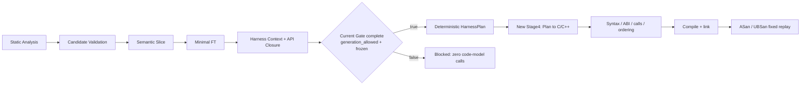

Frozen Context → HarnessPlan → Harness 实现与模型实测报告（2026-09-28）

新入口已完成：实际读取并验证 Minimal FT、Frozen Harness Context 和 API Closure，确定性产生 HarnessPlan，代码模型只把 Plan 翻译为 C/C++。direct parser 已通过新的真实 Candidate → Slice → FT → Context → Plan → Harness → compile → runtime 链；context/create/destroy 样例在定向 Context 复测及恢复后也完成了该链。owned-return 样例完成了真实 Context → Plan → Harness → compile → runtime，但其上游 FT 是显式手选 fixture，不能算作全链模型成功。

更换后的凭证已通过认证和原生工具调用。实际使用 `.env` 配置的 `https://ark.cn-beijing.volces.com/api/plan/v3`、请求模型 `ark-code-latest`、thinking disabled；服务端返回的实际模型是 `deepseek-v4-flash-ga-260731`。凭证按数据读取，不作为 shell 执行，不写入 artifact 或配置摘要。不存在 mock/recorded provider 的自动回退。



实现位于 `harness_generation/context_generation/`。`persistence.py` 验证 Slice/FT 发布摘要、Context 发布记录和每条 requirement 的证据，核对当前索引源码及声明，并重新运行 Completeness Gate。`builder.py` 保持 FT ID、CORE 和 EXCLUDE，选择 CORE 与 required support，投影参数构造、输入/长度关系、资源身份、create/init/use/cleanup、callback ABI、ownership 和返回语义。它对明确的调用关系进行拓扑排序；有证据的经由 API 输入路径增加相应先后依赖。context input 的生产者和消费者必须具有明确共享的 resource ID。无法绑定的 derived 参数、多个 creator return 别名、重复符号、循环顺序、内部 static API 或交错生命周期会阻止构建 Plan。

模型收到的只有 HarnessPlan JSON 和翻译指令，包括 ABI 与类型声明；没有项目源码函数体、SFG structure snippets、旧 FunctionTriplet、rough code 或仓库调查工具。默认 callback stub 返回零是明确的 harness 设计策略，不冒充 API 语义证据。Stage4 后的检查拒绝目标函数重定义、计划外 API、错误原型/实参数量、遗漏调用、目标调用循环和违反顺序的调用点。支持已知 `__cplusplus` linkage guard；其他未知预处理条件保守拒绝。编译与链接检查补充树解析器的 ABI/类型限制。

旧 `generate` 与 Stage1–4 保留为 baseline。新入口不调用 Stage1 的函数文档生成、Stage2 的 SFG structure snippets、Stage3 的 FunctionTriplet rough code，也不执行旧 Stage4 的 `load_protocol_ir → reconcile_protocol_ir → protocol_contract_projection`。ProtocolIR 没有成为新链输入或硬依赖。本轮没有修改 coverage/feedback score，也没有运行新链的 fuzzing。

运行方式如下；显式构建 recipe 适用于有外部库、特殊编译参数或 C++ target 的项目。自动 recipe 用于简单 C 项目。

```bash
.venv/bin/python -m harness_generation harness-context \
  --artifacts <phase1-artifacts> --provider openai-compatible --env-file .env

.venv/bin/python -m harness_generation context-generate \
  --artifacts <phase1-artifacts> --env-file .env --build --runtime

# 确定性 Plan，不需要模型凭证
.venv/bin/python -m harness_generation context-generate \
  --artifacts <phase1-artifacts> --plan-only

# 用冻结 Plan 验证已有 C/C++ harness，零模型请求
.venv/bin/python -m harness_generation context-generate \
  --artifacts <phase1-artifacts> --harness <existing.cpp> --build --runtime
```

支持精确 `--ft`、`--language c|c++`、项目相对 `--header`、输入字节上限、`--target-build` 和 `--resume`。artifact 位于 `context_generations/<ft-id>/<plan-id>/<configuration-digest>/`，保留 Plan、prompt、真实 response、源代码、静态检查、编译命令和逐输入运行记录，最后写 metadata 发布标记。恢复校验输入、模型/策略/构建配置、源文件与头文件、输出文件及二进制摘要；校验通过后不调用模型、不改写已有文件。失配或显式重新生成时，原运行移入 history，防止旧 response/build 被误当作本次成功。`passed` 只表示请求的检查通过；未指定 `--build --runtime` 的运行不提供编译或运行证明。

Context 调查改为同一函数最多八条 requirement 共用一次工具调查，逻辑 requirement、predicate、证据和门禁仍独立。终端 schema 绑定精确 requirement ID、subject function ID 和合法 `required_by` 函数 ID，避免把 `req_*` 当成函数。schema repair 仍有界；语义错误不通过 repair 修补，只将对应项记为 unresolved。相同 support API 的重复上游问题合并并保留所有问题，无精确 API ID 的未知项保持独立。已验证事实的再次曝光不重复计入 source 字符预算，查询缓存仍受当前 scope 和全局调用预算约束。creator/output producer 与 consuming cleanup 的结构候选分别排序，排序结果仍须读源码证明职责。

实测发现并修复两类正确性问题。第一，输入缓冲被分配 phantom resource ID 时，旧 Gate 可能 complete、Plan 才拒绝；现在无生命周期记录的 resource 引用在 Context Gate 就成为 hard missing，默认提示也不再给普通数据/长度提供构造资源 ID。第二，合法的条件 `extern "C"` 包装被 tree-sitter 判为语法错误；新检查按确定的 C/C++ 语言解析该 guard。context/create/destroy 的原始模型源码在修复后直接复用，编译运行通过，没有新增模型请求。新运行检查显式开启泄漏检测和 sanitizer 出错停止；禁止 UBSan 恢复后退出零被计为成功。固定 replay 不调用外部 symbolizer，避免符号化延迟影响有界运行结果。

真实 Plan 翻译单段测试有六种 API 模型，全部一次模型请求通过，累计 20,054 tokens。它的冻结输入由测试套件的显式 fixture 契约构建，**没有真实 Context 模型调查**，因此这里的 6/6 只属于代码翻译阶段。

| API 模型 | 真实代码生成 | 编译/链接 | 每组 6 次 ASan/UBSan replay |
|---|---:|---:|---:|
| direct byte parser | 通过 | 通过 | 6/6 |
| create → use → destroy | 通过 | 通过 | 6/6 |
| owned return → release | 通过 | 通过 | 6/6 |
| borrowed/static return | 通过 | 通过 | 6/6 |
| callback table | 通过 | 通过 | 6/6 |
| NUL string | 通过 | 通过 | 6/6 |

完整新模型流水线测试采用新的 parser-only 静态 artifact，无伪造语义 annotation。每个小型合成项目显式选定 `parse` anchor，不能当作入口 recall 评测。第一轮五个样例的完整模型链只有 direct 通过，其余结果均保留。source/artifact 未被生成阶段修改。

| 新鲜全链样例 | Candidate / Slice | 第一轮结果 | 后续定向复测 |
|---|---|---|---|
| direct | 均完成 | compile/runtime 通过 | 当前检查复核通过 |
| external context | 均完成，FT 有 1 CORE + 2 SUPPORT 候选 | Context incomplete，禁止生成 | schema 修订后 16 次调查 + resume 5 次调查完成；复用 11 条 requirement，required closure 为 creator + release；原始模型代码编译/运行通过 |
| owned return | Candidate 完成，Slice invalid | 停在 Slice | 单独已有 hand-selected FT 的真实 Context 成功，不能替代本列 Slice 失败 |
| callback | Candidate / Slice 完成 | Context incomplete | 定向复测 12 次调用后仍有 callback/state hard missing |
| NUL string | Candidate / Slice 完成 | Context incomplete | 模型没给出无 length 参数时的明确 NUL/length link，继续阻止生成 |

六个已有 FT 的 Context 实测也保留了逐条 baseline 和分组结果，默认全局预算均为 24 次调用。分组改变了调查单位和输出上限（4096 → 8192），以下不是严格 token/cost 匹配的消融。分组运行之后，又增加了精确 ID 的 schema 绑定；其结果是上表单独记录的定向复测。

| 已有 FT 样例 | 逐条 status / calls | 分组 status / calls | 分组 hard missing | source chars：逐条 → 分组 |
|---|---|---|---:|---:|
| direct parser | complete / 5 | complete / 5 | 0 | 12,615 → 1,712 |
| shared-context hub | incomplete / 24 | incomplete / 19 | 13 | 50,697 → 4,121 |
| JSON parser | incomplete / 19 | incomplete / 24 | 51 | 95,181 → 43,410 |
| wrapper | incomplete / 24 | invalid / 17 | 8 | 60,396 → 7,332 |
| owned return cleanup | incomplete / 23 | complete / 9 | 0 | 79,049 → 2,809 |
| FT 外 creator/release | invalid / 24 | incomplete / 11 | 7 | 83,215 → 7,711 |

分组调用数合计 119 → 85，source 字符计数显著降低，但真实 token 合计由 803,040 增至 1,009,088。大型 `anyOf` 契约 schema、重复的说明和部分长终端回答抵消了调用节省；不能把 source 预算去重当作 API token 成本下降。owned-return 的 Context 从失败变成完成是可复核改善，shared-context、JSON 和 wrapper 仍不能据此宣称已解决。JSON 保留的内部 static CORE 没有可直接调用 ABI，其历史快照的类型声明还与当前头文件不完全相符，源码一致性检查也会拒绝该输入；wrapper 的顺序事实存在循环，当前均保守阻止生成。

最终按照当前 `frozen_plan_code_v2` 和 `frozen_context_build_v3` 重新认证、编译及运行九份真实模型源码：上述六份单段源码，加上 direct 全链、owned-return 真实 Context 链和 external-context 复测链。九份原 Plan 均与当前 Builder 输出一致，全部 54 次固定 replay 通过，resume 均零模型调用且文件内容/时间不变。此复核只重用原始真实 response，不重新生成代码。它不改变之前失败运行的历史结论。

回归验证为 `230 passed`；`pip check` 和 `git diff --check` 通过。新增测试覆盖生成前门禁、当前源码变化、冻结摘要失配、Plan 身份、目标 ABI/调用数量/顺序、未知宏条件、同一 resource 的 feed → parse、多 CORE、owned/borrowed return、callback、NUL、C 与 C++ 编译、恢复输出篡改、重新生成失败时的旧 artifact 隔离，以及 UBSan 检出错误后不能被计为 runtime success。unit tests 明确使用 fixture/FakeLLM；真实 smoke 是显式脚本，不进入 pytest、不自动回退。

可复核数据位于本机忽略的 artifact 目录，源码脚本与本报告进入仓库修改：

- `artifacts/harness_context_ark_real_20260928_01/summary.json`：逐条 baseline。
- `artifacts/harness_context_ark_real_20260928_04/summary.json`：六个 FT 的分组调查，包含 invalid/blocked。
- `artifacts/context_pipeline_ark_real_20260928_02/summary.json`：五个新鲜全模型链样例的第一轮。
- `artifacts/context_retry_ark_real_20260928_01/`：external/callback 定向调查、external resume 及其源码生成。
- `artifacts/plan_translation_ark_real_20260928_01/summary.json`：六个显式冻结 fixture 的真实代码翻译。
- `artifacts/frozen_context_final_audit_20260928.json`：当前检查策略的九份真实源码、54 次运行和恢复验证。
- `artifacts/frozen_context_negative_gate_audit_20260928.json`：六个 Context 的当前 Gate 与保存状态一致，四个未完成/invalid 输入均零代码模型调用阻止生成。
- `scripts/smoke_harness_context.py`、`scripts/smoke_context_pipeline.py`、`scripts/smoke_plan_translation.py`：复现入口。

当前证据支持新架构的边界已建立，以及完整、可执行的冻结契约能显著简化代码模型任务。它仍不足以证明跨项目泛化。多数样例是小型合成 API fixture，缺少独立 parser/context-feed/callback/owned-return/stream-file 项目、多种子、预算匹配和人工契约标注；固定输入 replay 也不证明路径完整覆盖。静态代码检查验证语法、ABI、调用点和词法顺序，尚不是 ownership、指针别名或控制/数据流的形式证明。实际瓶颈仍在 Context 语义完成度、共享资源身份和 ordering，以及早期 Slice 对 owned return 等 API 模型的稳定性。

后续应先减少终端 schema 重复、明确 cleanup 消费 ownership 和 callback 字段/ABI/生命周期、定向处理共享资源路径，并增加针对失败路径的 runtime 输入。待这些 API 模型的端到端成功稳定后，再做跨项目 Candidate recall、Minimal FT 大小、Context completion、compile/runtime success 和 target-only coverage 实验；本轮未提前展开 coverage/feedback 优化。
