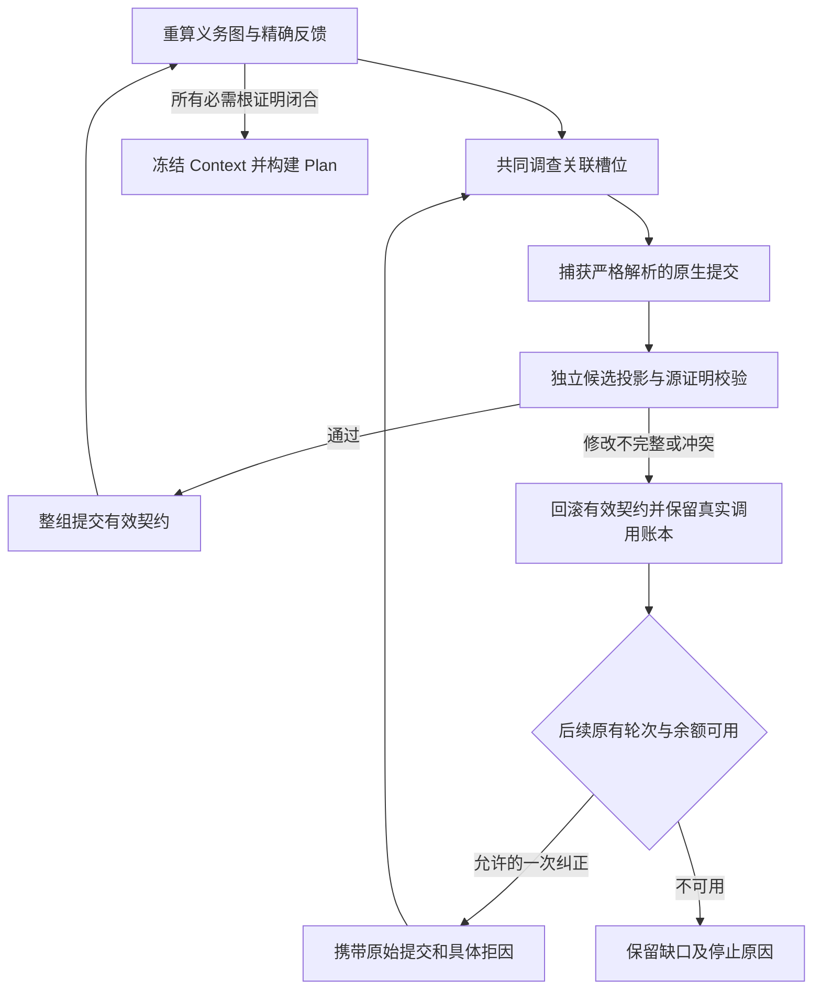

# Context 候选修订、回滚与拒绝反馈

2026-10-06 后续说明：用户指定 cJSON 后恢复了定向验证，修正测试夹具后 97 项通过，生产 fingerprint 未变；当前又按用户要求暂停测试。下文“测试未执行”描述 2026-10-05 实现合入时的状态。当前工作机制和数据流见 [详细说明](FRAMEWORK_EXECUTION_AND_DATA_FLOW.md)，cJSON 原始记录与暂停状态见 [能力检验记录](CJSON_RECON_FRAMEWORK_CAPABILITY_REPORT.md)，不能把定向通过视为全链稳定。

日期：2026-10-05。实现已从隔离工作区 I 合入 Main；**测试仍按用户要求暂停**。本轮只执行源码阅读、AST 解析、diff 和文件摘要检查，没有执行 pytest、fixture、离线回放、fresh run 或供应商调用。新增实现尚未证明稳定成功。

当前生产 fingerprint 为 `1da0159676fef323ce5be1fb51aceb9d8f9bacf348a5e7e344418e2d82eaae2c`，170 个生产文件。相对 Main 的 G 基线修改 11 个生产文件，加入 9 个测试文件，其中两个 callback 测试文件来自已验证的 H。完整前后清单及变更前备份见 [implementation_manifest.json](../artifacts/context_repair_transaction_implementation_20261005I/implementation_manifest.json)。这个摘要登记实现身份，不是新的 fresh cohort 注册或通过结果。

## 修复链条

1. Completeness 重算义务图，反馈定位最早未证明的主体、精确旧字段及关联 requirement。`argument_construction`、`input_binding` 和 extent 契约分别保留类型边界；需要共同修改时进入同一个修订组。具体冲突字段，包括先前通用反馈未列出的 boolean 和嵌套字段，也会出现在反馈中。组内其他反馈不能再要求保留正在修订的同一主体。
2. Agent 收到的是 `observed_proposals`，不会把所有旧提案统一标成 confirmed。提示分别提供每个主体的证明覆盖范围、实际资源 origin、歧义及完整源选项。只有精确的已有证书才能影响身份选择；参数 origin 与 caller-return origin 不按类型或同名 producer 合并。
3. 原生 terminal 完成严格 typed parsing 后，立即深拷贝 `native_submission`，再做 Agent 局部 merge。框架的 unresolved fallback 不冒充原生提交；partial group 中合法与非法槽位分别记录。
4. 已调查槽位的后续修改进入 [repair_transactions.py](../harness_generation/harness_context/repair_transactions.py)。所有提交先共同进入候选投影，再使用已有源证明规则求稳定状态。原先已证明的义务必须保留，不能引入新的验证错误或主体冲突，明确反馈的缺失局部证明必须补齐。只比较 hard gap 数量下降不足以授权提交。
5. 候选通过时一起发布 requirements、resolutions 和 facts；半套修改、未证明替代或破坏旧证明的候选回滚。回滚只影响有效契约和未提交的撤销；真实 model/tool calls、tokens、源码字符、issued evidence、discoveries、执行失败历史及全局预算都保留。
6. rejected 候选携带真实提交、拒因及 active/candidate graph digests，再交给 Agent。每个 requirement 在初次定向修订被拒后，最多获得一次纠正，且只能使用下一既有 completeness pass。默认仍是 3 passes、24 model calls、64 tool calls、96,000 source chars；不增加第四轮，不重置余额。单条调查模式也必须共同提交关联修订组；超过原 8 槽 batch 上限的组记录具体诊断，不拆开发布。
7. 重复旧语义且证明状态没有进展时记 `no_progress`。新增 evidence ID 本身不算进展；实际源证明从 missing 变成 proved 才可能算进展。相同语义 dependency 的合法证据刷新在事务内部合并引用，不产生重复 API 选择，原生重复选择仍按原规则拒绝。Provider failure 属于 execution failure，不获得新的语义纠正额度。

## 持久化与恢复

[persistence.py](../harness_generation/harness_context/persistence.py) 将真实 Agent attempt 与框架派生投影分开保存。原生 `attempt_*` 的 result、trace、evidence 和组计费 ownership 保留原样。候选事务先写 pending marker、原生归档和不可变组投影，最后写 committed marker；失败候选只归档真实尝试，不覆盖有效 latest。部分写盘、摘要被改或缺少组成员时拒绝缓存。后续已验证事务可以合法替代单独成员，旧事务投影仍保留历史身份。

完整 Context 恢复要求所有已保存 resolution 都与对应 latest 一致，包含 unresolved 但有保留事实的槽位；不能拼接一个真实旧 Context 与真实新 latest。派生 result 所引用的 fact/dependency evidence 必须随原调查文档保存。框架传入真实 source evidence 的源重算统一进入事务发布，包括首次调查产生的普通 latest；同一轮未变化且已拒绝发布的候选不重复保存，避免固定点循环重复创建相同事务。配置身份包括 policy v16、prompt v29、projection v8、closure feedback v3、事务及 source-support 版本。

[transaction_support.py](../harness_generation/harness_context/transaction_support.py) 将实际撤销证明用到的全局证据绑定到已保存的不可变 attempt。它优先引用本批 attempt，再查记录所属槽位的历史归档，最后查同 FT 的其他历史归档；不拿可变 latest 充当来源，不伪造工具事件。`source-support.json` 保存精确证据记录、发行或复用载体的路径及摘要，恢复时核验 issued 集合、evidence ID、源文件 SHA 和文档身份。找不到可靠载体或派生 result 缺少随附证据时，整组 latest 保持原样；候选校验和发布决定分别记录，缺口进入拒绝反馈而非中断 mining loop。后续无模型调用的源重算发布失败也保留旧有效事实。损坏的基线、作用域或文件系统错误仍按完整性检查处理，不伪装成可自动修复的语义遗漏。

## 验证状态与历史结果

本轮静态解析 20 个变化的 Python 文件，diff 检查通过；Main 完整生产清单与 I 一致，H 冻结源码摘要保持不变。新增测试覆盖关联反馈、提案证明权限、候选回滚、下一轮纠正、单条模式联动、provider failure、重复答案、共享 commit marker、缓存不一致及证据来源篡改。**这些 I 测试均未执行**，不得称为回归通过或稳定性验证。

| 历史版本 | 已完成结果 | 能说明的范围 |
| --- | --- | --- |
| F | 正式 fresh 18/20 | 保留原始两个失败；不因后续修复补算成功 |
| G | 全量 1566 passed；三个分次登记同身份组共 17/20 | JSON 5/5、owned 3/3、callback 1/3、shared 3/3、out 3/3、memory 2/3；仍未稳定 |
| H | 全量 1596 passed；callback fresh 3/3 | 窄 callback 与代码反馈修改的历史观测，不能代替 I 的验证 |
| I / 当前 Main | 仅静态检查 | 回归、故障注入执行及 fresh 重复均待恢复测试后确认 |

G 三组的全链成本为 320 model calls、555 tool calls、9,398,603 tokens，provider failed requests 0；见 [组合结果及成本](../artifacts/context_closure_feedback_combined_20261005G/metrics.json) 和 [独立审计](../artifacts/context_closure_feedback_combined_review_20261005G/REPORT.md)。G 的 shared 3/3 都实际触发成功的原生反馈修订。H callback 三次成本为 62 model calls、78 tools、1,908,527 tokens，provider failed requests 0；三次全链成功，但没有触发新增 callback omission 撤销规则。H 的额外自定义逐文档重建审计仍存在 derived requirement metadata 差异，不能称为全部独立审计通过。历史运行均完成于测试暂停之前，本轮没有追加运行。

## 仍然可能拒绝的情况

事务机制只授权既有源证明能够证明的替换，不提供任意覆盖具体值的权限。尤其是 `derived → fuzz_data`、不同资源身份、单位变化或 source-equivalent 但尚无支持证书的 replacement，不能因为新 candidate 看似闭合就退休旧具体提案。旧 proved obligation 的 identity 检查仍保守，可能拒绝尚未支持的等价重建。

首次没有旧结果的调查仍收集严格解析的提案；后续修订才经过候选事务。上游 EXCLUDE、未知源码、未支持的语义和耗尽预算仍保持缺口。新机制解决修改不完整时的反馈、回滚与再次纠正路径，尚不证明模型一定能选择正确来源，也不证明全部错误、长时运行或跨项目开发样例稳定闭合。
