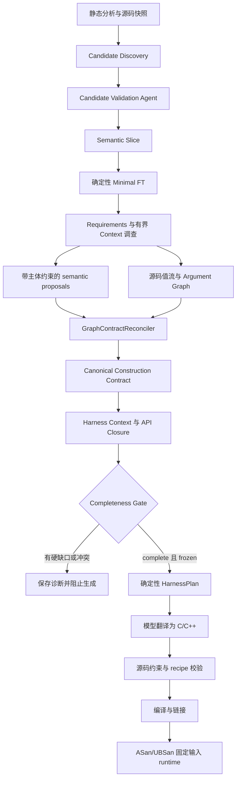

# 当前框架、验证证据与不足

日期：2026-10-01。代码基线为本地 `v0.2`，生产源码 fingerprint 为 `19fbf2ecdba1332e7aae649ea8065267ba1ad8b1da6c85d376f89cb64b16326b`。本文描述当前实现，不把历史版本的实验成绩归到当前版本。

当前系统已经形成以显式契约驱动的 harness 生成链：框架维护可追溯的候选、源码证据、资源身份和构造方案，模型调查语义并选择提案，冻结后由独立模型把 HarnessPlan 翻译成代码。它在若干开发样例上能完成编译和 sanitizer runtime，但仍是研究原型；尚无足够证据证明复杂 API 的重复稳定性或跨项目泛化。

## 1. 两条入口与整体流程

当前推荐研究入口为 `context-generate`，其上游链路如下：

这是职责示意图。实际 Context loop 会在调查轮次间重算图、契约、Closure 与 Gate；没有先永久完成 Graph、再只执行一次 Gate 的假设。

旧入口 `generate` 保留 `FunctionTriplet → Stage 1–4`，供已有 demo、baseline 和历史反馈实验使用。旧 Stage 1 编函数文档、Stage 2 编结构 snippet、Stage 3 拼 rough code，旧 Stage 4 仍包含 `load_protocol_ir → reconcile_protocol_ir → protocol_contract_projection`。这些不是新链的必经阶段。新 Stage 4 位于 `context_generation/stage4.py`，只接收冻结 Plan，不加载 legacy ProtocolIR 或 legacy FT catalog。

## 2. 各层负责什么

### 2.1 静态输入与 Candidate Discovery

`sfg_builder` 以 tree-sitter C parser 抽取函数、声明、结构体、opaque handle、callback typedef、访问线索等。完整 SFG 路径还可运行语义标注和结构流图分析；最新 targeted smoke 和 blind worker 使用 parser-only artifact，annotations、flows 与 SFG 可为空。因而新链不强制依赖旧结构流图中的 ISF/PRF/HPF 分类结果。

`entry_candidates.py` 建立独立候选目录。broad 策略保留函数假设，以 pointer、byte-like 参数、context、返回资源、访问线索及现有标注排序；预算未选中或只有声明的候选保留 deferred reason。legacy 策略按旧 ISF 标注选工作集。候选发现不等于确认入口，也不构造 FT。

这里仍有函数名和长度参数名启发式，例如 parser-like name 与 length-like name。它们只用于候选信号和优先级，不是 buffer extent、CORE inclusion 或 ownership 的证明。不能把后续 Graph 的值流约束解释成整个框架已经完全消除了名称启发式。

### 2.2 Candidate Validation

Candidate Agent 针对一个候选，通过受限只读工具调查实际外部输入与处理行为，给出 accepted、rejected 或 unresolved 及源码 evidence。模型只能提交有结构的决策，工具记录由框架签发并保存 trace。

这一层回答“能否作为 anchor”，不回答“完整 harness 怎么写”。accepted 后仍需 Slice 和 Context 验证。声明缺失、预算耗尽、证据不足和 provider 错误不能转成语义 rejected。

### 2.3 Semantic Slice 与 CORE 边界

Slice 区分 CORE、SUPPORT、EXCLUDE、UNRESOLVED。当前 native terminal 选择 source-issued `choice_id`；角色、reason 与关联 evidence 由框架展开，再经严格校验。非 anchor CORE 需要可重放的 inclusion proof，例如写入 anchor 实际读取字段、anchor 使用其处理结果、消费与输入相关的 anchor 返回字段。

纯 wrapper 只有调用关系或 byte-pointer signature，不能因此进入 CORE；当前 source effect 规则也不会仅凭这种兼容性把它签发为 SUPPORT。EXCLUDE 仍是模型的语义选择：读到完整源码使该选择可提交，不自动证明其行为无关。无法证明的 API 保持 UNRESOLVED。

CORE proof 只覆盖有限源码关系，不证明同类型参数一定指向同一运行时对象，也不证明该 API 必须执行。函数名相同、共享类型和邻接调用关系均不足以替代 runtime identity 与 lifecycle 证明。

### 2.4 确定性 Minimal FT

`MinimalFTBuilder` 不调用模型，不重新扫描仓库。它校验 Slice 与 snapshot，原样投影 CORE，保存 support candidates、关系、未知依赖和 excluded functions，支持 1 至 N 个 CORE。

Minimal FT 是语义核心与调查边界，不是完整可执行 API 集合。SUPPORT 此时还是候选；FT completed 也不意味着参数、cleanup、callback 或调用顺序已经闭合。legacy comparison 仅用于诊断，不成为新生成链的可执行依赖。

### 2.5 Requirements、Context Agent 与 API Closure

Requirement Builder 根据冻结 FT 和声明产生十类问题：input binding、argument construction、buffer length、lifecycle、return semantics、ownership、call order、callback、state、support decision。每条 requirement 保留精确主体、父依赖和 evidence。

真实模型默认按同一函数分组调查，减少重复读取与模型往返；single 模式保留为 baseline。对同一确切 API 的重复 support 问题合并，已经取得的 evidence 复用，工具输出采用初始 registry 加 delta，而不是反复发送完整目录。

Context 可以在有界范围发现 FT 外 creator、cleanup 或其他支持 API。发现、签发候选、选择 required/optional，以及加入实际 Closure 是不同步骤。required API 激活后还要调查其自身参数和必要契约，不能仅记录 API 名字就认为依赖闭合。

API Closure 单独发布 CORE、required support、optional support、排除范围与证据绑定。必需 API 未解析或自身义务未解决会阻止生成；optional 候选不自动进入执行计划。

### 2.6 Subject Effect 与提案主体约束

SUPPORT registry 使用实际源码 effect：pointer return、out-parameter write、parameter release、写入目标读取字段，以及 callback processing/registration。每个候选绑定 parent 和具体参数、return 或 pointee，并保存 API 参数、pointer depth 与 fields。

模型只能在现有 source-issued 候选中选择语义用途。construction、state 和 API role 组合受到约束，dependency 由事实选择推导，并在 replay 与 Closure 中重新核验。参数 A 上证明的 setter 不能用于参数 B；cleanup effect 也不能作为 input construction 的替代标签。

这些候选明确保留 `necessity_proven=false`：机制存在不等于需要调用，也不等于对象已经分配或 ownership 已经确定。有限 AST 关系不能替代路径语义证明。

### 2.7 值、资源与调用状态分离

| 契约 | 回答的问题 | 不能替代的证明 |
| --- | --- | --- |
| Value / argument | 参数值从哪里来 | ownership、有效期、必需调用 |
| Resource identity | creator-return/out origin 对应哪个对象 | 对象此刻是否已 feed/reset |
| Ownership | owned、borrowed、transferred、static，以及谁释放 | 参数的具体构造表达式 |
| Invocation state | 哪次调用前必须 init/feed/reset | 一个新 resource identity |
| Input representation / flow | fuzz bytes/size 经何种路径到达 CORE | 任意 buffer 参数都是真实 fuzz root |

例如 shared-context 的 acquire、supply、parse、dispose 共享同一 resource identity；parse 前的 input_fed 是 invocation precondition，不应产生第二个生命周期身份。

ownership 主体由声明签发为 PointerParameter、PointerReturn、OutParameterPointee 或 ResourceObject。scalar 参数与 scalar return 不允许伪造 ownership 主体。out API 的 `T **` cell 和它产出的 `T *` pointee 独立：cell 传地址，pointee 有对象 lifecycle；Canonical argument view 使用独立 `pointee_resource_id`，不把 cell 当作对象 consumer。

input/constant/callback 不能携带任意资源 origin。origin 枚举按主体 pointer depth 等声明约束限制；允许的类型关系仍不自动证明某一调用实例实际使用该 origin。

### 2.8 Argument Graph 与 Canonical Construction

Argument Graph 把参数、局部值、creator return/out origin、alias、struct field、cleanup 和 state 关联成可重算依赖图，产生候选 recipe 和具体 hole，例如 `creator_argument_missing`、`argument_origin_ambiguous`、`out_parameter_origin_unknown`。它避免把所有失败压成笼统的 argument unknown。

`GraphContractReconciler` 同时消费机械候选、已经接受的 semantic proposals 和参数语义范围约束，形成唯一 Canonical Construction Contract。它按 recipe 内容与运行时 origin 区分等价性，递归检查 creator 参数依赖。

| 情况 | 当前处理 |
| --- | --- |
| 唯一图 recipe 与 semantic proposal 一致 | resolved，记录 agreement |
| 多个同等机制、同一 origin 的 recipe | 规范化等价类，避免重复真相 |
| 多个不同 runtime origins | 不凭 API/type 标签合并；需精确 identity，否则 unknown/conflict |
| 图与已验证 semantic recipe 矛盾 | conflict，阻止活跃参数进入 Plan |
| 只有图的唯一可验证 recipe | 可投影为 construction；其他语义义务仍独立检查 |
| 只有可接受的 semantic recipe，图未重现 | 某些种类可 resolved，但保留 `semantic_recipe_not_reproduced` 诊断 |

最后一行是实际边界：当前实现不是“所有 resolved 都有静态 Graph proof”。semantic-only 仍可能作为合法来源；Gate complete 不能宣传成全部参数都由值流机械证明。不同 recipe 类型的接受边界及补充证据规则仍需进一步统一。

支持的构造子集包括 fuzz bytes/size、numeric constant、stack storage/zero init、递归 creator call、out parameter storage/call、resource reference，以及有界 derived scalar。有限 scalar IR 支持 fuzz_size、constant、min 和受界限检查的 add/subtract，不允许模型随意输出 C 表达式。

Graph 可读取已签发的 excluded caller body 作为证据，例如从调用者重现 `min(size, bound)`；Plan 仍禁止调用 excluded API。该策略重现 harness 的输入适配，不断言 caller 参数原本就是外部 fuzz input。

### 2.9 Input binding 与 Completeness Gate

同组 buffer_length 与 input_binding 复用一次 buffer/extent、NUL 和 binary-zero 选择，避免模型在不同 facts 中提出两个长度。单位与 element type 仍是独立语义；矛盾被保留为 diagnostic，Gate 阻止生成。

External Input Flow 从 fuzz bytes/size，经有限字段、feed、callback 或 scalar adapter 路径追踪到 CORE。CORE 不能仅因函数签名接近 parser 就被认作有 fuzz 输入；没有根或传播路径会形成硬缺口。

Gate 重算证据、活跃参数构造、Closure、ownership/lifecycle、return、callback、资源身份与 hard ordering。存在错误时 status=invalid；存在未满足硬义务时 incomplete；均没有时 complete。soft unknown 保留为诊断，不等同于 mandatory 问题已被忽略。

只有 `generation_allowed=true` 且 Context `frozen=true` 才允许生成。加载时再次验证 FT/Context/Closure 身份和摘要、已索引 live source 的 body/声明、发布文件及原 Gate 输出；不能仅修改保存的布尔值绕过 Gate。

### 2.10 HarnessPlan、代码翻译和验证

HarnessPlan schema 2、policy `frozen-context-harness-plan-v8` 是确定性构建产物，消费三份冻结输入及重算报告。它保存 input policy/transforms、精确 API/type declarations、canonical recipes、资源实例、create/init/CORE 顺序、preconditions、callback policy、结果处理和 cleanup。

新 Stage 4 模型只看到 Plan 和翻译指令，没有源码 body 或仓库查询工具。它不能重新发现 API、修改 canonical recipe 或创建新 Plan。plan digest/ID、C/C++ linkage、每个 invocation 的调用点、参数绑定、长度关系和 cleanup 受到后续源码 validator 与 recipe validator 检查。

generic build adapter 编译目标库和 harness，链接 smoke driver，并启用 ASan/UBSan。runtime 使用空输入、单零字节、单 0xff、`{}`、`a\0b` 和 0–255 字节序列六个固定输入，启用 leak 检查。`context-generate --runtime` 是 sanitizer replay，当前记录 `fuzz_executed=false`，不是持续 fuzz 或 coverage 优化。

## 3. Artifact、恢复与实验身份

每层保存独立文档与 trace，避免把完成状态折叠成单个总分。

| 路径或产物 | 内容 |
| --- | --- |
| Phase 1 functions/types | 源码快照、函数与类型身份 |
| candidate_discovery | 所有入口假设、优先级、deferred reasons |
| candidate validations / semantic_slices | 决策、源码 evidence、模型工具对话 |
| minimal_fts | Minimal FT、源 Slice 摘要、未知依赖 |
| harness_contexts | requirements、facts、argument graph、canonical contract、Closure、completeness、调查 trace |
| context_generations | HarnessPlan、prompt/response、harness、代码验证、build/runtime 与摘要 |
| native registration / freeze | 生产与运行脚本摘要、模型配置、预算、样例和调度身份 |

Resume 要核对配置、版本、输入和输出摘要；成功恢复可以零模型调用。Resume、事后配对重投影和 fresh native 是三种不同实验，报告不能把前两者算作新模型成功。

provider 层支持 DeepSeek 和 OpenAI-compatible 配置，保存实际响应模型与 tokens，区分 HTTP 400/401/429/5xx、timeout、tool parse/schema 错误和本地预算停止。malformed 历史 tool arguments 只在发送副本中 normalization 为合法 JSON，原始 trace 保留；不会执行被拒绝的工具或接受其语义。

生产源码、评测脚本和样例版本应分别冻结。当前默认依赖深度 2、最多 16 个发现 API、Context 24 model calls/64 tools/96k source chars/3 completeness passes/1 terminal repair。相同 ceiling 不表示相同实际成本；早退、timeout 和不同 CORE 大小都会影响实际 tokens。

## 4. 目前有哪些验证证据

最新完整离线回归为 **410 passed**，依赖检查通过。离线 Fake/Recorded tests、明确 fixture facts 和 reference harness 验证机制与边界，不能当成模型能自动获得契约的证据。

本次提交另从暂存区导出独立快照，确认 Python 实际导入该快照中的包，并核对 175 个生产/运行脚本与最终 native 归档完全一致。快照未复制 `.env` 或本地 artifacts，全量回归 **410 passed，70.64 秒**。测试后仅更新本文的验证说明，生产代码没有变化。

提交检查保留上游固定目标源码的原始字节与许可证；第三方文件存在原有行尾空白和 EOF 空行，不为格式检查修改评测 source hashes。自有源码、测试与文档的 whitespace 检查通过；`.env`、凭证和本地运行 artifacts 不进入提交。

最新十次 native 分属三个 production fingerprints：

| 冻结版本 | 样例数 | Slice | Context | 编译 / runtime | 解释 |
| --- | ---: | --- | --- | --- | --- |
| 首版 Subject Effect | 6 | 6/6 | 4/6 | 4/6 | bounded scalar、creator-with-args、out-parameter、owned-return 成功 |
| 中间约束版 | 3 | 3/3 | 0/3 | 未进入 | shared、callback、owned；证据 enum 误拒绝、malformed JSON 和 timeout |
| 最终修正版 | 1 | 1/1 | 1/1 | 1/1 | shared-context，零硬缺口，六个固定输入通过 |

最终 shared-context 12 次 Context model calls、27 次工具调用；整链 19 个成功响应、275,098 tokens。模型翻译代码一次；resume 零调用。此 fingerprint 没有重测其他五类，不能称其“六类成功率 4/6”或把三批合成稳定性成功率。十份 FT 未将 usage 纳入 CORE，支持边界改善，但不能证明任意 wrapper 都已正确裁剪。

历史独立盲测 V2 在旧 fingerprint 下完成 240 次：Slice 127/240、Context 0/240，104 次受 429 影响；服务恢复后的暂停复测完成 52 次，Slice 45/52、Context 0/52。这些不能推断当前代码必然失败，也不能被最新开发 smoke 覆盖。它们明确表明泛化尚未建立。

历史 cohort 的失败已经参与生产改进，此后不能继续把同一组样例的新运行当作未见过的 blind evidence。最新定向 smoke 是 Development / Regression。blind worker 使用明确 anchor，只评价给定入口之后的 semantic pipeline；不报告全项目 Candidate recall。

逐次预算、真实响应、失败记录、三个源代码归档与审计见 [Subject Effect / Binding 报告](SUBJECT_EFFECT_AND_BINDING_REPORT.md)。盲测方法和历史结果见 [泛化评估报告](BLIND_GENERALIZATION_EVALUATION.md) 与 [暂停复测报告](BLIND_GENERALIZATION_RETEST.md)。

## 5. 当前不足与影响

### 5.1 Context 的语义闭合仍是主要瓶颈

模型即使读到源码，也未必稳定选择正确的 return semantics、ownership、init/feed 区分、cleanup 和 support necessity。同一 recipe 的 construction resolved 不能替代这些独立义务。首批 shared 构造闭合但仍被 call order 与初始化义务阻止，说明剩余失败往往发生在层间语义边界。

框架目前也有误拒绝风险：中间版把“必须有主体证据”收紧为“只能有主体证据”，实际拒绝了合法补充 evidence。最终已修复该例，但这不证明其他 schema/subject 组合不存在过严或过松问题。应继续使用明确反例与原始 native trace 审计。

### 5.2 callback 还没有形成稳定端到端能力

ABI 可解析不等于 callback harness 可构造。userdata 的 creator/stack/zero-init、registration、字段初始化、保留时间、ownership 和 callback 输入路径需要同时匹配。首批和中间版 callback 均 incomplete，最终版本没有 callback native 成功证据。

当前 stub policy 也不证明 pull reader、custom allocator、返回计数或保留指针等 callback 的完整行为语义。任意返回值、EOF、负数错误、内存提供和计数更新，不能仅凭签名自动构造。

### 5.3 机械分析是有限的 C 源码子集

局部 straight-line 值流、有限 alias/field 和有界调用委托可以重算；复杂分支合流、循环、跨过程指针变换、逃逸、宏展开、条件编译、外部库实现和未知布局仍可能产生 hole。核心 parser 使用 C grammar；代码输出可为 C++ 并不意味着目标 C++ 的模板、重载、RAII、异常等已经得到等价支持。

签发 CORE/SUPPORT proof 证明有限 source relation，不能声称形式化证明所有路径、必要性、同一运行时实例或语义正确性。错误 missing 与准确 conservative missing 需要分开评估。

### 5.4 Plan 的表达能力仍小于 Graph

Plan 支持递归 creator 参数、out storage 和有界 scalar，但一般非零 aggregate/field 初始化、任意表达式和完整 ABI adapter 尚未统一下沉。当前每个 invocation 的 calls_per_input 为 1，模型指令禁止 target-call loop；重复 feed、重复 CORE、refcount 次数及复杂多实例 schedule 不能假装由函数集合表示。

重复/重载符号需要显式 ABI adapter；cleanup 与活跃调用交错会被拒绝，不能表示一般分阶段生命周期。多来源、同类型多对象或多个 creator 调用实例也容易触发 identity ambiguity。遇到这些情况必须诊断并停止，不能用“多调用一次”填补语义。

### 5.5 生成和运行检查仍有语义盲区

源码 validator 是受限语法/绑定校验，不是任意 C/C++ 的语义等价证明。sanitizer 能检测实际执行路径上的部分 memory/UB/leak 问题，但不能保证全部 error paths、长期资源增长、真实输入消费或非崩溃输出正确。

六个固定输入的通过证据较弱，尤其对状态机、错误清理、分支控制字节和 stream abstraction。新链目前没有形成固定预算的长期 fuzz、目标限定 coverage、reference 差分或正确性 oracle 闭环；旧 pipeline 的反馈和 coverage 机制不能自动算作新链能力。

### 5.6 模型协议与成本尚不稳定

source-issued choices、分组问题、registry delta 和 Graph/Canonical 提示投影减少自由度与重复内容，但输出仍可能 malformed JSON、引用缺失主体证据，或在合法候选中选错用途。timeout 和预算耗尽也会阻止完整语义轨迹。

最新三批未出现 400/429，并有真实 normalization 后成功响应；不能据此认为供应商问题永久解决。最终版本仅一次成功，也不足以估计方差、成功概率、尾部成本或每类 token 效率。

### 5.7 跨项目实验和消融需要重新设计

开发 fixtures 是小型合成 C API，不代表现实库的跨文件、宏、build options 与完整 public API。明确 anchor 的实验没有评价入口发现 recall；缩小 source slice 与真实全仓库使用也不是同一任务。

现有 A/B/C ablation 脚本针对较早 construction/resource identity 投影设计，未完整拆除当前 Argument Graph、Canonical Reconciliation、External Input Flow 等新层。因此不能直接把今天的 A/B/C 当作最新完整架构的因果消融，需要重新定义干预与检查不变量，再冻结新独立样例。

### 5.8 工程接口仍处于演进期

旧 Stage 1–4、FunctionTriplet、ProtocolIR 与新 Context/Plan 链同时存在，维护入口、配置、模型 transport 和历史兼容的成本较高。应继续明确 baseline 生命周期，不通过自动降级掩盖新链失败。

多个契约的原始 facts 与派生视图仍保留，必须持续核验投影和摘要一致性；Canonical 是 construction 的统一入口，不等于所有 semantic facts 已合并成一种 schema。当前本地 schema 子集校验器不实现 JSON Schema `contains`，主体 evidence 成员条件由独立 semantic validator 强制；后续需要完善能力或明确边界。

branch 名为 v0.2，而 pyproject 的 package version 仍为 0.1.0；目前是开发分支身份，不应解释为已经发布 0.2 软件包。实验 artifacts 被 gitignore 排除，报告中的本地原始 trace 链接在纯仓库 clone 中不可用；可共享复现包还需单独归档分发。

## 6. 后续开发的验收标准

| 优先级 | 工作 | 可检查的完成条件 |
| --- | --- | --- |
| P0 | callback userdata/construction/lifetime 闭合 | 至少覆盖 creator、public stack object、registration 与 pull input 的独立端到端样例；误绑定与过早释放被拒绝 |
| P0 | semantic-only 与 Graph/subject/role 边界 | 每类 recipe 的接受、矛盾和误拒绝有明确规则与反例，诊断不被静默覆盖 |
| P1 | 冻结最终版并做预算匹配重复 | 六类各 5–10 次 fresh，全部失败进入分母，固定预算、工具链、模型配置，记录 gap、calls、tokens、compile/runtime |
| P1 | 扩展可执行 schedule | 先表示必要 invocation multiplicity、分阶段 lifetime，再支持 repeated feed/CORE/refcount；保留拒绝歧义的负例 |
| P2 | 加强 runtime 与 semantic oracle | 错误路径、状态序列、反复调用资源增长、reference 差分与目标限定 coverage 分开评价 |
| P2 | 新独立跨项目 cohort 与消融 | 重新冻结生产/评测/样例；入口 recall 与给定 anchor pipeline 分开；已用于开发的 cohort 退出 blind 分母 |

这些是后续验收建议，不是本次已完成的工作。本次没有启动新的大规模 blind cohort。

## 7. 实现入口

| 模块 | 主要源码 |
| --- | --- |
| 候选与验证 | [entry_candidates.py](../harness_generation/entry_candidates.py)、[semantic_discovery](../harness_generation/semantic_discovery/agent.py) |
| Slice 与 source effect | [core_proofs.py](../harness_generation/semantic_slicing/core_proofs.py)、[proposals.py](../harness_generation/semantic_slicing/proposals.py)、[support_effects.py](../harness_generation/semantic_slicing/support_effects.py) |
| Minimal FT | [builder.py](../harness_generation/minimal_ft/builder.py) |
| Context loop / proposals | [loop.py](../harness_generation/harness_context/loop.py)、[terminal.py](../harness_generation/harness_context/terminal.py) |
| Graph / canonical | [argument_graph.py](../harness_generation/harness_context/argument_graph.py)、[reconciliation.py](../harness_generation/harness_context/reconciliation.py) |
| identity / invocation / input | [resource_identity.py](../harness_generation/harness_context/resource_identity.py)、[invocations.py](../harness_generation/harness_context/invocations.py)、[input_flow.py](../harness_generation/harness_context/input_flow.py) |
| Gate 与冻结加载 | [completeness.py](../harness_generation/harness_context/completeness.py)、[persistence.py](../harness_generation/context_generation/persistence.py) |
| Plan 与翻译 | [builder.py](../harness_generation/context_generation/builder.py)、[stage4.py](../harness_generation/context_generation/stage4.py) |
| 源码验证与运行 | [validation.py](../harness_generation/context_generation/validation.py)、[recipe_validation.py](../harness_generation/context_generation/recipe_validation.py)、[build.py](../harness_generation/context_generation/build.py) |
| 固定预算 smoke / blind | [smoke_argument_graph.py](../scripts/smoke_argument_graph.py)、[worker.py](../scripts/blind_eval/worker.py)、[evaluate.py](../scripts/blind_eval/evaluate.py) |
