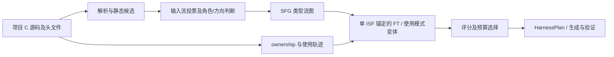

# FT 生成逻辑的跨项目泛化能力评估

评估日期：2026-09-28。代码基线：`7b3e421ebe45ecb0527b316d0c75209678d96bab`，以本地工作区代码为准。

## 结论

**当前实现具备跨 C 项目复用的架构，但跨项目泛化能力是有条件的，尚无充分证据证明它能在未知项目上稳定生成语义正确、成本可控的 FT。** 对“直接传入字节指针、类型可解析、资源创建与释放关系清晰”的小型 C API，支持较好；对大型共享上下文库、多输入 API、依赖调用历史的状态 API、回调驱动 API，支持明显减弱；C++ 目标项目不在当前 SFG 前端的有效支持范围。

最直接的限制集中在 FT 生成本身：

- **入口召回依赖语法与名称。** 等价的 `char *` / `char[]` 声明、`len` / `count` 名称可能得到不同结果；名称过滤甚至能否决受控模型给出的正向判断。
- **类型关联不足以表达可执行调用关系。** 同名但不同作用域的结构会被合并，共享结构的无关 API 会扩大 FT；函数数量上限通过丢弃整个 FT 控制成本，未解决最小调用集合的提取。
- **生命周期闭包依赖项目可见证据。** 返回值创建/释放模式有支持；out-parameter 模式可借助使用轨迹恢复，但在没有调用样例时可能无法闭包。
- **排序分数不能解释为成功概率。** 当前评分奖励结构规模和语义置信度，没有用跨项目真实结果校准；固定调用预算也不包含重试、回滚和前置语义分析。

综合判断：**适合继续作为可审计的研究原型；不宜宣称为开箱即用的通用 FT 自动生成方案。** 当前最该优先修复的是候选检测与输入绑定规则不一致、类型作用域缺失，以及大型 FT 缺少基于实际调用证据的裁剪。

## 范围与证据等级

这里的 FT 是 **Function Triplet**，不是 fine-tuning。评估主链路为：源码解析 → ISF/PRF/HPF 语义标注 → Structural Flow Graph（SFG）→ FT 抽取 → 排序与预算选择。Stage 1–4 harness 生成仅用于检查 FT 是否为后续生成提供了足够且可执行的信息。

本次执行了三类本地检查：

1. **当前代码实测：** 对 JSON、Expat、libxml2 执行静态扫描；运行 17 个受控 API 探针；用当前抽取器重新处理已有 Phase 1 产物。
2. **历史产物复核：** 检查 JSON 与 libxml2 的 functions、annotations、triplets、selection 和生成阶段结果；记录模型来源字段、版本及预算差异。
3. **文档证据：** 参考仓库的 Markdown 案例报告。其 benchmark 源码和完整原始取证已不在当前展示目录中，本次未独立重跑。

本次新增模型请求为 **0**，没有运行新的付费 LLM 生成或长时间 fuzz。受控探针让所有静态字节候选获得正向 stream 判断，其角色、方向及使用模式复核沿用内置 mock，因此只验证确定性规则的边界，**不能计算真实模型的准确率、跨项目成功率或漏洞发现率**。已有测试目录只保留缓存，本次没有把这些缓存当作可执行回归测试。

完整机器可读数据见 [FT_GENERALIZATION_EVIDENCE.json](FT_GENERALIZATION_EVIDENCE.json)，复现脚本见 [evaluate_ft_generalization.py](evaluate_ft_generalization.py)。脚本只读取目标源码与已有产物，临时探针目录自动清理。

## 实现中哪些部分有利于泛化



实现没有把 FT 抽取主体绑定到某个 JSON 函数名。ISF/PRF/HPF 分类、图遍历、opaque handle 边界、生命周期闭包和稳定 ID 都通过统一数据模型传递，因此换一个符合这些契约的 C 项目具有可行性。`SemanticAnalyzer` 可替换，prompt 提供函数体、签名与相关结构定义，能够处理未预设的 API 名称。

其他值得保留的能力包括：

- 其他 ISF 的入口角色会在当前锚点的遍历中屏蔽，避免替代入口无界扩展；null 节点作为哨兵，不用来连接无关结构组件。
- 使用模式不仅靠名称猜测，还记录同变量的 producer/consumer/cleanup、参数位置、条件及 normal/error 路径；语义复核只能在静态证据范围内裁剪和分组。
- 对 ownership 与 opaque resource 的闭包缺失有显式排除原因；对真实薄包装函数可记录结构替代关系，减少重复调用。
- FT ID 基于项目相对路径、函数名、规范化签名及可选变体键，选择清单绑定 FT catalog 指纹，利于迁移和审计。

这些是**实现的可复用性**证据；它们本身不能证明语义标注正确或目标项目适配成功。

主要入口：[pipeline.py](../sfg_builder/pipeline.py)、[triplet_extractor.py](../harness_generation/triplet_extractor.py)、[triplet.py](../harness_generation/triplet.py)、[ft_selection.py](../harness_generation/ft_selection.py)。

## 当前代码的实测结果

### 1. 三个项目的静态扫描

使用默认目录扫描，包含项目内测试、示例和已有 fuzz 源码；没有按实际构建清单限制范围。因此下表是扫描负担与候选规模，不是生产 API 的召回率。项目路径、Git revision、扫描源码 SHA-256 和完整 warning 记录已写入证据 JSON。

| 项目 | 扫描文件 | 函数定义 | 静态候选函数 | 字节流候选函数 | 含解析 warning 的文件 | 默认模式所需最少语义请求 |
| --- | ---: | ---: | ---: | ---: | ---: | ---: |
| JSON demo | 2 | 10 | 6 | 2 | 2 | 20 |
| Expat | 86 | 1029 | 576 | 426 | 32 | 3095 |
| libxml2 | 159 | 3522 | 2996 | 1467 | 131 | 10405 |

最少语义请求按代码预检公式计算：每个 stream 参数 3 次投票、每个 struct-related 候选 1 次角色判断，再加无法静态确定的结构方向判断；不含 usage review、重试和后续 harness 生成。SFG CLI 的真实模型请求默认上限为 300，**默认全目录扫描 Expat 与 libxml2 会在发起模型请求前因预算不足退出**。用户需要缩小源文件范围或提高预算，这已经构成项目级适配成本。

三个项目都能发现典型直接字节入口，如 `json_parse`、`XML_Parse`、`xmlReadMemory`。Expat 的 `XML_ParseBuffer(parser, len, isFinal)` 不携带字节指针，因此没有 stream candidate；要覆盖这一入口，需要表达“获取内部缓冲 → 拷贝输入 → 提交解析”的协议，单函数 byte-pointer 锚定模型不能直接涵盖该路径。

parser 会保留含 tree-sitter error 的文件中的可恢复记录。warning 多不等价于同等数量的函数错误，但意味着函数、宏修饰声明和类型是否完整需要额外核验。尤其不能把被解析到的函数数量当作正确率。

来源：[parser.py](../sfg_builder/parser.py)、[candidates.py](../sfg_builder/candidates.py)、[SFG 预算预检](../sfg_builder/pipeline.py)、[SFG CLI](../sfg_builder/cli.py)。

### 2. 17 个受控探针

探针保留具体源码，改变 API 的单个特征。表中“eligible”只表示 FT 通过当前排序资格判断，不表示 harness 已可执行。探针编号对应 evidence 中的顺序。

| # | API 特征 | 观察结果 | 泛化含义 |
| --- | --- | --- | --- |
| 1 | `const char *data, len` + Context | 有 FT，有输入长度绑定，eligible | 直接字节接口的正对照 |
| 2 | `const void *data, len` + Context | 有 FT，有绑定，eligible | 常规 void buffer 可识别 |
| 3 | 将 #2 的 `len` 改为 `count` | 函数仍为结构候选，但没有 ISF / FT | 有效字节输入在模型判断前被漏掉 |
| 4 | 将长度改为 `byte_count` | 有 FT，eligible，但没有输入长度绑定 | 静态候选与 FT 长度规则不一致 |
| 5 | `const signed char *data, len` | 有 FT，eligible，但没有输入长度绑定 | 两处 byte type 白名单不一致 |
| 6 | 将 #1 的 `char *data` 改为 `char data[]` | 没有 ISF / FT | 未对 C 参数数组的指针语义做归一化 |
| 7 | 输入字节参数名改为 `path` | 正向 oracle 仍被名称规则否决，无 FT | 命名约定覆盖语义证据 |
| 8 | `header, header_len, body, len` | 只生成 `header ↔ len` 绑定，eligible | 首个 stream 与首个白名单长度被错误配对 |
| 9 | `context_init` 原地写字段，`feed` 读字段 | FT 包含 init 与 feed | 能找相关函数，仍需后续计划表达初始化先后 |
| 10 | 仅返回标量的 `parse(data, len)`，默认模式 | 有单函数 FT | 扩展模式支持无结构入口 |
| 11 | 与 #10 相同，`paper_minimal=True` | 无候选、无 FT | demo 模式会系统排除无结构入口 |
| 12 | 将 #1 源码放入 `.cpp` | 没有扫描到文件、没有 FT | C++ harness 输出能力不等于 C++ 目标分析能力 |
| 13 | 两个 `.c` 各自定义不同布局的 `State` | 合并成一个类型，FT 混入另一个文件的 inspect | 类型缺少翻译单元/声明作用域身份 |
| 14 | 同一 Context 上增加 21 个独立 inspect API | 22 函数 FT 被整体丢弃 | API 扇出导致入口消失，未裁剪出最小调用集合 |
| 15 | opaque handle 通过 out-parameter 创建，无 caller | feed FT 无生命周期闭包，ineligible | standalone API 定义不足以恢复该模式 |
| 16 | 为 #15 增加同变量 open/feed/close caller | 产生 1 个 usage pattern；feed FT 含完整生命周期，eligible | 使用轨迹扩展有效，但依赖样例是否存在 |
| 17 | opaque handle 返回值创建 + free | 无 caller 仍能闭包，eligible | 已支持的返回值生命周期正对照 |

尤其值得处理的是 #4、#5、#8：当前排序允许它们进入候选池，却未提供完整或正确的输入绑定。后续模型可能从源码自行补全，也可能误用这些提示。这里已经证实的是 **FT 表达和资格规则的缺口**，没有执行 harness 生成，因此不将其直接记作运行时错误。

### 3. 当前抽取器重算已有 Phase 1

重算使用当前 `synapseflow-function-triplet-v5`、每 FT 最多 20 个函数，再按最多 20 FT / 300 次基础生成调用 / 20 结构单元进行选择。它检验当前确定性下游逻辑，不会重新验证历史角色标注。

| Phase 1 数据来源 | 当前保留 FT | 因超过 20 函数丢弃的变体 | 排序 eligible | 预算内选中 | 基础调用估计 |
| --- | ---: | ---: | ---: | ---: | ---: |
| JSON 历史目录 | 2 | 0 | 2 | 2 | 14 |
| libxml2 xmlIO 真实决策 replay | 10 | 0 | 10 | 10 | 222 |
| libxml2 全库旧目录，语义来源字段缺失 | 1129 | 343 | 1118 | 18 | 300 |

全库旧数据的 1472 个变体中，343 个（23.3%）因过大被排除；保留的 1129 个中有 984 个单函数 FT（87.2%）。这不是“87.2% 的入口只需一个函数”的真实结论：输入标注未经重新验证，部分入口没有结构流，简单候选仍需独立语义审查。当前下游在固定预算下能约束选择规模，但复杂依赖入口可能在选择前已经消失。

三个数据集的根路径变化检查均得到相同 FT ID。全库重算、评分及第二次路径检查合计约 109.5 秒；该时间不包含新的源码语义分析或模型调用。JSON 当前抽取结果为每 FT 2 个函数，与旧 catalog 的 4 个函数不同，进一步说明历史版本不能直接代表当前行为。

JSON 与 libxml2 xmlIO 的重算说明：在已经准备好的 Phase 1 数据上，同一套抽取逻辑可跨项目运行。全库结果同时用于观察函数上限的影响。目录根路径变更后的 ID 比较仅验证产物路径规范化，不构成重命名 API 或未知项目的语义泛化实验。

## 历史证据如何解读

### JSON：证明小项目路径成立，不能给出跨项目成功率

本地 `artifacts/json_parser` 有两个 parser FT，历史版本每个包含 4 个函数、2 个结构单元，基础调用估计为 9；两个 `pipeline_result.json` 均记录所有阶段与 fuzz smoke 通过，分别发生 7 次和 0 次回滚。README 也记录了真实 API demo 的端到端验证。但这一历史目录的 `annotations.json` 没有 `semantic_backend` 字段，**本次不能仅凭它的 `status=ok` 认定其标注全部来自真实模型**。当前代码要求真实语义来源，默认生成路径会拒绝这种无法验证来源的旧产物。

`json_parser_pre_fix` 的四个 FT 曾包括 `default_alloc`、`default_free`，后来目录收敛为两个 parser FT，体现候选与类型规则变化能显著改变结果。两个目录是开发过程记录，不是随机独立样本；也不能据此估计修复后的总体准确率。

### libxml2：跨库复用有证据，但全库与窄范围必须分开

全库旧产物 `artifacts/libxml2_20260923` 的 `triplets.json` 为 **1,277,413,396 bytes，约 1218.2 MiB**，包含 1472 个历史 FT。其旧选择配置未设置函数数与调用预算上限，选择 1461 个 FT，基础生成调用估计合计 361922。最高分 FT 之一为 `xmlDictAddQString`，包含 254 个函数、249 个结构单元、估计 506 次调用。该目录缺少语义 backend 字段，且方向 prompt 为旧版，**这些数字用于说明规模失控的历史形态，不用于评价当前真实模型质量**。当前 rank/generate 的默认 catalog 上限是 128 MiB，原 catalog 不能直接按默认配置消费。

真实模型的可核查证据来自 **xmlIO 子范围**：原 Phase 1 产物标明 `semantic_backend=llm`，共 55 个候选、174 条成功 decision trace，其中 13 条为静态方向判断，其余 161 条为模型决策记录。后续 replay 目录共享这些记录；它们不是多次独立模型实验。最终 replay 产物为 33 个结构相关候选、10 个 ISF / FT，usage pattern 为 0，ownership relation 为 10。

旧 replay 的 24 个 FT，经过结构过滤变为 12 个，再经过 path/URI 规则变为 10 个。这有助于减少偏离内存输入的入口，也说明前置规则对跨项目目标分布影响很大。该真实样本的扫描文件为 xmlIO.c 加 45 个头文件，不能称作 libxml2 全库的真实 LLM 评测。

最高分 `xmlOutputBufferWriteString` 的 FT 有 17 个函数、18 个结构单元，基础调用估计 38，分数为 0.917254。一个历史 Stage 4 的第 15 次 attempt 通过 intermediate/compiler/linker/runtime 并获 `stable_promoted`；该 outcome 明确记录 `fuzz_smoke_completed=false`。另一次 rerun 的 pipeline 以 `40/40` 调用预算耗尽退出，Stage 4 多次拒绝调用扫描范围内仅声明的 `xmlBufferCreate/xmlBufferFree`。这说明高结构评分不保证低成本生成成功。

此外，该成功目录使用独立准备的 `build/hg_xmlio_export_static.c` 和预构建 `build/libxml2.a` 参与链接。它证明经适配后的路径成立，未证明框架能自动恢复大型项目的构建环境。当前函数可调用性检查还会将扫描范围内“仅声明”的 API 判为不可链接，外部 archive 的真实符号可用性需要进一步与 build manifest 对齐。

本次重算结果与上述历史 FT 的版本、来源和预算不同，不能直接作前后成功率比较。

### Markdown：补充异类接口案例，证据强度有限

[现有案例报告](CASE_STUDY_MARKDOWN_WASM.md)记录了 `md_parse`、`parseUTF8` 路径及独立 reference harness 的 finding 归因，同时指出 ranking 没默认选中自然 parser 入口、callback typedef/table 语义存在偏差。它为回调型 C API 的适配提供了案例证据，但本次没有对应完整源码与产物，且指定入口带有人为干预，不能作为无人干预的跨项目泛化成功样本。

## 造成泛化边界的机制

### 输入识别：不可恢复的前置过滤与不一致的绑定规则

静态 stream detector 接受限定 byte type；void 指针还必须有白名单长度及位置/名称证据。类型 alias 解析能帮助普通 typedef，但数组参数没有转换为 effective pointer。投票层对 filename/path/URI 名称硬否决；因此模型能力提升无法补救全部前置漏检。

抽取器另维护 `_BYTE_STREAM_BASE_TYPES` 和 `_LENGTH_PARAMETER_NAMES`，与候选模块不同：前者少了 `signed char`，后者少了 `byte_count` 等名称。`_bypass_semantics` 又直接取第一项 stream 和第一项 length，没有建立参数间的数据关系。多输入、长度指针、NUL 终止字符串、宽字符等契约无法统一表达。

改进应先统一类型/长度解析，再为绑定建立逐参数证据与明确的 `unknown` 状态；对实际 body 中的索引、拷贝和 callee 传参关系作配对，不靠列表顺序拼接。

来源：[候选规则](../sfg_builder/candidates.py)、[投票规则](../sfg_builder/voting.py)、[参数提取](../sfg_builder/parser.py)、[FT bypass 语义](../harness_generation/triplet_extractor.py)。

### 图表达：类型共享不能代替对象身份与调用协议

SFG 是类型级图，不是完整调用图或对象级数据流图。`TypeResolver` 以全局名称/alias 集合合并结构，探针 #13 证实不同文件中的独立类型发生混并。多结构输入输出使用笛卡尔积候选边；`BOTH` 方向被压缩为 input-only；inferred 标记目前主要区分多端点边，**`inferred=false` 也不代表实际调用关系已被证明**。

opaque handle 边界、owned producer 特判和真实使用模式已经缓解一部分扩大问题，但普通共享 context 上仍容易聚合大量 API。当前限制在闭包计算之后检查函数数，然后丢弃 FT：这能避免巨量 artifact，却会让复杂项目的入口不再进入候选池。应分别统计“入口被识别但过大”和“入口没被识别”，不能把剩余小 FT 的成功率当作整个项目的成功率。

应为类型引入声明来源与翻译单元身份，为对象补充 producer/consumer 绑定，用可执行使用轨迹裁剪最小依赖子图，将可选处理 API 作为变体而非共同义务。无实际 caller 的场景需要保守的调用前置条件合成。

来源：[TypeResolver](../sfg_builder/parser.py)、[FlowBuilder/SFGBuilder](../sfg_builder/graph.py)、[闭包与大小限制](../harness_generation/triplet_extractor.py)。

### 生命周期：支持范围取决于 ownership 与 caller 可见性

静态 ownership inference 以匹配资源类型为前提，再使用构造/释放名称、文档和 allocation origin 证据；parse-like 创建者还受调用链深度及节点预算限制。cleanup 形状或候选歧义会使配对失败。为 opaque consumer 选择的一对 producer/cleanup，在同类型多模式资源中也未必满足每个 consumer 的真实前置条件。

使用模式挖掘能恢复 out-parameter、引用计数、条件及错误路径，因此不能笼统认定这些功能完全不支持。其证据来自当前扫描范围内的函数体、直接调用与简单 alias 跟踪；跨函数状态、callback 间接调用、库外客户程序和未扫描的样例仍可能不可见。`paper_minimal` 又关闭 usage mining/review，所以默认 demo 成功无法证明这些扩展能力。

来源：[ownership.py](../sfg_builder/ownership.py)、[usage.py](../sfg_builder/usage.py)、[usage_semantics.py](../sfg_builder/usage_semantics.py)、[pipeline.py](../sfg_builder/pipeline.py)。

### 排序与验证：工程代理指标尚未完成跨项目校准

评分使用 input evidence、structural confidence、structural opportunity、harness readiness，以及可用时的 usage support。基础权重为 0.30/0.25/0.25/0.20，usage support 额外 0.20；只对可用项重新归一化。语义 confidence 混合模型自评与静态判断，结构机会奖励 PRF 数、结构数、文件数及边数，缺少 public-entry 优先、实际可构造性和历史成功率校准。

选择器先按绝对 marginal benefit，再按 base score 排序；benefit-per-call 只在后续比较中发挥作用，因此它不是按成本收益主导的优化器。基础成本为 `functions + structural_units + 3`，不包括 Phase 1、token 数、重试、回滚和构建适配。跨项目比较应测真实总成本。

Stage 4 的 FT API 范围约束、ownership 和 protocol helper 例外能减少任意调用，但也把 FT 漏掉的必需构造器变成生成障碍；protocol sidecar 的 reconciliation 已提供补充路径，却没有证明所有通用初始化与环境依赖都能自动补齐。prompt 中还有 xmlBuffer、FILE*/fd 等具体工程策略，需要在其他库上独立验证。编译/runtime gate 不能替代 ABI、生命周期和有效状态覆盖验证。

来源：[ft_selection.py](../harness_generation/ft_selection.py)、[stage4.py](../harness_generation/stage4.py)、[protocol_reconciliation.py](../harness_generation/protocol_reconciliation.py)、[prompts.py](../harness_generation/prompts.py)。

## 按目标项目形态的适用性判断

| 目标形态 | 当前判断 | 依据与限制 |
| --- | --- | --- |
| 小型 C parser，直接 bytes/length，返回结构 | 支持较好，但外部效度有限 | JSON 与返回值资源探针；真实项目样本少 |
| C 库的局部模块，构建 recipe 已准备 | 有条件可迁移 | libxml2 xmlIO 有真实标注和 Stage 4 通过记录，适配与重试成本高 |
| 大型 C 库，共享 context 类型、密集 API | 当前较弱 | 历史 catalog 膨胀及 22 函数探针；上限主要通过删除控制 |
| opaque handle，通过返回值创建 | 有限支持 | 有静态配对及生命周期闭包；名称/签名/歧义敏感 |
| out-parameter / refcount / 错误清理路径 | 依赖调用样例，有条件支持 | usage mining 有对应模型；样例缺失、间接调用和纸面模式关闭是限制 |
| 多输入、内部缓冲提交、状态协议 API | 当前较弱 | 多输入错配、XML_ParseBuffer 的无 stream 参数边界 |
| callback table / 外部 I/O / 环境依赖 | 当前较弱，缺系统实验 | Markdown 案例与具体生成策略；无法保证有效初始化及正常路径 |
| C++ 原生库 | 当前前端不支持 | 扫描仅 `.c/.h`，C grammar；`.cpp` 探针无输入文件 |

## 改进优先级与验证方案

**P0：修复确定性信息损失。** 统一候选检测与 FT 的 byte/length 规则；补齐参数数组语义；以数据关系匹配多个 buffer/length；为 unresolved binding 建立显式诊断与资格策略；按声明作用域区分结构类型。验收使用 #3–#8、#13 的变体及新名称，检查每个参数与长度的证据，而非只检查是否生成 FT。

**P1：从“共享类型闭包”推进到“可执行最小调用集合”。** 按目标构建范围建立 source/symbol manifest；保留必需构造、处理、清理序列，将非必需 API 独立为变体；从 out-parameter 与 caller trace 补全生命周期；让缺失依赖和超大闭包能够修复或拆分。需要单独报告目标入口丢弃率、辅助调用准确率、资源闭包正确率和实际构建适配时间。

**P1：让选择器使用经验证的目标价值与成本。** 增加公开入口与可调用性证据，将输入绑定、构造可行性和有效执行深度纳入排序；对 confidence 做外部标注校准；记录端到端请求/token/墙钟成本，预留重试预算。对结构规模奖励与收益/成本排序分别消融。

**P2：开展冻结规则的跨项目留出实验。** 建议至少 12 个独立 C 库，按直接解析、编解码、多状态 handle、out-parameter/refcount、callback、I/O 六类分层，每类至少 2 个；同库 fork 不算独立项目。冻结当前开发样本上的 prompt、阈值和权重，以 project 为单位留出，避免测试项目规则反向进入方法后仍被称为零适配。

正式评测应至少区分两条路径：完整自动候选发现与排序，以及人工指定入口后的 FT/生成能力；另记录构建 recipe、源范围裁剪、手写 wrapper 和 harness 修补的人工投入。每个目标运行至少 3 个独立模型采样，固定版本、工具链、请求/token 预算和 fuzz 时间。

核心指标及分母建议如下：

| 指标 | 定义 | 用途 |
| --- | --- | --- |
| 入口召回 | 自动识别的有效入口 / 人工标注有效入口 | 统计前置过滤损失，包括超大 FT 被丢弃的入口 |
| FT 依赖质量 | 对必需 API 集合与顺序约束的 precision/recall | 分离多带辅助函数和漏掉初始化/cleanup |
| 资源契约正确率 | 正确资源绑定、释放方式与路径 / 标注契约 | 发现 ABI、ownership、out-parameter 和状态错误 |
| 排序 Recall@K / 预算内收益 | 固定预算实际成功触达的有效入口 | 验证评分是否有目标价值 |
| 端到端有效 harness 率 | 经独立语义复核的有效 harness / 预定有效入口 | 防止只统计已选小 FT、编译成功或“无 crash” |
| 目标代码覆盖与成本 | target-only coverage、有效处理路径、总请求/token/时间 | 分离 harness 插桩与真实目标收益 |

基线应包括直接根据公共 header 生成、单入口生成、同一方法的 graph-only、usage/ownership 关闭、ranking 关闭及人工 reference harness。成本必须包含前置语义分析；source glob、人工入口选择和项目专用约束都应披露。finding 需独立归因，不能用 fuzz artifact 数量充当漏洞数。

## 复现与本次评估的边界

在项目根目录执行：

```bash
.venv/bin/python docs/evaluate_ft_generalization.py
```

脚本读取相邻的 `../libexpat`、`../libxml2` 及当前 demo，并检查 `artifacts/` 中列出的历史目录；这些目录被 Git 忽略，其他 checkout 不保证存在。缺少目录会记录为 unavailable。运行会覆盖本次证据 JSON，受控 oracle 探针不需要网络、凭据或编译器。

本报告没有人工标注的跨项目真值集、预算匹配对照、独立模型多次采样或新的端到端实验。因此结论应表述为：**当前方法有明确的跨库复用机制，也有已复现的泛化瓶颈；稳定的跨项目语义泛化仍待通过冻结规则、独立项目与完整成本的实验验证。**
