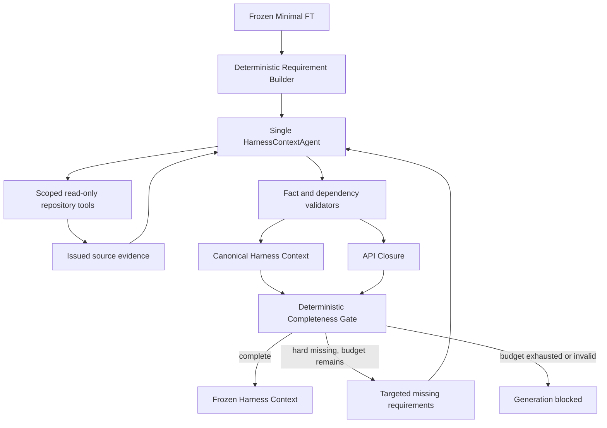

# Harness Context implementation report

实现日期：2026-09-28。本轮以本地 `v0.2` 工作区中已完成的 Minimal FT 为输入，实现到 Frozen Harness Context。没有生成 HarnessPlan 或 harness，没有调用 compiler、执行目标程序或运行 fuzzing；没有改动 Stage 1–4 实现、Semantic Slice 分类或 Minimal FT 构建逻辑。

实现具备确定性需求生成、有界证据调查、独立 API Closure、硬缺失拦截和可恢复 artifact。离线验收通过。真实 DeepSeek 已完成六组调查，但只有直接输入样例达到 complete；复杂样例保留 incomplete。最后一轮复测遇到 HTTP 402，因此不能声称最终版本的全部六组真实实测通过。

## 架构与职责



新增 `harness_generation/harness_context/` 下的 `requirements.py`、`models.py`、`evidence.py`、`tools.py`、`agent.py`、`loop.py`、`api_closure.py`、`completeness.py`、`persistence.py`、`cli.py` 和公开导出文件。顶层 CLI 只增加 `harness-context` 路由。复用已有 AgentModel、DeepSeek provider、BoundedAgentLoop、RepositoryTools、RepositoryIndex、JSON 原子写入和 run document persistence，没有另造 provider。

Requirement Builder 根据冻结 FT、Phase 1 参数/返回类型、相关类型声明、已有 relation 和 Slice evidence IDs 机械生成问题。问题包含来源 basis，不以函数名称推断生命周期角色。支持九类需求：`input_binding`、`argument_construction`、`lifecycle`、`return_semantics`、`ownership`、`buffer_length`、`call_order`、`callback`、`state`；额外的 `support_decision` 用于调查现有 SUPPORT 候选及明确未知依赖。状态限定为 `open / resolved / unresolved / not_applicable`。

CORE 始终等于上游集合。SUPPORT 的未知用途需要调查，可以保守 unresolved。新发现 API 只能成为 dependency proposal，由 validator 接受为 required/optional support，或保留 rejected/unresolved。FT ID 与 Closure ID 独立；Closure depth 由 `required_by` 到 CORE 的关系计算，不把工具搜索深度直接当成语义依赖深度。

## Agent、工具与证据

每次只调查一个 requirement。输入只有 FT 摘要、当前问题、相关 confirmed facts、相关工具 evidence、工具 schema、资源身份和剩余预算。框架先通过受限 `get_function` 提供当前函数体；源码放在 tool message，不能成为 system/user 指令。测试覆盖源码注释中的 prompt injection。

终止入口是原生 `submit_requirement_resolution`，强制当前 predicate、类型化 value、evidence IDs 和 dependency proposals。未知值使用 enum/null 或 unresolved，不能以自由 JSON prose 代替终止调用。一次 schema repair 只允许模型自己重新提交；参数身份、证据身份、ownership 和 dependency role 错误不做语义修复。补查保留具体 schema 路径和 validator 诊断。

工具复用六个既有查询，并增加 signature、struct fields、type usages、initializer/cleanup candidates、assignments、return usages、argument usages 查询。initializer/cleanup 查询只返回结构候选；同类型、名称和源码邻近都不能直接证明角色。查询限制如下：

- 函数读取要求当前授权范围内的 exact function ID；发现工具先返回真实 ID，再允许读 body。
- 类型/符号必须已出现在当前范围或相关证据中；源码 range 限于授权函数，文件路径验证仓库边界。
- 每个查询有数量、行数、字符数限制；新函数发现受全局数量与深度限制；EXCLUDE 不能被拉入 closure。
- Agent 工具表没有 shell、任意文件读取、网络、写入、compiler、执行或 fuzz 能力。

Fact 必须引用已签发、相关、未截断的当前函数源码证据。Dependency 还需要目标 API body、可核验的 discovery evidence、合法 parent、当前 snapshot 的身份和匹配的角色。validator 重新验证缓存中的事实与 proposal，不仅检查 JSON shape。

参数、返回指针、ownership field 和 resource type 与 Phase 1 对齐。callback 的非空签名还要与对应参数或 struct field 声明匹配；仅忽略名称、空白及注释，不猜 typedef 或调用约定等价。资源可以同时绑定 creator 返回值与 CORE 参数，但 lifecycle 必须一致。冲突的 ownership、输入、参数构造、长度、返回契约和调用顺序会被拒绝。

## Canonical context 与确定性完成条件

`HarnessContext` 保存 input、argument、lifecycle、ownership、buffer length、ordering、callback、state、return contracts，以及 facts、open requirements、dependencies 和 evidence IDs。它记录语义契约，不提前写 C expression。

三个 validator 分别检查事实合法性、Closure 投影和 hard/soft completeness。以下缺失阻止 generation：CORE 没有 fuzz input 路径、参数无法构造、context/owned return lifecycle 缺失、owned resource 不知释放 API、mandatory API 身份或可调用性未知、长度/NUL/字节约束未知或冲突、mandatory callback ABI/lifetime 未知、必需调用顺序不足。static CORE 保留原身份，同时报告 accessibility diagnostic。

`complete` 要求无 validation errors 且无 hard missing，才有 `generation_allowed=true` 和 `frozen=true`。`incomplete` 保留缺失；`invalid` 保留冲突或身份错误。没有 confidence score、名称特判或 LLM completeness judgement。

Optional logger/statistics 等 SUPPORT 未决可以是 soft unknown，不强制进入 required closure。Gate 产生具体 MissingRequirementTasks，后续只补查相关 requirement，复用已解决且无关的结果。SUPPORT 消费调用者资源时，资源引用问题回到其已有 construction/ownership requirement，避免产生无法执行的空 requirement ID 任务。失败的补查保留既有 grounded facts，仍保持 unresolved。

## 预算、CLI 与恢复

默认每个 FT 的预算：

| 项目 | 默认值 |
| --- | ---: |
| 每次 requirement 调查轮数 | 4 |
| 全局模型请求数，含 repair | 24 |
| 全局 repository tool 调用数，含 bootstrap/失败查询 | 64 |
| 新发现函数数 | 16 |
| dependency depth | 2 |
| 源码/证据字符预算 | 96,000 |
| completeness rounds | 3 |
| 单查询 reference 数 | 6 |
| 单 range 行数 | 80 |
| 单 evidence 字符数 | 12,000 |
| terminal schema repair | 最多 1 次 |

字符预算包含向模型重复暴露的相关证据及其记录开销，不只统计不同源文件的字节。未知/预算耗尽/工具范围耗尽/非法响应/provider error 都保守 unresolved。metrics 区分请求尝试数和已返回响应的 token 用量。

```bash
.venv/bin/python -m harness_generation harness-context \
  --artifacts artifacts/foo --provider deepseek \
  --model deepseek-flash --thinking disabled

.venv/bin/python -m harness_generation harness-context \
  --artifacts artifacts/foo --ft ft_example --resume
```

可按 exact FT ID 或 candidate/function ID 筛选，所有预算均有对应 CLI 参数。CLI 默认读 `DEEPSEEK_*` 环境变量；真实 smoke 使用既有脚本将本地 `.env` 中兼容的 `LLM_*` 凭证映射为 DeepSeek 环境变量，不记录凭证值。

Resume fingerprint 包含 FT/metadata digest、FT policy、Phase 1 source/functions fingerprint、requirement builder、prompt/schema/tool versions 与 digest、model/thinking/provider 配置、预算和当前 requirement descriptor。使用已有 publication/live-source 校验与原子写入。完整且兼容的 root 经当前 Gate 再验证后零模型调用、零 artifact 重写；部分结果仅复用 resolved/not_applicable requirement，open/unresolved 或失效项重新调查。

本阶段只在输入 artifact root 的 `harness_contexts/<ft-id>/` 写 requirements、facts、api_closure、harness_context、completeness、metadata，以及 root evidence/resolutions。每个 `agent_runs/<req-id>/` 保存 result/trace/evidence/metadata，并以 `attempt_000N` 保存历史和 execution index。root metadata 最后发布，包含各文件 digest。模型调用、工具调用、tokens、source_chars、discovered_functions、resolved_requirements、hard_missing、soft_unknowns、closure_size、required/optional support 数和 completeness rounds 均保存。

## 离线验收

最终运行 `.venv/bin/python -m pytest -q`：**187 passed**，其中 Harness Context 测试 **41 项**。`pip check` 无依赖冲突，`git diff --check` 通过；新增未跟踪源码和文档另行进行 whitespace check。

覆盖 direct parser、create/parse/destroy、ambiguous SUPPORT、owned/borrowed return、buffer 长度冲突、NUL string、mandatory callback 未知和错误 ABI、optional logger、FT 外 required support、预算耗尽、100 个同类型 API、非法 terminal/evidence/参数/CORE 修改、cleanup/init 角色误报、shared resource identity、契约冲突、provider failure、定向补查、完整/部分 resume、root 篡改/缺失 commit marker，以及 model/thinking/budget/builder/prompt/tools/FT 配置变化失效。Fake 只用于显式离线测试，不作为真实 smoke fallback。

## 真实 DeepSeek 实测

命令：

```bash
.venv/bin/python scripts/smoke_harness_context.py \
  --max-total-model-calls 48 --resume

.venv/bin/python scripts/smoke_harness_context.py \
  --max-total-model-calls 48 \
  --output artifacts/harness_context_real_20260928_02
```

模型配置为 `deepseek-flash`、thinking disabled，实际响应中的 served model 和 token counters 有保存。只把请求数上限从 24 提到 48；工具 64、发现 16、深度 2、字符 96,000、completeness 3 保持默认。

复用已有真实 Slice/FT：direct、hub、json、wrapper。另两组 smoke fixture 明确手选单一 CORE 并准备独立上游输入：owned-return cleanup、需要 FT 外 context creator 的样例。其上游准备不是新一次真实 Semantic Slice mining；Harness Context 调查才调用真实模型。没有为项目或函数名称添加实现特判。

第一轮完整六组响应审计见 [历史实测摘要](../artifacts/harness_context_real_20260928_01/summary.json)。这是改进前一版 prompt/反馈的历史结果，不等同于最终版本全部复测通过：

| 样例 | Context | 请求/真实响应 | 返回 tokens | hard missing | 停止原因 |
| --- | --- | ---: | ---: | ---: | --- |
| direct parser | complete | 6 / 6 | 32,375 | 0 | complete |
| context lifecycle / hub | incomplete | 35 / 35 | 206,497 | 21 | source budget |
| json_parser | incomplete | 17 / 17 | 146,781 | 46 | source budget |
| wrapper | incomplete | 22 / 22 | 150,724 | 27 | source budget |
| owned return cleanup | incomplete | 29 / 29 | 175,870 | 3 | completeness rounds |
| FT 外 required support | incomplete | 35 / 35 | 251,266 | 4 | tool budget |

六组均有真实 provider 响应、非零 token 统计和上游 byte digest 不变，审计通过。hub 识别了 create/destroy；owned-return 样例发现了 FT 外的 `node_release` 并加入 required support，FT 身份不变，但其顺序/资源契约仍未全部解决。专门的 FT 外 creator 样例没有可靠完成 closure，因此保持 incomplete。json 的 static CORE 没有被删改，accessibility diagnostic 是上游 CORE 质量问题的显式反馈。

最后一轮结果见 [最终复测摘要](../artifacts/harness_context_real_20260928_02/summary.json)：

| 样例 | Context | 请求/真实响应 | 返回 tokens | hard missing |
| --- | --- | ---: | ---: | ---: |
| direct parser | complete | 8 / 8 | 43,423 | 0 |
| context lifecycle / hub | incomplete | 41 / 7 | 39,975 | 21 |
| json_parser | incomplete | 25 / 0 | 0 | 51 |
| wrapper | incomplete | 48 / 0 | 0 | 43 |
| owned return cleanup | incomplete | 18 / 0 | 0 | 11 |
| FT 外 required support | incomplete | 21 / 0 | 0 | 12 |

direct 完成后再次 `--resume`：零模型调用，全部 context artifact 内容与 mtime 不变。随后 provider 请求失败；独立最小请求诊断得到 `APIStatusError / HTTP 402`，没有输出异常 body、headers 或凭证。已停止继续调用。后四组没有实际响应，明确判为审计未通过；脚本退出码为 1，没有用 mock 填充。请求尝试数大于响应数不代表这些请求产生了成功模型推理或 token 费用。

两轮六组均验证 context 阶段没有改变既有上游 JSON。最终保存的六组 artifact 还用最终版本的 deterministic validators 作了零模型调用复核：全部与已保存 completeness report 一致，无 validation errors，见 [最终静态复核](../artifacts/harness_context_real_20260928_02/final_validation.json)。历史与最终摘要保存不同轮次信息；四组共有输入目录的 root context 是最后一次运行的结果，历史调查的 trace/evidence 保存在 attempt history。

## 限制与后续边界

真实模型并未证明复杂项目可以稳定 complete。需求数量、重复证据和模型 terminal/schema 遵从性会耗尽预算；跨项目 API precision/recall 也尚无独立人工 ground truth。这里的 complete 是已知契约满足确定性规则，不是编译、运行或覆盖率保证。

源码引用、角色一致性和声明匹配不能形式化证明所有 C 语义。callback 的 typedef/calling convention、宏和复杂别名、跨项目库 ABI、外部符号链接、隐式状态和错误路径仍可能保守 unresolved。`external_definition` 仅证明当前 snapshot 有非 static 定义，不证明最终链接成功；declaration-only 与 static 对外调用不自动通过。

调查查询可以利用完整 Phase 1 索引，但给模型的结果始终有界；100 个同类型函数也不会全部进入 closure。没有做 global source prompt 对照、编译验证、harness validity 或 coverage 评价。最后一轮 provider HTTP 402 是未完成完整真实复测的外部限制，保留历史成功响应与最终失败记录供复核。

Harness Context does not modify Minimal FT.

API Closure may extend beyond Minimal FT SUPPORT candidates.

Agent does not decide completeness.

Completeness is determined by deterministic validators.

A complete Harness Context is necessary but not sufficient for a high-quality fuzz harness.
