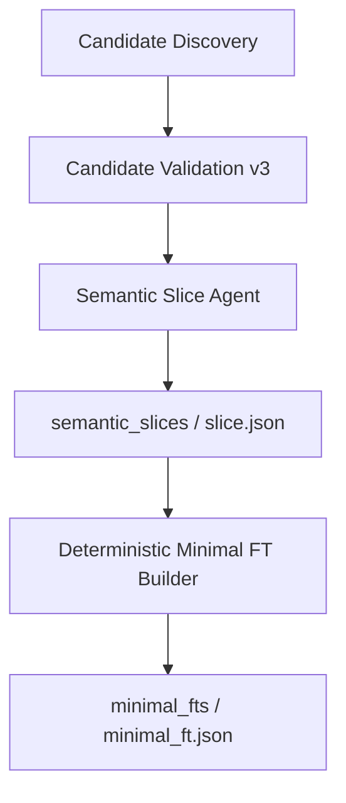

# Deterministic Minimal FT Builder 实现报告

本轮基于本地 `v0.2` 的实际实现增加独立的 Minimal FT Builder。它将已有 Semantic Slice 确定性地投影为 Fuzz Target API Unit，允许 1、2、3 或 N 个 CORE。本轮执行到 Minimal FT artifact 为止；四组已有真实 Slice 的 smoke 和 resume 均通过，全量测试 **146 passed**，其中新增 **45** 项 Minimal FT 测试。

## 架构与文件



| 文件 | 职责 |
| --- | --- |
| `harness_generation/minimal_ft/__init__.py` | 导出 Builder、Validator、输入与结果类型 |
| `models.py` | schema、枚举、角色映射、稳定身份、Slice 规范化、Phase 1 快照 |
| `builder.py` | 校验输入后精确投影 CORE/SUPPORT/EXCLUDE，合并未知依赖 |
| `relations.py` | 从已有事实生成带 provenance 的关系与缺失端点记录 |
| `validation.py` | 输入身份、完整性与输出不变量校验；重放关系及未知依赖 |
| `persistence.py` | 输入摘要、流式 legacy 读取、原子写入、缓存与 catalog |
| `cli.py` | standalone 构建、精确 candidate 选择、resume |
| `harness_generation/artifacts.py` | 新增 Minimal FT 的安全路径与目录属性 |
| `harness_generation/cli.py` | 新增 `minimal-ft` 子命令分发 |
| `tests/test_minimal_ft.py` | 45 项离线测试 |
| `scripts/smoke_minimal_ft.py` | 复用四组已有真实 Slice，构建、resume 与输入未改动验证 |
| `README.md` | 命令及实现报告入口 |

Candidate Discovery、Candidate Validation v3、Semantic Slice Agent、SFG/FT 旧实现和 Stage 1–4 均未修改。生产模块未引入模型客户端、源码解析器或 RepositoryIndex；只读取 artifact 快照，不读取目标项目源码，也不调用 `.env` 凭证。

## CLI 与持久化

```bash
harness-generation minimal-ft --artifacts artifacts/foo
harness-generation minimal-ft --artifacts artifacts/foo --candidate 'api.c:2:parse'
harness-generation minimal-ft --artifacts artifacts/foo --candidate candidate_<24-hex>
harness-generation minimal-ft --artifacts artifacts/foo --resume
```

`--candidate` 可重复指定，仅接受 Phase 1 中的完整 function ID 或已有 Slice 的 candidate ID。裸函数名不用于消除身份歧义。可通过 `--no-legacy-comparison` 禁用可选 legacy comparison 和 legacy relation 输入。`completed_with_unresolved` 正常退出；任一选中 FT 为 `invalid`，退出码为 1。

```text
<artifacts>/
  semantic_slices/<candidate-id>/{slice,metadata,evidence,trace}.json
  minimal_fts/
    <ft-id>/minimal_ft.json
    <ft-id>/metadata.json
    catalog.json
```

Builder 只写 `minimal_fts/`，旧 `triplets.json`、Phase 1 和 Slice 输入保持原样。JSON 使用现有临时文件加 replace 的原子写入方式，先写输出，再写 metadata 提交标记。缺失或不兼容的 metadata 不允许缓存复用；catalog 每次重新索引当前兼容结果，选中单个 candidate 时保留其他兼容项。artifact 路径检查阻止目录越界。

## Schema 与 FT identity

canonical 输出采用 `schema_version=1`、`artifact_kind=minimal_function_triplet`、`policy_version=semantic-slice-minimal-ft-v1`。

| 字段 | 内容 |
| --- | --- |
| `ft_id`、`candidate_id`、`anchor_function_id` | FT、候选和项目内函数身份 |
| `core_functions` | function ID/name、固定 role 枚举、原 Slice evidence IDs/reason codes |
| `support_candidates` | function ID/name、support kind 枚举、原 Slice evidence IDs/reason codes |
| `relations` | 稳定 relation ID、端点、kind/strength 枚举、结构化 provenance、evidence IDs |
| `unresolved_dependencies` | 已知 function ID 或 null、questions、原始 references/provenance |
| `excluded_functions` | 原 Slice 的 EXCLUDE IDs |
| `source_slice` | artifact 根目录相对路径、规范化 Slice 内容摘要 |
| `source_snapshot` | source fingerprint、Phase 1 functions snapshot fingerprint |
| `build_status` | `completed`、`completed_with_unresolved` 或 `invalid` |
| `validation_errors` | invalid 的确定性错误码与字段位置；有效结果为空 |
| `legacy_comparison` | 可选的旧 FT 集合对照 |

FT ID 格式为 `ft_<sanitized-anchor-name>_<sha256-prefix>`，hash 保留前 24 个十六进制字符，输入为：

```json
{
  "anchor_function_id": "<exact project function ID>",
  "core_function_ids": ["<sorted unique CORE IDs>"],
  "policy_version": "semantic-slice-minimal-ft-v1"
}
```

SUPPORT、关系、时间、随机数及 artifact 绝对路径不参与身份。CORE 改变会改变 FT ID；SUPPORT 改变只使输出与缓存配置变化。身份计算使用 CORE 集合，但校验保留并拒绝输入的重复项，不以去重修复非法 Slice。

Slice 规范化仅排序其声明为集合的四个身份数组、classification 行及各行 reason/evidence/question 数组；保留重复项供校验。对象 key 使用 canonical JSON 排序。trace 的事件顺序、源码快照、参数顺序等不被重排。已有 Slice v1 本来就按这一约定持久化，因此纯数组排列变化仍匹配原 metadata 的 Slice 摘要。测试使用八轮随机排列验证相同 FT ID 和完整 canonical Minimal FT JSON，并验证 artifact 根目录和项目路径移动不改变输出。

## CORE 与 SUPPORT 边界

有效输入满足：`MinimalFT.core_functions IDs == Slice.core_functions`，`support_candidates IDs == Slice.support_functions`。anchor 永远为 `anchor`；其他 CORE 按已有 reason code 机械映射为 `input`、`consume`、`state_transition` 或 `processing`。例如 external input injection 映射为 input，input consumption 映射为 consume。Builder 不重新判断函数的重要性。

SUPPORT 的明确 reason code 映射为 `initialization`、`creation`、`cleanup`、`allocator`、`callback`、`configuration`；单独 wrapper delegation 映射为 `wrapper`。多种具体用途冲突或没有唯一映射时保留 `unknown`，增加 `support_kind_unresolved`。这是一项保守的枚举投影规则，不根据函数名、源码 body 或参数推断生命周期。

SUPPORT 不进入 CORE，没有 `mandatory=true`，也不生成调用顺序。输出 metadata 明确记录 `support_is_api_closure=false`、`lifecycle_completeness_established=false` 和 `harness_generated=false`。

## Relation provenance 与 unknown

Relation Builder 读取现有 ownership、usage pattern、Slice frontier evidence、直接调用查询 evidence、SFG/flow type-node 和 legacy relation evidence。不会重新提取或分析源码。

- 明确持久化的 producer/consumer/cleanup 契约或 ownership/lifecycle/explicit usage group，投影为 strong `shares_resource`。group 使用稳定的星形连接表达资源关联，不产生初始化顺序或调用顺序。
- 现有调用查询明确属于 name-only resolution，即使只有一个可能 callee，也保留为 weak `calls`。
- Slice weak frontier 及 SFG/flow 共享非 null 类型节点只生成 weak `structural`；不将共享类型解释为行为依赖。
- 函数名相似、源码相邻、参数名称没有参与关系推断。EXCLUDE 不被关系证据提升回 CORE、SUPPORT 或 unresolved。

每个关系保留 artifact 来源以及适用的记录 ID、事实 digest、evidence IDs、source/resource/confidence 或 type node。关系 ID 由完整关系记录内容计算；不同证据可保留独立记录，因此关系条数不等于独立调用边数量。

原 Slice unresolved frontier 的所有身份与原 open questions 均保留；没有显式 classification 的 frontier 也保留，并增加 `semantic_slice_not_investigated`。间接调用、目标歧义、无法解析或缺失的关系端点、无法映射的 SUPPORT 用途继续作为 unknown。未知函数或 Slice 外的已有函数不会成为新 API，原始引用记录在 `function_id=null` 的 dependency 中。相同未知桶按问题和引用内容稳定合并。

有 dependency 时状态为 `completed_with_unresolved`，不代表 Builder 失败。非法输入则生成带来源摘要和 validation errors 的 `invalid` 诊断 artifact，不发布修正后的有效 API 集合。

## Validator 与 resume

`MinimalFTValidator` 校验：

- Slice schema/policy/run status、四组身份、分类角色及 reason enum、证据引用、metadata 身份和 frontier/discovered universe；原 accepted validation catalog 若存在，也须匹配源快照与候选。
- CORE 非空且含 anchor；完整 function ID 来自 Phase 1 snapshot；名字一致、无重复，CORE/SUPPORT/EXCLUDE/原 unresolved 分组不重叠。
- 输出 CORE/SUPPORT/EXCLUDE 与输入精确一致；role/support kind 映射及 reason/evidence 不被改写。
- relation 端点只属于 CORE、SUPPORT 或已知 unresolved frontier；kind/strength 为枚举，provenance 有来源，弱证据不能升级为 strong。
- FT ID、source Slice path/digest 和 source snapshot fingerprint 一致；原 unresolved 身份及问题不能消失。
- 从持久化事实重放关系和 dependencies，拒绝仅靠 provenance 标签伪造关系，也拒绝删除 Builder 新增的 unknown；legacy comparison 若输出，同样必须与输入一致。

Slice/evidence/trace 内容摘要必须匹配 Slice metadata；configuration fingerprint 和本轮 evidence publication 必须自洽。Minimal FT 输出摘要必须匹配提交标记。Validator 不执行 repair。

resume 配置绑定 policy、builder schema、规范化 Slice digest、source fingerprint、functions snapshot fingerprint、Slice metadata/evidence/trace digests、validated catalog digest、legacy 文件内容 hash 和 comparison 开关。任何关键输入改变均失效；invalid、输出被改动、缺失提交标记也不能复用。source fingerprint 使用现有 Phase 1 身份机制，functions fingerprint 额外绑定 schema/files/functions/structs，不含项目绝对根路径。

compatible resume 只读取 artifacts 并校验已有结果：0 LLM calls，0 repository rescans。测试在生成上游 fixture 后删除项目源码目录，并禁止模型调用、C parser 与 syntax index；构建和 resume 仍成功。被缓存的 `minimal_ft.json`、`metadata.json` 内容和 mtime 保持不变。

## Legacy comparison

旧 triplet membership 只进入 `legacy_comparison` 的 `legacy_ft_found`、`core_overlap`、`new_core_only`、`legacy_only`、旧 FT IDs 和 oversized frontier；它不能改变新 CORE/SUPPORT/EXCLUDE。旧关系仅以已有 relation evidence 的身份参与投影。

旧 `triplets.json` 与 `triplet_exclusions.json` 按记录流式读取，使用标准库，不因大文件跳过对照。拒绝重复 JSON key、非有限数和截断文档；可选 legacy 文件损坏记录为 comparison diagnostics，不替代 Slice 的语义结果。缓存配置仍绑定这些文件的 hash。

## 测试与真实 artifact smoke

新增 45 项测试覆盖全部十个指定场景：single direct parser、三阶段 CORE、create/destroy SUPPORT、可选 logger、unresolved、重复 IDs、stale digest、legacy disagreement、随机排列确定性、empty CORE/missing anchor。另覆盖未知或裸身份、非法 role/reason/evidence、关系端点缺失及越界、只有 consumer 的 ownership、强关系 provenance、name-only 调用、冲突 SUPPORT、伪造输出/删除 unknown、多个 candidate catalog、项目路径迁移、各种 resume 配置变更、提交标记丢失、输入不改动、禁模型/禁源码扫描、超过 1 MiB 的 legacy JSON 跨块读取和畸形 legacy JSON。

最终验证命令及结果：

```text
.venv/bin/python -m pytest -q       -> 146 passed
.venv/bin/python -m pip check       -> No broken requirements found.
git diff --check                    -> passed
.venv/bin/python scripts/smoke_minimal_ft.py -> 4/4 passed
```

Smoke 输入为此前真实模型生成并已保存的 `artifacts/semantic_slice_real_20260928_03/{json,direct,hub,fixture}_phase1`，本轮不重新生成 Slice，也不调用 DeepSeek。脚本为模型构造/调用、C parser 和 RepositoryIndex syntax index 安装禁止调用的 guard，并校验整个原 artifact 输入文件集的内容 hash；四组输入均未改变，四组构建与 resume 均退出 0。

| 已有 Slice | CORE | SUPPORT | 未知依赖条目 | 关系 strong / weak | Builder 状态 |
| --- | --- | --- | --- | --- | --- |
| json_parser | json_parse、would_overflow、new_value、json_parse_ex | json_value_free_ex、json_value_free；均 cleanup | 0 | 18 / 13 | completed |
| direct parser | parse | 无 | 0 | 0 / 0 | completed |
| shared context hub | feed、parse | create 为 unknown；destroy 为 cleanup | 1 | 0 / 3 | completed_with_unresolved |
| wrapper fixture | decoder_wrapper、parse_blob、feed、process_context | 无 | 1 | 0 / 2 | completed_with_unresolved |

hub 的 create 在原 Slice 同时带 creation 和 initialization reason，按通用规则保留 `support_kind_unresolved`；set_logger/stats/encode 仍为 EXCLUDE。wrapper 的 `api.c:13:unavailable` 与原问题完整保留。json_parser 中的两个内部 helper 沿用 Slice CORE，Builder 不自行缩减为公共入口。四组结果都精确投影原 CORE/SUPPORT，未添加 fixture 专用规则。

Smoke 汇总：[summary.json](../artifacts/minimal_ft_smoke_20260928_01/summary.json)。各 Minimal FT 位于相应输入目录的 `minimal_fts/`；运行 artifact 继续由 git 忽略。此 smoke 验证确定性投影与恢复，不重新证明上游语义判断的正确性或跨项目泛化能力。

## 阶段边界与下一阶段接口

Minimal FT Builder does not establish API closure.

Minimal FT Builder does not prove lifecycle completeness.

Minimal FT Builder does not generate harnesses.

SUPPORT functions are candidates for later Harness Context Mining.

Builder 返回 `MinimalFTBuild.minimal_ft`，并持久化同一 canonical dict。未来 `build_harness_context(minimal_ft, project_index, ...)` 可消费这一记录及其来源、候选与 unknown；本轮只保留这个数据边界，不实现 Harness Context Agent、API Closure、Completeness Gate、HarnessPlan、编译或 fuzz。
