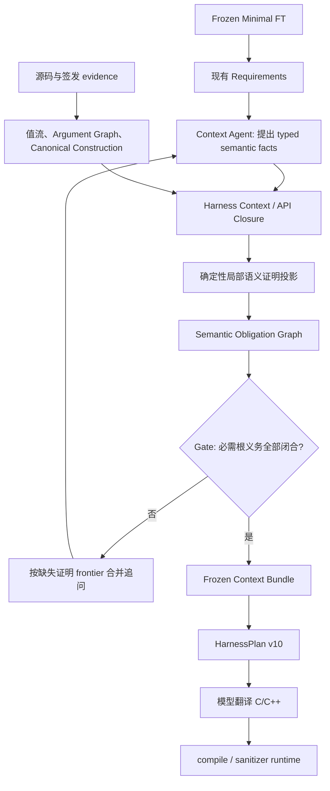

# Semantic Closure Framework：义务、证据与依赖闭合

日期：2026-10-02。以当前本地 `v0.2` 实现为基础，本轮没有运行真实模型、没有继续 blind experiment，也没有修改此前冻结的源码和实验结果。

本轮目标是让 Context 调查回答“哪些语义义务已有证据，哪些仍缺证据”。这是一轮证明组织和门禁重构，不是新的 harness 构造策略，也不是稳定性或泛化实验。

## 1. 当前流程



Agent 工具集合、terminal wire schema、fact 类型和发现预算保持现有机制。模型不能生成 graph nodes、dependencies、proof status 或 generation decision。确定性的投影读取已校验的事实、已有构造证明和 API Closure，建立义务及其依赖。

`semantic_proofs.py` 承接原 Gate 中的局部语义检查，包括来源、声明、参数、长度、ownership、lifecycle、return、callback、状态与 ordering。它只输出证明缺项和校验诊断，不决定生成。`obligations.py` 组织这些局部证明和依赖；`completeness.py` 重算闭合，只检查必需根义务和证明输入完整性。

原有校验仍然必需。把它们移到证明投影层并不意味着仅凭图结构就能证明任意源码语义。

## 2. 义务节点与闭合规则

每个节点有稳定的 `obligation_id`、所属 `requirement_id`、函数／参数／resource 主体，以及：

| 字段 | 含义 |
| --- | --- |
| `evidence_ids` / `fact_ids` | 签发的源码证据和已校验的事实引用 |
| `local_proof.status` | 本节点局部证明：`proved`、`not_applicable`、`missing`、`contradicted` |
| `local_proof.sources` | 区分 typed semantic proposal、可重算 framework projection、canonical recipe、字段值流等依据 |
| `dependencies` | 带关系类型的必要前提；当前为 AND 依赖 |
| `proof_status` | 闭合后的 `proved`、`missing`、`contradicted` 或 `blocked` |
| `blocking_obligations` | 导致本节点无法闭合的证明缺口 |
| `diagnostics` | 原有精确失败分类和相关 Argument Graph holes |

`local_proof=proved` 只说明当前节点的证据成立。只有所有必要依赖也闭合，`proof_status` 才是 `proved`。`blocked` 专门表达“局部证据存在，但依赖尚未闭合”。

框架从最小闭合集合开始迭代，不使用上次保存的 `proof_status` 作为前提。无依赖且局部成立的节点先闭合，再传播到上层。循环不会自证；缺失依赖和重复 identity 产生诊断。已签发的 `not_applicable` 仍需通过现有主体和事实校验，不能用裸标签跳过义务。

每个 mandatory Requirement 对应必需根义务；没有现成 Requirement 的安全缺项仍保留为必需节点。未激活的可选 support 问题留在诊断中，不因普通 unknown 阻止生成。源码／事实／Requirement universe／Closure 投影错误成为完整性义务，不能被模型的 resolved 标签覆盖。

现有 `requirements.status` 与 Context 中的 `open_requirements` 保留为调查记录；它们不是生成判据。completeness 中的 resolved/unresolved 现在按义务闭合统计，包含框架独立证明的情况。

## 3. 本轮接入的依赖

没有新增 Graph 节点语言的任意扩展入口，也没有让模型编依赖。当前依赖来自已有结构：

- canonical parameter recipe → 其参数依赖；creator／out call → producer invocation 的参数、ownership、return 等独立义务。
- lifecycle 的 create／mandatory init／cleanup → 对应 API 的可调用定义及 invocation 义务。
- 调用前的 state／lifecycle initialization → initializer invocation 与既有的 before-use ordering。
- 已有同 resource 的 field write/read transition → 字段写入义务 → writer invocation → writer 的 argument／ownership 等义务。
- callback userdata → 精确 owner 参数的 canonical construction，以及 userdata lifetime／ownership。
- CORE input binding → 独立的 buffer-length 义务。

例如 shared-context 的图中可以出现：

```text
parse.state (局部证据已成立)
  ├─ 相同 resource 的 data / size 字段已写入
  │    └─ feed invocation
  │         ├─ feed 参数构造
  │         ├─ feed ownership
  │         └─ feed buffer-length
  ├─ 既有 resource lifecycle
  │    └─ create / destroy invocation 的独立义务
  └─ feed 在 parse 之前的 ordering
```

字段证明只使用已有 Argument Graph 的 `graph_same_origin_field_write_read` transition，必须匹配实际 writer、reader、resource 和字段。没有这项静态证明时，不凭字段名生成一份证明；仍保留经过既有校验的 semantic proposal 及其 initializer 依赖。

API invocation 依赖不递归要求“cleanup 参数重新拥有一个全新 lifecycle”，避免把 caller 传入的同一 resource 变成新的构造对象。callback userdata 依赖自己的 parameter recipe，避免整个 argument Requirement 与 callback ABI 互相递归。

另外补上了一个局部证明覆盖检查：mandatory state Requirement 的 context／opaque 参数必须有明确的 precondition 条目。空 `preconditions=[]` 不再足以关闭此义务。

## 4. Agent 追问与证据复用

Agent 请求任务改为 `semantic_obligation_proof`，prompt 明确禁止设计 harness。新增的只读 prompt 投影 `semantic_obligations` 只包含当前义务及其传递依赖，并分为 `proved`、`missing_evidence`、`blocked`，不投递完整项目图。

首轮仍沿用现有 per-function grouped 或 single Requirement 调查。后续轮次使用图的缺失证明 frontier，按既有 Requirement ID 合并为一次追问，保留相关 obligation IDs、证据、graph holes 和被阻塞的根义务。不会因为多个父义务 blocked，就重复要求 Agent 提交同一份 ownership 证明。已执行失败及 unchanged evidence 跳过机制继续生效。

这是一个有限的调度改进：本轮没有实现通用自动定理证明、任意 obligation 合成或全新的搜索 Agent。

## 5. 发布、冻结与 Plan

Context 目录新增 `semantic_obligation_graph.json`，同时由 completeness 引用同一投影；metadata 的 `document_digests` 同时保护两份发布记录。Graph 绑定 FT、Context、Closure、Requirements、Resolutions 和 evidence 摘要。

Context 摘要计算时只排除 `frozen`：freeze 是闭合的结果，不能成为自己的证明前提。冻结后重新加载同一输入，Graph 仍可精确重算。

当前版本标识：

- Context policy：`semantic-closure-harness-context-v2`。
- Graph：`semantic-obligation-graph-v1`。
- Agent prompt：`semantic-obligation-context-agent-v13`。
- Plan policy：`semantic-closure-harness-plan-v10`，schema 仍为 2。

配置指纹加入 Graph version；旧 requirement resume 和旧 frozen Context 不自动与新门禁混用。`load_frozen_inputs` 从已验证的源码与事实重建图，核对保存的 completeness；旧 complete 标签不能直接进入新链。Plan 必须接收当前闭合图，并验证它绑定的 FT／Context／Closure，保存 Graph digest 后继续按已有 recipes 生成。

## 6. 离线证据

验证使用当前 `tests/`。pytest 默认收集范围也限定到此目录，避免把 `artifacts/` 中的历史冻结测试副本当作当前代码测试。它不改变冻结副本。

最终全量离线验证：`.venv/bin/python -m pytest -q tests --durations=8`，**438 passed，340.85 秒**，包含现有 clang 编译及 ASan／UBSan runtime 回归；新增 13 项也独立通过。默认 `pytest --collect-only` 确认只收集当前 438 个用例。全量日志保存于 `artifacts/semantic_closure_offline_20261002/offline_validation.log`。

新增 13 个用例覆盖依赖证明撤回、循环、缺失引用、重复节点、optional unknown、shared-context initializer ownership、callback userdata、长度追问合并、空状态事实、artifact pinning、篡改图后重封摘要及旧标签拒绝。

shared-context 的审计样例使用显式 scripted semantic fixtures；不是原生模型结果。完整图包含 **34 个节点、19 个必需根，19 个根全部闭合**。撤回 feed ownership 后，parse 的局部 state 证明仍成立，但总图变为 incomplete：**2 个根未闭合，1 个 frontier 缺口，1 条 ownership 追问**。撤回 creator ownership 同样阻止状态和构造依赖放行；callback 用例验证了 ABI 事实仍成立时 userdata 依赖可以阻止生成。

审计产物位于本地忽略目录 `artifacts/semantic_closure_offline_20261002/`：

- `shared_complete_graph.json`：完整图。
- `shared_missing_feed_ownership_graph.json`：撤回 ownership 后的重算图。
- `missing_proof_tasks.json`：合并追问。
- `summary.json`：明确记录 `native_model_calls=0`、`blind_experiment=false`。
- `validation.json`：全量测试结果、生产源码 fingerprint 和旧冻结源码身份核验。

这些结果证明的是闭合、撤回和发布验证机制的行为。它们不证明 Context completion 提高，也不证明跨项目泛化。此前 60 次配对模型结果仍只属于其原冻结 fingerprint。

## 7. 当前不足与边界

1. **证据校验不等于形式化语义证明。** canonical recipes 和有限字段值流可静态重算；ownership、部分 state 和 return 仍使用已签发源码支持的 typed semantic proposals。`proved` 表达框架当前证据政策下的成立，不是完整 C/C++ 程序逻辑的定理。
2. **依赖范围有限。** 首版消费既有 construction、invocation、callback、input-length 关系，不能穷举任意隐藏 precondition、异步 callback、全局状态、跨线程关系或多次调用 schedule。
3. **粒度仍有保守合并。** 部分 invocation 依赖整个 function-level ownership／argument Requirement；同一函数中某个参数缺项可能阻塞其他参数相关的初始化证明。尚未支持选择性 OR 证明和复杂 proof equivalence。
4. **首轮调查仍是现有 Requirements。** 已减少后续追问重复，尚未将首轮完全改成动态按依赖拓扑调查，也未测量原生模型 token 或工具调用节约。
5. **重算有成本。** 调查 prompt 和冻结门禁都重新投影 Context／Graph，当前没有增量 proof invalidation 缓存。没有为缓存引入另一个可变真相来源。
6. **没有新稳定性证据。** 本轮不运行 blind 或重复模型实验，也不验证 provider 400 路径。后续若评估收益，应围绕缺证据定位、重复调查次数、false complete 与端到端成功做有预算约束的针对性比较。

主要代码：[义务图](../harness_generation/harness_context/obligations.py)、[局部证明投影](../harness_generation/harness_context/semantic_proofs.py)、[闭合 Gate](../harness_generation/harness_context/completeness.py)、[调查循环](../harness_generation/harness_context/loop.py)、[离线测试](../tests/test_semantic_closure.py)。
