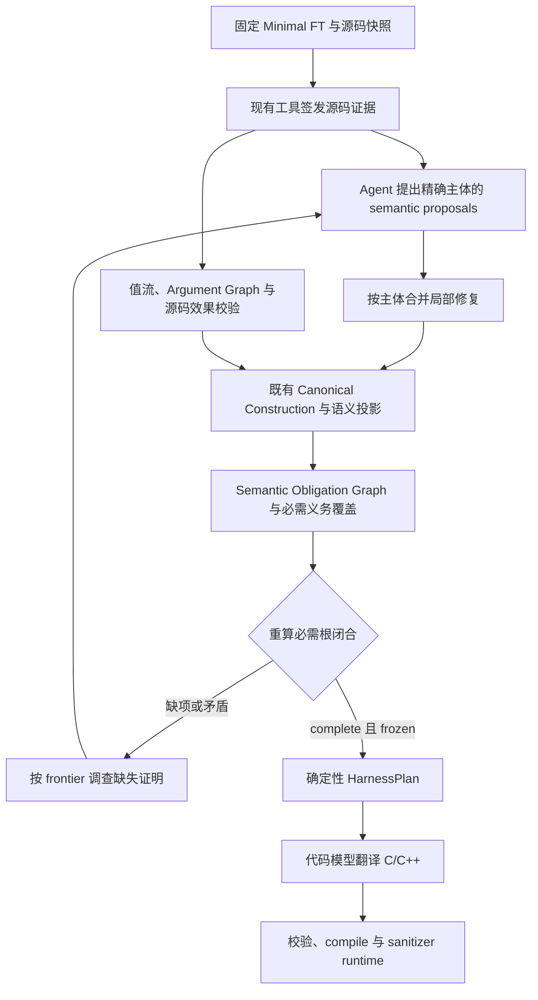

# 证明可靠性、主体义务与局部修复测试报告

日期：2026-10-02。以本地 `v0.2` 为基础。此次没有启动 blind cohort；先进行固定事实的门禁回放，再运行固定 FT 的小规模真实模型实验。

本轮证明了两点：新的门禁能拒绝一组此前错误放行的语义声明；补齐一个主体可以保留其他主体的证明和证据。真实模型实验没有证明 Agent 稳定性或重复调查效率提高：新版完成率下降，重复显式查询增加。下面分别列出实现、可归因证据和未解决问题。

## 1. 当前职责与此次修改范围

上游保持 `Static Analysis → Candidate Validation → Semantic Slice → Minimal FT`。Context 阶段的主要职责如下：



Agent 继续使用已有工具、terminal wire schema 和 fact 类型。此次新增的是确定性源码校验与事实合并逻辑，没有扩展 Argument Graph 的构造节点类型或 ContextBudget。旧 `generate` 和 Stage 1–3 baseline 保留。

当前版本：Context policy `source-grounded-harness-context-v3`，Agent prompt v16，Semantic Obligation Graph v2，调查投影 v3，工具行为 v6，HarnessPlan policy v11；最终源码校验为 `source-obligation-grounding-v2`，局部修复为 `subject-local-repair-v1`。工具行为版本变化来自 bootstrap 复用，工具 schema 摘要与基线完全相同。

## 2. `proved` 的源码依据与覆盖

新增 [proof_grounding.py](../harness_generation/harness_context/proof_grounding.py)。只消费已经签发、包含完整函数体的证据；不以 citation 合法或 proposal 的 `resolved` 标签代替效果证明。

校验维护参数、局部对象和别名的来源，并在最多 32 条路径、最多两层项目内调用传播中记录字段写入、返回对象、out-parameter 导出、释放对象和指针逃逸。证明 initializer 时要求目标对象一致，所有相关路径都建立必需字段；已识别的字面量非返回 guard 还要求字段值相符。条件写入、无法重现的效果和不明确对象来源保持缺证据。

已加入对应反例和正例：

| 检查对象 | 反例或缺证据 | 正例 |
|---|---|---|
| 必需字段 | 写 other，遗漏 ready；写入错误字面量 | 同一对象无条件写入必需字段 |
| 控制流 | 仅某分支写入；return 后写入 | 两分支均写入；明确的 non-null 对象前提 |
| 对象身份 | 初始化另一个 stack/creator 对象；重赋参数 | 原参数与直接别名 |
| callback userdata | 保存指针却声明 `during_call` | 对已识别的保留行为不作短生命周期声明；这不是任意长期生命周期的证明 |
| cleanup | 参数改指另一个对象后释放 | 原参数被同一释放路径消费 |
| out resource | 某路径没有导出已构造对象 | 每条路径导出同一对象，后续字段初始化可重现 |
| 内存原语 | 同名参数或局部函数指针遮蔽 calloc/free/abort | 未被遮蔽的已支持 C 原语 |

必需义务不完全由模型列出的 preconditions 决定。图会从实际声明补齐参数、pointer return/out pointee 的主体义务，从完整源码补齐观察到的 incoming field；实际 API invocation 汇总全部必要参数与主体。`required_coverage` 记录覆盖项，Gate 检查目标节点、必需 invocation 根和依赖边是否存在。测试验证了删除字段义务后不能靠剩余节点全部闭合取得放行。

这里的覆盖范围仍受静态分析支持范围限制；不是一般 C/C++ 程序的前提完整性定理。

## 3. 主体粒度与局部修复

新增 [repairs.py](../harness_generation/harness_context/repairs.py)。事实按精确主体拆分和合并：ownership 使用 parameter/return/field/subject kind；argument、state、callback 和 input 使用相应 parameter；lifecycle 使用资源绑定主体；长度使用 buffer/length 对；顺序使用 API 对与 resource。

兼容的细化保留旧条目并合并证据。unknown 可被已知值细化；未知 API/identity 可以补齐。不同的具体声明保留双方事实，产生 `subject_repair_conflict`，不能用最后一次回答覆盖。未知回答不会撤回已知值；布尔和整数常量按规范化 JSON 区分；collection 元数据矛盾也参与校验。

ownership 和 argument 的函数级节点改为聚合节点，缺项下沉至确切主体。callback userdata 的生命周期依赖其确切 pointer subject；initializer 的 invocation 仍要求全部必要参数成立。局部修复同时接入单项/grouped terminal 校验和 loop 持久化，不依赖模型重新复述整个 Requirement。

完整 Gate 的固定事实 witness 给出：

| 状态 | ctx ownership | data ownership | 追问任务 | 结果 |
|---|---|---|---:|---|
| ctx 缺项 | missing | proved | 1 | incomplete |
| 只补 ctx | proved | proved | 0 | complete |
| ctx 出现矛盾 | contradicted | proved | 1 | invalid |

data 的 evidence IDs 保持一致。单项修复没有产生无关新缺口；冲突撤回 ctx 的证明，data 的证明保留。[原始 witness](../artifacts/semantic_proof_reliability_20261002/local_repair_witness/results.json) 使用显式 scripted facts，不计为真实模型成功。

## 4. 首轮调查与复用

[loop.py](../harness_generation/harness_context/loop.py) 在第一轮和后续每个调查批次前重算 Context、Closure 与 Gate，跳过已闭合义务。缺口按阻塞的必需根数量排序，按函数合并调查，首次请求也提供实际 frontier。

框架读取 subject 后，Agent bootstrap 复用既有 query cache；不再次调用 execute 或收取同一 bootstrap 的 tool 成本。来源、scope 和完整函数体检查仍适用。已有证据再次进入模型上下文仍计 prompt tokens。此次没有引入增量 proof cache。

这一机制减少了机械的 bootstrap 和已成立 Requirement 调查；是否减少模型自身的重复查询，需要由下面的真实结果判断。

## 5. 固定 FT、事实和证据的离线配对

先由冻结基线一次性签发源码证据与事实。两版 Gate 加载同一份 FT、Requirements、facts、resolutions、evidence 和 discoveries；每对输入摘要及原始文件 SHA256 均一致。Gate 回放不调用模型。

| 样例 | 期望 | 基线 | 新版 | 新版主要诊断 |
|---|---|---|---|---|
| direct parser | 放行 | complete | complete | — |
| 正确 initializer | 放行 | complete | complete | — |
| initializer 写错字段 | 拒绝 | **错误 complete** | incomplete | initializer_field_or_object_mismatch |
| 条件初始化 | 拒绝 | **错误 complete** | incomplete | initializer_conditional_or_unreproduced_write |
| 初始化另一对象 | 拒绝 | **错误 complete** | incomplete | initializer_field_or_object_mismatch |
| feed 保留输入却声明 during_call | 拒绝 | **错误 complete** | incomplete | ownership_escape_lifetime_conflict |
| cleanup 释放错误对象 | 拒绝 | incomplete | incomplete | cleanup_object_or_path_conflict |

5 个负例的错误放行为 **4/5 → 0/5**；2 个正例的错误阻塞均为 **0/2**。追问任务总数 **1 → 6**：旧门禁遗漏了四个问题，新门禁需要为真实缺口提出任务，不能把这里的增加解释为重复调查恶化。callback 保留 userdata 的反例另由专项源码测试验证，没有把它混入这 7 对 Gate 样例的分母。

新增 32 个专项回归；最终全量 **482 passed，234.78 秒**，包含现有 clang 编译、ASan/UBSan 固定输入 runtime。全量日志见 [validated_revision_pytest.log](../artifacts/semantic_proof_reliability_20261002/validated_revision_pytest.log)。

## 6. 小规模真实模型重复实验

采用 3 类开发样例：direct parser、shared create/feed/parse/destroy、owned return。每类每版重复 2 次，共 **6 对、12 个 fresh trial**，交替两版先后顺序。

FT 使用离线显式角色准备并冻结；Context 调查、Plan 翻译均调用 `.env` 配置的真实提供商，无 mock fallback 或外部重试。请求模型为 `ark-code-latest`，实际返回 `deepseek-v4-flash-ga-260731`，thinking disabled。每类 FT 摘要相同，模型配置和预算相同。此次不评价 Candidate recall、Slice success 或上游模型稳定性。

Context 上限保持：24 model calls、64 tool calls、96,000 source chars、3 completeness rounds、每 Requirement 4 rounds、16 discovered functions、dependency depth 2、一次 terminal repair。Context 每响应最多 4,096 tokens；代码翻译最多一次响应、8,192 tokens。所有准备后发生的 Context 工具调用计入相应预算。

| 指标 | 基线 v15 | 冻结新版 v16 |
|---|---:|---:|
| Context complete | 5/6 | 3/6 |
| compile success | 5/6 | 3/6 |
| sanitizer runtime success | 5/6 | 3/6 |
| Context model calls / 真实响应 | 53 / 53 | 39 / 39 |
| tool calls | 86 | 62 |
| 模型显式查询 | 35 | 34 |
| 重复显式查询 | 19 | 21 |
| Context total tokens | 1,592,215 | 1,262,288 |
| 代码翻译 calls | 5 | 3 |
| 代码翻译 tokens | 53,704 | 20,439 |
| provider 请求错误 | 0 | 0 |

共记录 **92 个 Context 响应、8 个代码响应，2,928,646 tokens**。重复查询指标为 cost-owner trace 中 round>0 的相同工具/参数查询，已有 bootstrap 查询计入已见集合；它是显式查询重复的下界，不覆盖语义等价的不同查询或模型内部重复推理。hard-gap 行数为 21 → 20，一条缺口可能映射多个必需根，不能作为独立缺口数或质量评分。

按类别看：

| 类别 | Context / runtime 基线→新版 | Context tokens 基线→新版 | 重复查询 基线→新版 |
|---|---|---:|---:|
| direct | 2/2 → 1/2 | 61,339 → 72,290 | 0 → 0 |
| shared | 1/2 → 0/2 | 1,245,333 → 762,941 | 18 → 18 |
| owned return | 2/2 → 2/2 | 285,543 → 427,057 | 1 → 3 |

新版记录了 17 次已闭合 Requirement 跳过、38 次 bootstrap 证据复用。这些机制生效，但重复显式查询没有下降。总 tokens 下降约 20.7%，同时新版有三个 trial 因矛盾未进入生成；不能解释为相同成功产出的效率提高。在两版都 runtime 成功的 3 对 trial 上，Context tokens 为 **305,797 → 456,903，增加约 49.4%**。

失败具有明确归因：

- 新版 direct 第一遍把 size 先标为 input、后改为 derived。两项同主体声明冲突，Gate 拒绝闭合。
- 新版 shared 两遍都先声明 feed 的 data 为 `during_call`，随后给出 `until_context_cleanup`。源码确实保存该指针；旧错误声明没有被静默删除，最终为 ownership 冲突。
- 基线 shared 第二遍因 terminal schema/repair 失败，8 个 grouped Requirements 标记执行失败。它不是 provider 请求失败；其失败留在分母中。
- 基线 shared 第一遍虽然 compile/runtime 成功，但 feed 的 data 仍声明 `during_call`。将相同终态事实送入最终门禁，会被 `ownership_escape_lifetime_conflict` 拒绝。固定输入 runtime 成功不能证明这项语义声明正确。

因此，本轮有更可靠拒绝错误语义的证据；没有更高 Context completion、整体稳定性或跨项目泛化的证据。

## 7. 冻结与最终源码边界修复

真实模型实验始终使用同一冻结新版 `revision_final`，源码校验 v1。实验期间未修改该快照。复查中补充了原语同名遮蔽检查，最终本地源码与 `revision_validated` 一致，源码校验 v2；没有将两版 native 结果合并。

Production fingerprint 定义为两个生产包的相对 Python 文件路径→SHA256 映射的 canonical JSON 摘要：

| 快照 | fingerprint |
|---|---|
| 本轮基线 | `f277f5ebf3ad82b8099fa29e43feaec8912ef26ea47b29470187499fd4c96fbf` |
| native 冻结新版 | `9d58a49b2973ec6bcf05642686082e3378307c10c324119d68438501fdfa425f` |
| 最终本地源码 | `6725385aaab0be6b241e192e8aa68446b39a6a8dc4e9ca7586832ad8b4e43422` |

最终版再次通过全部 7 对离线 Gate 回放。用已保存的 12 个 native 终态重新计算 Gate：新版 6 个 trial 的完整 completeness report 均与冻结版本一致。这个回放没有新模型调用，只证明边界修复没有改变这些已记录事实的门禁结果。

本轮另外观察到 **5 次真实 terminal repair 请求**包含 `malformed_historical_tool_arguments` normalization，均获得 HTTP 200。这是当前提供商实际接受该归一化请求的证据，不能推广为所有供应商的历史 HTTP 400 根因已解决。[请求观测](../artifacts/semantic_proof_reliability_20261002/normalization_observations.json)。

首次评估 runner 的准备/导入错误单独归档，没有产生有效模型 trial。原始 runner 还将 `build_success` 正确记录，却遗漏同步 `compile_success`；收集器直接从真实 `build/build.json` 重算报告值，原始 trial 未改写。terminal 执行失败与 provider 错误也按 trace 分开统计。未来 runner 已修正这两处统计字段。

## 8. 当前不足与下一步

1. **矛盾修复缺少显式撤回流程。** 当前保留所有兼容事实，也保留同主体矛盾 proposal。首次错误即使从未取得闭合证明，随后正确回答也可能形成持续冲突。下一步应区分已证明知识、待证 proposal 和已被源码否定的 proposal；撤回应有精确主体、源码反证和审计记录，继续保护已证明事实。本轮没有通过删除失败事实提高完成率。
2. **源码证明仍有范围限制。** 循环、复杂 alias、未知/间接调用、跨模块效果、非零 aggregate/field recipe 和一般 callback 异步生命周期尚未完整建模。incoming field 覆盖目前主要针对声明为 struct/opaque handle 的参数；`void *` userdata 经 cast 后的字段前提仍需把实际 resource 类型接入覆盖，不能宣称已经覆盖所有 callback state。长期 lifetime、部分 return/state 仍依赖 semantic proposal 与既有校验；`proved` 是当前证明政策下的状态，不是完整程序逻辑定理。
3. **粒度尚未完全一致。** 参数、return/out pointee 和 incoming field 已细化；部分 lifecycle/order/state 仍按 Requirement 聚合。诊断与 fact wire 的 field/resource 表达还不能覆盖所有局部修复。
4. **模型重复调查尚未改善。** owned return 的 tokens 和重复查询增加，shared 的重复查询保持 18 次。应先分析已签发证据如何被重新消费、proposal 为什么改变、frontier 是否要求了错误层级的证明，再决定是否引入增量缓存。
5. **重算和提示都有成本。** 多次完整投影带来 CPU 成本；proof view、事实记忆和调查 agenda 也增加 prompt。应做独立的提示裁剪或调度消融，避免把失败较早造成的 token 降低当作效率提升。
6. **验证规模与 API 多样性有限。** 只有 3 类开发样例、每版每类 2 次；真实 callback、stream/file、复杂外部 creator 没有加入本轮 native 分母。不能据此宣布跨项目泛化或恢复 blind cohort。

## 9. 原始数据与复现

- [收集结果与逐 trial 指标](../artifacts/semantic_proof_reliability_20261002/collected_results.json)。
- [相同事实的 Gate 配对](../artifacts/semantic_proof_reliability_20261002/offline_verified/summary.json)与[最终版回放](../artifacts/semantic_proof_reliability_20261002/offline_validated/summary.json)。
- [native registration](../artifacts/semantic_proof_reliability_20261002/native/registration.json)、[未经改写的原始 trial 汇总](../artifacts/semantic_proof_reliability_20261002/native/summary.json)。
- [最终源码的 native 终态回放](../artifacts/semantic_proof_reliability_20261002/post_freeze_replay/summary.json)。
- [预算、工具、源码快照及历史冻结审计](../artifacts/semantic_proof_reliability_20261002/audit.json)。历史 callback 冻结文件仍与原 manifest 匹配；凭证未写入报告或 artifact。

```bash
.venv/bin/python -m pytest -q tests --durations=8
.venv/bin/python scripts/collect_semantic_reliability.py \
  --root artifacts/semantic_proof_reliability_20261002
# 新实验须使用新的 output 目录；不会覆盖已有 frozen trial。
.venv/bin/python scripts/evaluate_semantic_reliability.py --phase offline \
  --baseline <基线源码快照> --revision <新版源码快照> --output <新输出目录>
.venv/bin/python scripts/evaluate_semantic_reliability.py --phase native \
  --baseline <基线源码快照> --revision <新版源码快照> \
  --env-file .env --repetitions 2 --output <新输出目录>
```

原始数据与源码快照位于本地忽略目录 `artifacts/`；本报告、实现、专项测试与评估/收集脚本作为源码维护。
