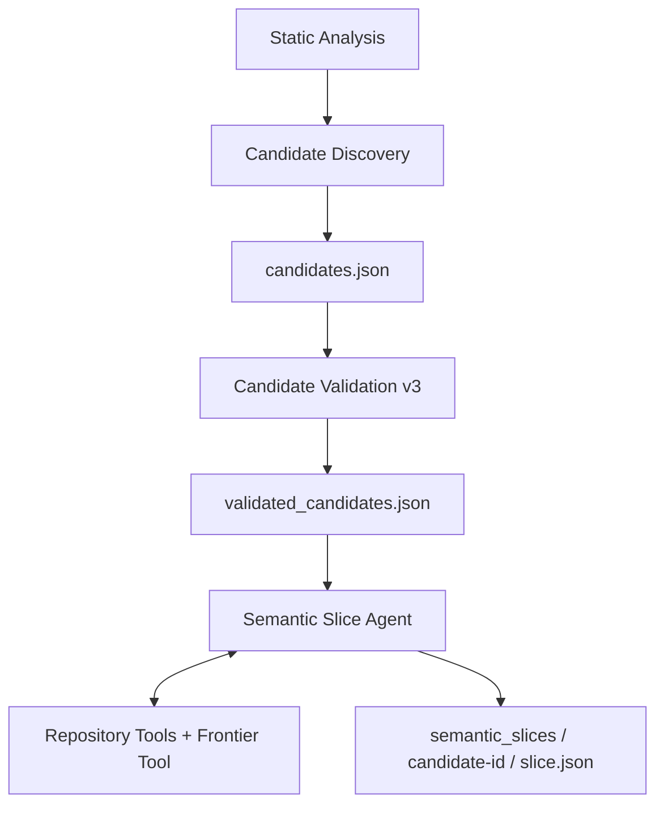

# Candidate schema repair 与 Semantic Slice 实现报告

日期：2026-09-28。以当前本地实现为基础完成修改。Candidate Validation 冻结为 v3；Semantic Slice 是独立阶段。本轮全量 **101 passed（4.69 秒）**，最终真实 DeepSeek Slice smoke **4/4** 符合预先定义的场景要求，正式 CLI 实测与无凭证 resume 均返回 0。这是定向 smoke，不能据此宣称大型跨项目泛化已经得到验证。

## 1. Candidate schema repair 的实现

`semantic_discovery/models.py` 区分可修复的 `DecisionSchemaError` 与证据/语义校验失败。字段缺失、类型、enum、reason 与 verdict 的结构约束错误可返回：

```json
{"error":"schema_validation_failed","field":"reason_codes[0]","received":"context_feed","allowed_values":["external_input_sink","buffer_length_relation","structured_input","finite_indirect_input_path","parser_decoder_consumer_api"]}
```

此处 allowed_values 是 schema 示意节选；真实错误记录包含适用的完整枚举。框架不会把 `context_feed` 从 reason 自动移动到 input_mode，也不会将未知 reason 映射为合法值。模型必须在同一消息历史重新调用 `submit_candidate_decision`。首次 assistant 参数、结构化 error tool result 和修复提交全部保留，最终 result 只保存校验后的决策或保守 unresolved fallback。

伪造 evidence、缺少候选自身源码、缺少完整 rejection 源码等 invariant 失败不触发 repair。

## 2. Repair 独立预算与失败透明性

`max_terminal_repairs=1`，CLI 可设置 `--max-terminal-repairs 0` 关闭。上限只允许 0/1。repair 最多额外增加一次模型调用，不增加普通 exploration round、不增加 repository tool budget；该调用只提供 terminal schema。再次请求 repository tools、混合提交或再次无效会终止为 `unresolved + invalid_output`、`run_status=invalid`，不会执行额外查询。

trace 与 metadata 记录 `terminal_submission_attempts`、`schema_repair_attempted`、`schema_repair_success`、`initial_schema_errors`。budget 同时区分 `rounds`、`model_calls`、`tool_calls`、`terminal_repairs`。

另完成了受控实测：前两次响应是预设的源码查询与错误 terminal，第三次由真实 DeepSeek 修复，明确不是三轮均为真实模型。结果 accepted/completed，2 次普通 round、2 次源码工具调用、1 次真实 repair、2 次 terminal submission；原始 `reason_codes[0]=context_feed` 保留。证据目录：

`artifacts/candidate_schema_repair_real_20260928_01/candidate_discovery/agent_runs/candidate_55853a26a78b2a4ef77bd83a/`

复现入口：`scripts/smoke_candidate_schema_repair.py`。

## 3. Candidate Validation 冻结版本

**`recall-first-entry-validation-v3`**。本轮不扩大 Candidate Validation 的职责，不改变 accepted/rejected/unresolved、input mode 和原有语义 reason 定义。Slice 可消费仍然兼容且证据完整的历史 v2 accepted 记录，不要求重新 validation。

## 4. Semantic Slice 文件与架构

新增：

| 文件 | 职责 |
| --- | --- |
| `harness_generation/semantic_slicing/__init__.py` | 独立模块接口 |
| `semantic_slicing/frontier.py` | 从实际 Phase 1、construction、旧 FT 记录组装有来源的结构 frontier |
| `semantic_slicing/tools.py` | frontier 分页工具、现有六个工具的 scope/discovery 约束、源码身份映射 |
| `semantic_slicing/models.py` | strict terminal schema、reason/role 约束、deterministic validator |
| `semantic_slicing/agent.py` | Slice prompt、accepted anchor bootstrap、canonical/fallback 分离 |
| `semantic_slicing/persistence.py` | accepted 输入 gate、配置兼容、完整性与 resume |
| `semantic_slicing/cli.py` | 独立 `semantic-slice` 命令 |
| `tests/test_semantic_slicing.py` | 39 项离线场景与边界测试 |
| `scripts/smoke_semantic_slice.py` | 显式真实模型 smoke、CLI、汇总与审计记录 |

复用并少量修改 `semantic_discovery/loop.py` 与 `persistence.py`，分别承载共用 bounded loop 与原子文档持久化；Candidate Agent 同样使用该 loop。`artifacts.py` 增加安全的 slice 路径，顶层 `cli.py` 增加路由。README 与本报告说明操作和边界。没有复制 DeepSeek provider，也没有在本轮进一步修改旧 FT extractor、Stage 1–4、SFG 构建或 Protocol。



本轮结束在 H，未连接 deterministic FT Builder。

## 5. Slice canonical schema

每个 accepted candidate 输出：

```text
semantic_slices/<candidate-id>/
    slice.json
    trace.json
    evidence.json
    metadata.json
```

`slice.json` 使用 schema_version=1、artifact_kind=semantic_slice、policy_version=recall-first-semantic-slice-v1。字段包括 candidate/anchor 身份、classification、四个分组、budget、model、run_status。

terminal 只提交 `classification`；每条严格要求 `function_id, role, reason_codes, evidence_ids, open_questions`，不得增加字段。framework 从 Phase 1 补充规范 function 名称与 anchor/provider/budget 身份。terminal 最多 256 条显式分类；不要求模型把 oversized universe 全部重写到输出。

`core_functions/support_functions/excluded_functions/unresolved_frontier` 都是排序后的真实 function ID 数组。classification、reason/evidence/question 数组规范排序、去重；JSON 原子写入并排序键，记录文档 digest。raw native responses 与 canonical slice 分开保存。

`run_status` 为 completed、completed_with_unresolved、invalid 或 error。无有效提交时，canonical fallback 仅保留已经 accepted 的 anchor 为 CORE，其余已知函数均 unresolved；metadata 明确 `canonical_is_fallback=true`，不得当作模型完成语义分类。

## 6. Frontier 如何提供 strong / weak / oversized

`get_semantic_frontier(candidate_id, function_id, offset=0)` 返回 anchor、每条函数的真实身份、既有 labels/PRF/HPF/operation、输入/输出结构 flow，以及 relation provenance。

- **Strong**：现有 ownership、explicit usage pattern 与旧 FT relation_evidence；保留 relation ID、function IDs、resource、来源、confidence 与既有 evidence。生命周期关系通常支持 SUPPORT，不能自动决定 CORE。
- **Weak**：复用 `LegacyStructuralClosure.select` 查询 SFG/flows；补充 structs、opaque/struct-like handles 的同类型邻居，以及既有 FT membership。类型、指针、返回类型和可达关系只作调查提示。
- **Oversized**：保留 candidate construction diagnostics、`triplet_exclusions.json` 中对应 anchor 的完整 function ID frontier 与 relation_evidence，给每个成员标记 oversized 来源。

每页最多 `max_references_per_query` 条（默认 10），返回 total/query_truncated/next_offset。framework 首先发布且计费一次仅含 anchor 的 bootstrap 页；初始完整 universe 留在 metadata，不免费灌入模型上下文。

可选旧 triplets/exclusions 文件超过 8 MiB 时不整体载入，provenance 明确记录 skipped/size/warning；继续使用完整 Phase 1 结构关系及 catalog 内嵌 construction frontier。这个限制属于首版实现边界：如果关键信息只存在于超大旧 FT 文件，应先提供按 anchor 的精简结构元数据，后续可实现专门的 streaming/index reader。当前不会宣称已读取被跳过的记录。

## 7. 四种角色的约束

| 角色 | 判断边界 |
| --- | --- |
| CORE | accepted anchor，或真实 input injection/consumption、目标状态推进、核心处理/数据状态依赖；非 anchor 必须调查实际函数源码 |
| SUPPORT | 对当前目标有具体初始化、资源创建/释放、allocator/callback/minimal setup 依赖；可选日志/统计不能仅凭修改 Context 就进入 SUPPORT |
| EXCLUDE | 有源码支持的目标外行为；要求完整函数体，避免从截断片段强制缩小 Slice |
| UNRESOLVED | 证据不足、符号歧义、未调查或 budget exhaustion；必须有 open question，允许没有 evidence |

reason 按 role 校验。cleanup wrapper 仍可以 SUPPORT，并使用 `resource_cleanup + wrapper_delegation`；`wrapper_delegation` 本身不能单独证明 SUPPORT。共享 Context 不会产生任何自动 CORE 判定。

## 8. Deterministic validator 与探索边界

落盘前检查：strict shape/enum/role reasons、anchor 必须 CORE、function ID 唯一且来自 initial frontier 或合法工具实际发现、evidence 必须由本 run 发布且与对应函数有关、CORE/SUPPORT/EXCLUDE 不得缺 evidence、UNRESOLVED 必须有问题。

非 anchor CORE 不能只引用 weak frontier、type definition 或 name-only call/reference；需额外实际函数源码。SUPPORT 需源码或完整 strong relation。EXCLUDE 需完整 `get_function`，或确实覆盖整个函数体的 owned live source range；截断不能证明整个函数无关。

所有未分类 initial/discovered 函数进入 unresolved_frontier，永不默默丢弃。严格拒绝裸函数名、编造 ID、旧 run 未发布的 evidence、prose JSON、混合 terminal/query 和重复 terminal。

现有六个工具继续使用原索引与预算。`get_function/callers/callees` 只允许已授权函数；references/type query 要使用已有签名/类型/字段/源码出现的符号；source range 必须与当前已授权函数重叠，并遵守原有 indexed owned file、路径、快照和范围约束。合法返回的 callers/callees/references/source 才能发现更多 project functions，默认最多 **32** 个。source range 返回付费的 `project_functions` 精确身份列表，避免模型从名字猜 ID；超出预算时整个查询及新授权回滚。

此 validator 校验身份、证据来源、角色结构和保守规则，并不等于自动证明模型对 C 数据流/状态依赖的解释正确；仍需要人工复核和跨项目标注评测。

## 9. CLI 与 resume

```bash
harness-generation semantic-slice \
  --artifacts artifacts/foo --provider deepseek \
  --model deepseek-flash --thinking disabled \
  --max-candidates 1 --max-rounds 6 --max-tool-calls 24

harness-generation semantic-slice \
  --artifacts artifacts/foo --candidate 'api.c:8:parse' --resume
```

默认只处理 validated catalog 中 accepted 且 completed 的候选，校验 discovery/source fingerprint、原始 validation 文档完整性与已有 evidence/trace。显式 candidate 支持真实 function ID 或稳定 candidate ID，可重复指定；unresolved/rejected 不进入 Slice。缺失 validated artifact 会明确失败，不隐式重新 validation。

默认 DeepSeek flash、non-thinking，thinking 与全部原有探索预算可配置。额外参数 `--max-discovered-functions` 默认 32，可设 0；`--max-candidates 0` 可检查输入但不调用模型。默认预算 6 round / 24 query / 48000 source chars / 12000 chars per record，包含 bootstrap 与额外 source identity payload。太小的预算连完整 anchor bootstrap 都容不下时直接报错，不写一个无 evidence 的“合法”Slice。

resume 比较 source/discovery/frontier/accepted validation/task prompt+schema/model/thinking/budget/discovery cap 指纹，校验三份文档 digest、trace 中已发布 evidence 集合、live source hash，并重验 canonical 分类与 unresolved 分组。兼容 completed/completed_with_unresolved 可以零模型调用复用；invalid/error 会重试。

## 10. Fake / Recorded 测试

Candidate 新增 5 项 repair 回归：context_feed 放错 reason 后模型修复、两次无效、repair 请求源码被拒、关闭 repair、Recorded 原生 terminal 重放；原 32 项 Candidate 测试继续通过。

Slice 的 **39 项**测试覆盖六个要求场景：shared context hub、孤立 direct parser、真实 wrapper delegate discovery、同类型无关 API、80 个额外 API 的 oversized frontier、三类预算耗尽。另验证 anchor/identity/evidence/role/shape invariants、weak-only CORE/SUPPORT/EXCLUDE 拒绝、unresolved question、scope/discovery cap、native sole terminal、完整与局部 live range、source ID payload 的预算原子回滚、cleanup wrapper、旧 FT/exclusions 输入、accepted gate、CLI 保留原文件、resume 指纹/文档/源码失效及 Recorded deterministic replay。

Fake/Recorded 用于验证框架和边界，不作为模型 precision/recall 结果。

## 11. 完整测试与必要检查

```text
.venv/bin/python -m pytest -q
101 passed in 4.69s

.venv/bin/python -m pip check
No broken requirements found.

git diff --check
通过
```

组成：Candidate Discovery 25 + Candidate Validation 37 + Semantic Slice 39。正式 `harness-generation semantic-slice --help` 已核验全部参数。本轮没有执行编译或 fuzz。

## 12. 真实 DeepSeek Semantic Slice smoke

已运行，模型 `deepseek-flash`、thinking=disabled；API 实际返回的 served_model 同名。使用用户指定 `.env`，按数据读取赋值并显式映射到 DeepSeek client，不 source shell；凭证不进入 prompt、trace、metadata 或报告。

第三轮最终结果（均非 fallback）：

| 场景 | CORE | SUPPORT | EXCLUDE / UNRESOLVED | 结果 |
| --- | --- | --- | --- | --- |
| shared Context hub（7 个 frontier API） | feed、parse | create、destroy | set_logger/stats/encode 为 EXCLUDE | completed |
| 隔离 direct parser | parse | 无 | 无 | completed |
| decoder wrapper | decoder_wrapper、feed、process_context、parse_blob | 无 | 5 个无关 API EXCLUDE，unavailable UNRESOLVED | completed_with_unresolved |
| 实际 json_parser 源码 | json_parse、json_parse_ex、new_value、would_overflow | json_value_free、json_value_free_ex | 无 | completed |

4 个 Slice 共 **15 次模型调用、30 次工具查询（含 bootstrap）、96891 tokens**；每个 run 都在各自预算内并通过持久化 resume 校验。此统计不含新 hub/direct anchor 的真实 Candidate Validation、独立正式 CLI 与受控 repair 调用。json_parser 使用已有 Phase 1 snapshot（其中既有静态 mock 语义 annotations 保留其来源）和历史真实 accepted 记录，Slice 本身是实际 API 调用。

正式 CLI 对 direct fixture 真实处理 1 个 accepted anchor，core=1/unresolved=0、exit=0；另一条 --resume 在无 API key 时 processed=0/resumed=1、exit=0。

前两轮记录完整保留：01 的摘要记 1/4，但 hub 的 optional logger 仍误归 SUPPORT，且 direct fixture 含真实 caller、不适合“隔离 parser”断言；wrapper 的完整 owned source range 被首版 validator 过严拒绝，JSON cleanup wrapper 的合法角色组合也被 enum 过严拒绝。02 修正这些边界并加强 setup 约束后 3/4，wrapper 仍提交裸函数名。03 在 source-range 工具提供受预算约束的真实 ID 后达到 4/4。没有通过框架猜测或移动字段来纠正模型。

## 13. 实测 artifact 路径

最终汇总：[`artifacts/semantic_slice_real_20260928_03/summary.json`](../artifacts/semantic_slice_real_20260928_03/summary.json)。

完整 run：

```text
artifacts/semantic_slice_real_20260928_03/
  hub_phase1/semantic_slices/candidate_55853a26a78b2a4ef77bd83a/
  direct_phase1/semantic_slices/candidate_3f236b18200c0251eee0a8c3/
  fixture_phase1/semantic_slices/candidate_a9012253fc2bc5c33b0ef465/
  json_phase1/semantic_slices/candidate_16afff77e612563990c1718f/
  cli_phase1/semantic_slices/candidate_3f236b18200c0251eee0a8c3/
  cli_smoke.txt
```

前两轮在 `artifacts/semantic_slice_real_20260928_01/` 与 `_02/`。运行目录和 `.env` 由现有 gitignore 排除；代码与报告没有包含凭证。

## 14. 后续 Minimal FT Builder / Harness Context 工作

本轮未让 Slice 覆盖 triplets.json。后续需要 deterministic builder 定义 CORE 到最小 FT 的转换、static/internal helper 与公开 API 的表示、unresolved 的保留策略、多个合理 core 路径/变体及旧 FT 对照。

SUPPORT 当前只是有来源的候选角色，尚未形成运行闭包或保证生命周期完整。资源获取/释放、初始化顺序、allocator/callback/configuration、错误路径、输入连接与长度/ownership、API Closure、Harness Context、completeness gate 留在后续阶段。模型对可选 setup、间接状态依赖、name-only/间接调用仍可能误判；需要预算匹配、重复随机采样、独立大型项目与人工标注，而不是根据这一次 4/4 smoke 推断稳定泛化。
