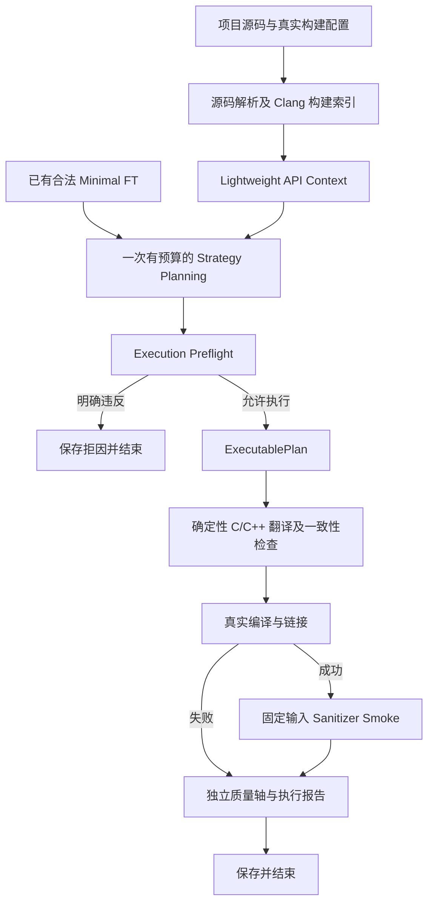

# HG v0.5 生成优先设计

更新日期：2026-10-12。本文描述清理后保留的 generate 链。原始重构要求保存在 [fix2_plan.md](fix2_plan.md)；其中保留旧独立认证流程的要求已被本次“仅保留 v0.5 链”的清理要求取代。2026-10-11 的结果见 [历史验收摘要](V05_GENERATION_FIRST_ACCEPTANCE_20261011.md)，不能用来认证当前清理版。

## 1. 运行链



公开命令只有 `parse` 和 `harness-run`；后者仅支持 generate，默认自动 build/runtime。已有 FT 是兼容输入，当前仓库不再提供 Candidate→Slice→FT 的旧生产流水线。verify、recover、DSH、SVF 及历史评测入口已退役。

一次 planning 是一个有预算的调查阶段，可能包含多个源码工具和模型请求。一次执行包含目标对象、harness、driver 和链接命令以及固定输入进程。编译、sanitizer 和质量结果不反馈到第二次规划；`feedback_iteration=0`。

## 2. 责任与授权

| 部分 | 保留职责 |
| --- | --- |
| Parser / Source Analysis | 当前源码身份、函数索引、Clang canonical 类型、ABI 和构建身份 |
| Lightweight Context | 对精确目标及有界相关 API 签发当前进程内的调用范围 |
| Strategy Planner | LLM 调查并提交调用、参数绑定、capture、guard 和 cleanup |
| API Contracts / Execution Preflight | 检查 ABI、范围、当前证据及可信的已知调用错误 |
| ExecutablePlan | 固定 Strategy、范围、证据、源码/构建、headers 和输入上限 |
| Translator / Validator | 按同一个 typed plan 确定性生成 C/C++，独立检查一致性 |
| Build / Runtime | 编译链接并保存固定输入 sanitizer 运行观察 |
| Single Controller / Checkpoint | 单次动作账本、结果保存及完成结果认证恢复 |
| Quality | 分别投影 Plan、代码、编译、runtime 和有效性 |

模型不能扩大 API scope，也不能签发 contract、ownership 或 proof。读取到 API 文档或提出合法用法，不等于建立已验证的语义契约。未知命题保留来源、适用范围及 unknown 状态。

## 3. Lightweight API Context

`--target` 必须是当前索引中的精确函数 ID。`--support-api` 可重复指定相关 API；框架根据真实 Clang 可调用性、类型关联及有界调查选择范围，不仅凭名称或共享 primitive 指针授权。

默认 `max-context-functions=8`、`max-context-scan=1024`。constructor/cleanup/use 的发现提示帮助分配调查预算，不证明这些函数具有对应效果。范围遗漏实际 helper 时，规划可明确失败，不能伪造新增授权。

保存的 Context 绑定 source/functions fingerprint、Clang 构建身份、源码记录及精确函数集合。JSON receipt 和自声明 hash 本身不能重新签发执行权限；加载或恢复需要从当前输入重新验证。

`--ft` 与 `--target` 互斥。已有 FT 的授权按自身当前身份检查，不把 Lightweight Context 冒充旧 FT 的语义认证。

## 4. Execution Preflight

| 检查 | 行为 |
| --- | --- |
| 函数、参数、ABI、声明类型 | 使用当前 Clang callable 信息；可信不匹配拒绝 |
| API scope 与源码证据 | 越权、伪造或漂移拒绝 |
| 资源声明及绑定 | 未定义、前向引用、错误 capture 和绑定拒绝 |
| 当前源码可确认的入口前提 | 明确已知拒绝的资源状态拒绝 |
| 局部 release | 重复释放、已释放后使用、释放框架借用输入拒绝 |
| 已支持 callback 的 ABI | 当前可确认的不兼容拒绝 |
| 复杂 ownership / cleanup / 循环 / 递归 | unknown，保留执行假设和边界 |

契约状态为 satisfied、violated、unknown。预检允许执行不表示已证明目标库内部的完整内存行为。默认执行不调用完整 Effect Verifier 或 Obligation Graph 决定生成准入。

## 5. ExecutablePlan 与执行

| 字段组 | 内容 |
| --- | --- |
| Plan | schema、`artifact_kind=executable_plan`、policy、ID、digest |
| Strategy | typed steps、strategy ID/digest、source/functions fingerprint |
| 授权 | context/FT identity、精确 authorized IDs、evidence digest |
| Preflight | 当前检查、执行资源及 `unknown_contracts` |
| Build / Translation | build identity、API/type declarations、headers/hash、language、input bound |
| 许可 | `execution_allowed=true`、candidate、immutable、frozen |

为保留结果字段兼容性，`semantic_verified=false`、`generation_allowed=false`、`formal_success_statistics_allowed=false`。这些字段不能由代码生成或一次运行通过提升为 true。

执行前的独立 Verifier 从当前源码、scope、证据和构建配置重建 Plan，再检查 deterministic translator 的代码。自包含 digest 仅能证明内容完整性，不能代替当前执行授权。代码生成不请求代码模型；不支持的翻译保存 `unsupported_translation`，不会退回自由代码生成。

固定 smoke 输入长度为 0、1、1、2、3、256；编译和运行启用 ASan/UBSan 并保存命令、状态、stderr、timeout 及输入。通过结果只适用于实际执行的输入，不等于长期 fuzz 稳定性或有效覆盖。

## 6. 单次动作与恢复

动作顺序为 Strategy Planning→Execution Preflight→Generate/Execute。预检拒绝或准备失败保存原因并结束；目标运行失败也不重新选择 Strategy。

已经完成但尚未汇总的动作，可以在绑定 candidate、evaluation、Plan、代码、recipe、执行观察和成本之后恢复汇总。完成结果的 resume 不重复 provider、编译或目标进程。有 pending 或无法认证的外部动作时保存诊断并停止，不自动重试未知动作。

记录成本时区分规划账本、源码/Clang 调查、编译及 runtime。缺少 usage 不等于 tokens=0；离线 fake/transcript 数据不计真实 provider 消耗。

## 7. 质量与边界

| 质量轴 | 含义 |
| --- | --- |
| L0 Plan | 当前独立输入下 Plan 合法 |
| L1 Code | 已生成且与 Plan 一致 |
| L2 Build | 真实编译链接观察 |
| L3 Runtime | 实际输入的 sanitizer 进程观察 |
| L4 有效性 | 当前可信输入消费或动态有效性观察；没有证据则 unknown |

不能从无崩溃推断输入得到有效处理。sanitizer 栈只能在证据支持的范围内登记可能的目标崩溃；无栈、混合泄漏等情况保留未分类。保存的历史 observer 标签不能重建当前 process-local live receipt。

当前能力仍是有界 ABI、入口及局部契约检查，不包含通用文档/人工契约认证、任意 callback/stream/out 语言扩展、完整 ownership、循环递归证明、coverage 排名或自动 Feedback Controller。

## 8. CLI 与验证登记

安装和示例见 [README](../README.md)。两个公开入口为：

```bash
python -m harness_generation parse \
  --project <project> --output <new-index> \
  --compile-commands <compile_commands.json>

python -m harness_generation harness-run \
  --artifacts <index> --target <exact-function-id> \
  --target-build <target_build.json> --headers <public_header.h>
```

已有合法输入可用 `--ft <ft-id>` 替换 target，并用 `--strategy-run <run-id>` 指定已保存 Strategy。`--mode generate` 是可显式指定的唯一模式。`--resume-run` 仅处理这个 generate 链的认证恢复。

清理版需要以保留的测试代码重新验证；旧 203 文件 fingerprint、142/33/1 测试组合和真实项目结果均属于 2026-10-11 历史版本。历史数据已按请求删除，当前验证由清理报告另行登记。
